# Prague Parking V2 – Klassdiagram och projektöversikt

**Uppdaterad:** 2026-10-22  
**Utvecklingsperiod:** 5–22 oktober 2026 (18 kalenderdagar)  
**Omfattning:** Hela lösningens projektstruktur, domänmodell, OOP-kontrakt, applikationsflöden, UI, konfiguration och JSON-persistens.  
**Projektstatus:** Prague Parking 2.0 (G) och 2.1 (VG) är färdigutvecklade, manuellt testade och genomgångna mot kravspecifikationen inför inlämning.

Det här dokumentet är **en samlad arkitekturöversikt över hela projektet**, inte enbart ett klassdiagram över fordonen. Diagrammen visar de viktiga klasserna, deras ansvar och relationerna mellan lagren. G och VG presenteras separat eftersom de använder olika kapacitetsmodeller och kan köras oberoende av varandra. Den färdiga G-koden har bevarats oförändrad.

> **Omfattning och precision:** Klassdiagrammen visar de centrala klasser och operationer som framgår av projektets dokumenterade implementation. För att diagrammen ska vara läsbara utelämnas en del hjälpmetoder, privata fält, parameterlistor och konstruktorsignaturer. Detta är en **manuellt framtagen arkitekturöversikt**, inte automatiskt genererad UML eller en oberoende, fullständig granskning av samtliga källfiler. Testpåståenden avser redovisade manuella kontroller.

## 1. Så läser jag diagrammen

| Symbol | Betydelse |
|---|---|
| `<|--` | **Arv:** exempelvis `Vehicle` till `Car`. |
| `<|..` | **Implementerar interface:** en klass uppfyller ett kontrakt. |
| `*--` | **Komposition:** en ägare innehåller och hanterar en samling delar. |
| `o--` | **Aggregation:** en klass håller referenser till objekt. |
| `..>` | **Beroende/anrop:** en klass använder en annan. |
| `-->` | **Association/referens:** ett objekt känner till ett annat. |
| `+`, `-`, `#` | Publik, privat respektive skyddad medlem i UML. |
| `?` | I de typade G-signaturerna: värdet kan vara `null` (nullable). |

**Skillnaden mellan begreppen:** En *klass* kan innehålla data och implementation. Ett *interface* definierar vilka medlemmar en klass måste tillhandahålla, men behöver inte bestämma hur de fungerar. En *abstrakt basklass* kan dela kod och tillstånd mellan konkreta klasser. En *delegat* som `Func<IVehicle, int>` är ett sätt att skicka en funktion som parameter; det är inte ett interface eller ett arv.

## 2. Övergripande projektstruktur

Samma Visual Studio-solution innehåller två kompletta program, vart och ett med ett eget klassbibliotek för datahantering:

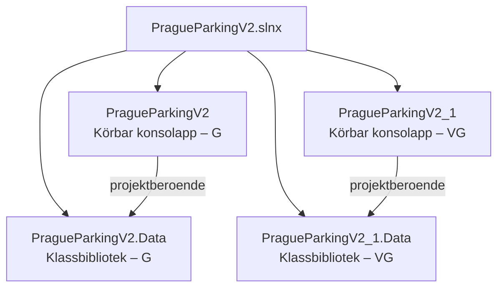

| Lager/ansvar | V2.0 (G) | V2.1 (VG) |
|---|---|---|
| Konsolprogram | `PragueParkingV2` | `PragueParkingV2_1` |
| Dataåtkomst | `PragueParkingV2.Data` | `PragueParkingV2_1.Data` |
| Domain | `Vehicle`, `Car`, `MC`, `ParkingSpot`, `ParkingGarage` m.fl. | Samma grundansvar, dessutom `Bicycle`, `Bus`, `IVehicle`, `IParkingSpot` och bussreservationer |
| Application | `ParkingDataMapper` | `ParkingDataMapper`, `TestDataSeeder`, `DemoScenario` m.fl. |
| UI | Menyer, vyer, `AppTheme`, `MessageService`, `GarageOverView` | Motsvarande vyer, Sunset-tema och Live Demonstration |
| Kapacitetsregler | `VehiclesPerSpot`: en Car eller två MC per plats | `SpotCapacity` och `VehicleTypes.Size`; blandade storlekar, buss över fyra platser |
| Konfigurationsfil och kördata | Egna runtime-filer | Egna runtime-filer och versionshanterad `config.template.json` |

Båda programmen använder **C#/.NET 10**, **Spectre.Console 0.57.2** och **System.Text.Json**. UI arbetar mot domänlogiken; fil- och JSON-hantering ligger i Data-projektet. `ParkingDataMapper` översätter mellan lagrens modeller, så att dataklassbiblioteket inte behöver känna till domänens konkreta fordonsklasser.

## 3. Prague Parking 2.0 (G) – domänmodell

Följande är det **bevarade G-domändiagrammet** från tidigare dokumentation. Metodernas kapacitetsparametrar avser endast G-versionens `VehiclesPerSpot`-modell.

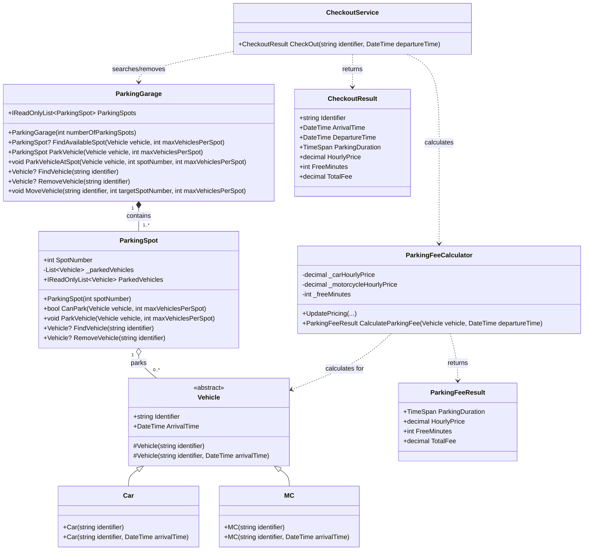

### De viktigaste klassernas ansvar i G

| Klass | Ansvar |
|---|---|
| `Vehicle` | Abstrakt basklass med `Identifier` och `ArrivalTime` i UTC; konstruktorer för nyregistrering och återställning. |
| `Car`, `MC` | Konkreta fordon som ärver basklassens gemensamma egenskaper och validering. |
| `ParkingSpot` | En enskild plats, en intern fordonslista och kontroll av typ/kapacitet. |
| `ParkingGarage` | Samlingen av platser; sökning, dubblettkontroll, parkering, flytt och borttagning. |
| `ParkingFeeCalculator` | Prisregler, gratisperiod och avgiftsberäkning. |
| `ParkingFeeResult` | Strukturerat resultat av prisberäkningen. |
| `CheckoutService` | Samordnar sökning, avgiftsberäkning och borttagning vid utcheckning. |
| `CheckoutResult` | Resultat som kan visas i kvitto och UI; sparas inte i JSON. |

I G hämtas `maxVehiclesPerSpot` från `config.json`: normalt **Car = 1** och **MC = 2**. Olika fordonsklasser delar inte plats i G. `ParkingGarage.MoveVehicle()` flyttar **samma objekt** så att den ursprungliga ankomsttiden bevaras. Vid återställning från JSON används `ParkVehicleAtSpot()` för att återställa det gamla platsnumret, inte den automatiska sökningen efter första lediga platsen.

## 4. Prague Parking 2.1 (VG) – färdig domänmodell

VG-versionen behåller grundprinciperna men använder fyra fordonsklasser, två interfaces, storleksenheter och särskild hantering av bussreservationer. Diagrammet visar **centrala kontraktsmedlemmar och operationer**; de korta metodnamnen är avsiktligt inte fullständiga C#-signaturer.

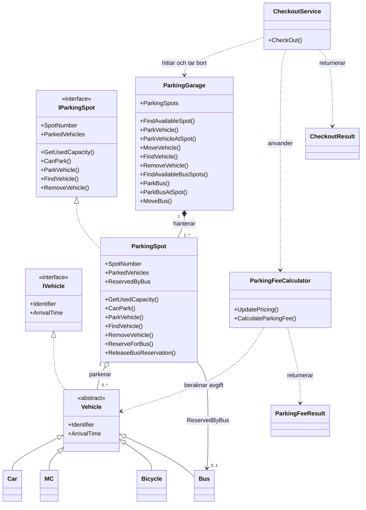

### 4.1 `IVehicle` – fordonskontraktet

`IVehicle` ställer krav på att en implementerande typ tillhandahåller **`Identifier`** och **`ArrivalTime`**. Den abstrakta basklassen `Vehicle` implementerar interfacet; därmed omfattas `Car`, `MC`, `Bicycle` och `Bus` av samma kontrakt genom arv.

**Varför:** Kod som arbetar med fordonens identitet eller ankomsttid ska kunna använda ett gemensamt API utan att först behöva veta om fordonet är en bil, motorcykel, cykel eller buss. `IVehicle` anger *vilka uppgifter som ska finnas*. Basklassen `Vehicle` delar den gemensamma implementationen och valideringen mellan fordonsklasserna.

### 4.2 `IParkingSpot` – parkeringsplatsens kontrakt

`IParkingSpot` anger att parkeringsplatsen ska tillhandahålla `SpotNumber`, `ParkedVehicles` och operationer för **kapacitetsberäkning, kontroll av parkering, parkering, sökning och borttagning** (`GetUsedCapacity`, `CanPark`, `ParkVehicle`, `FindVehicle`, `RemoveVehicle`). Den konkreta klassen `ParkingSpot` implementerar dessa operationer.

**Varför:** Anropskod kan förhålla sig till ett väldefinierat parkeringsplatskontrakt. Interfacet bestämmer vilka funktioner som är tillgängliga; `ParkingSpot` avgör genom sin kod **hur** fordonslistan, tillåten beläggning och kapacitetskontrollen hanteras.

Bussreservationernas specialfunktioner, exempelvis `ReserveForBus`, ligger i den konkreta parkeringslogiken och samordnas av `ParkingGarage`. De anges därför inte som del av det allmänna `IParkingSpot`-kontraktet. Att en klass **implementerar** ett interface betyder inte att varje intern anropsväg måste använda just interface-typen.

### 4.3 Storleksbaserad kapacitet och delegater

VG använder den konfigurerbara platskapaciteten `Garage.SpotCapacity = 4` och följande standardstorlekar:

| Fordon | `VehicleTypes.Size` | Beläggning |
|---|---:|---|
| `Bicycle` | 1 | Fyra cyklar kan fylla en normal plats. |
| `MC` | 2 | Två MC kan fylla en normal plats. |
| `Car` | 4 | En bil fyller en normal plats. |
| `Bus` | 16 | En buss reserverar fyra sammanhängande platser. |

En **MC + Bicycle** ger **2 + 1 = 3 av 4 enheter**. Blandning är möjlig i VG när reglerna och den sammanlagda storleken tillåter det. G tillämpar fortfarande `VehiclesPerSpot` och ändras inte.

De storleksbaserade metoderna får en **`Func<IVehicle, int>`** som returnerar ett fordons storlek. `ParkingSpot` kan då summera beläggningen utan att läsa `config.json` eller känna till konfigurationsfilens format. Det är ett konkret exempel på att skicka **beteende som parameter** med en delegat. De äldre `maxVehiclesPerSpot`-överlagringarna och konfigurationsegenskapen `VehiclesPerSpot` rensades bort ur V2.1 den **22 oktober**; de finns kvar i G där de behövs.

### 4.4 Buss – ett objekt, fyra sammanhängande platser

En `Bus` är **ett** domänobjekt. Den lagras i `ParkedVehicles` endast på sin **primärplats**, men samma bussinstans refereras av `ReservedByBus` på samtliga fyra platser. En plats som reserverats av en buss kan inte användas av andra fordon.

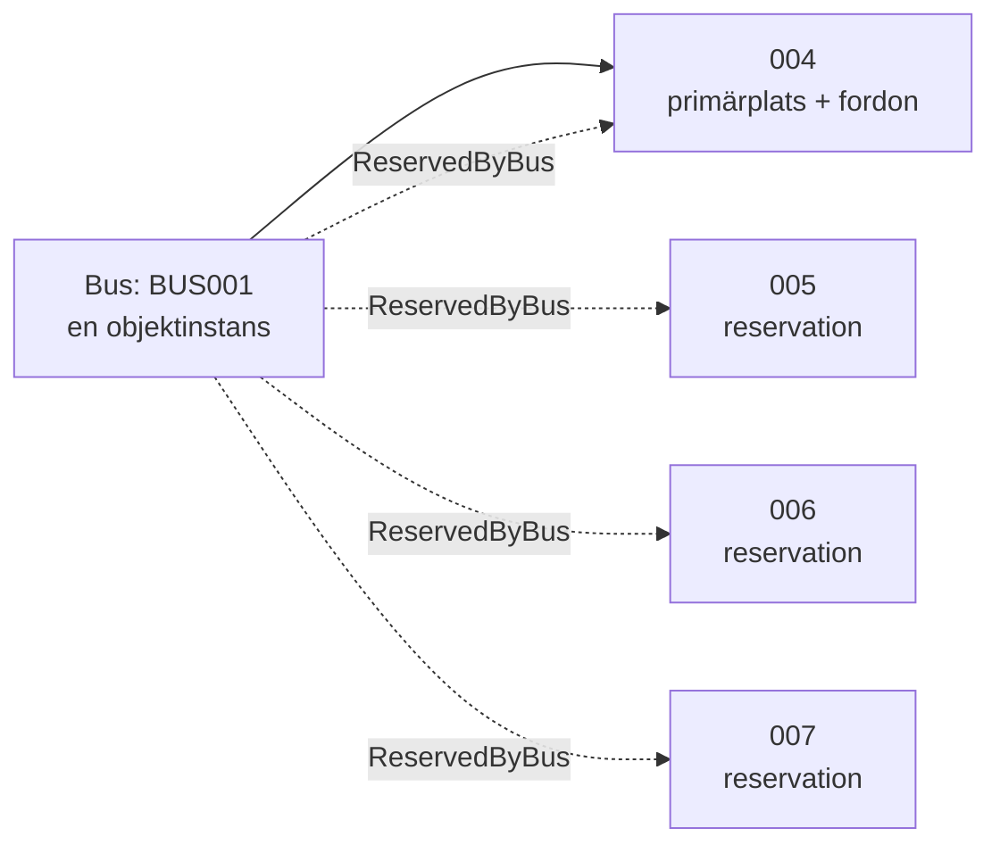

`ParkingGarage` söker fyra **helt lediga, intilliggande** platser och hanterar en buss som en enhet vid sökning, flytt, utcheckning och återställning. Även överlappande flytt stöds: **`BUS001` 004–007 → 006–009** har testats. När bussen checkas ut frigörs hela gruppen; avgiften beräknas för **ett fordon**, inte fyra.

Enligt lärarens förtydligande gäller **001–050 vid både nyparkering och flytt**. `BusMaxParkingSpot = 50` är därför kursversionens standardvärde. Området är inte reserverat enbart för bussar; andra fordon får också använda platserna.

## 5. Application och Data – DTO, mapping och JSON

Den permanenta lagringen har **samma grundstruktur i G och VG**. VG känner även till `Bicycle` och `Bus`. På filnivå sparas endast platser som faktiskt har ett fordonsobjekt; en buss skrivs **en gång på primärplatsen**. Dess övriga tre reservationer återställs av domänlogiken när filen läses in.

### 5.1 Datamodell och Data-projekt

Det ursprungliga diagrammet för DTO:er och filåtkomst är bevarat:

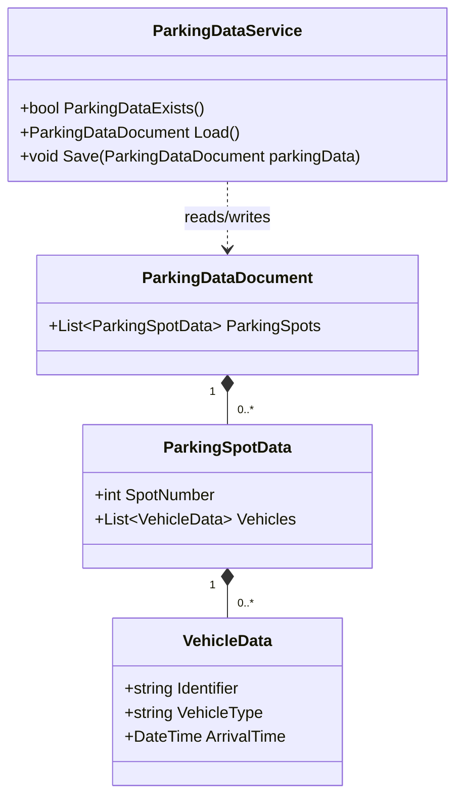

| Komponent | Ansvar |
|---|---|
| `ParkingDataDocument` | Rotobjektet med samlingen `ParkingSpots`. |
| `ParkingSpotData` | Sparat `SpotNumber` och samlingen `Vehicles`. |
| `VehicleData` | `Identifier`, `VehicleType` och `ArrivalTime` (UTC). |
| `ParkingDataService` | Läsa, validera och spara `Data/parking-data.json` med `System.Text.Json`. |
| `ConfigurationService` | Läsa och validera aktiv `Config/config.json`; i VG även skapa den från mall om den saknas. |
| `AppConfiguration` | Värdena för priser, garage, tidszon och fordonstyper. |

`ParkingDataService` använder körkatalogen via `AppContext.BaseDirectory`; den ska inte vara knuten till en viss utvecklingsdators sökväg. Vid sparning används en tillfällig `.tmp`-fil och sedan filflytt/-ersättning. Felaktig befintlig JSON avvisas i de dokumenterade uppstartstesterna i stället för att tyst ersättas.

### 5.2 Applikationslagrets mapper

Det ursprungliga G-diagrammet för mappern är bevarat. I VG används motsvarande ansvar med utökat stöd för nya fordonsklasser och bussreservationer:

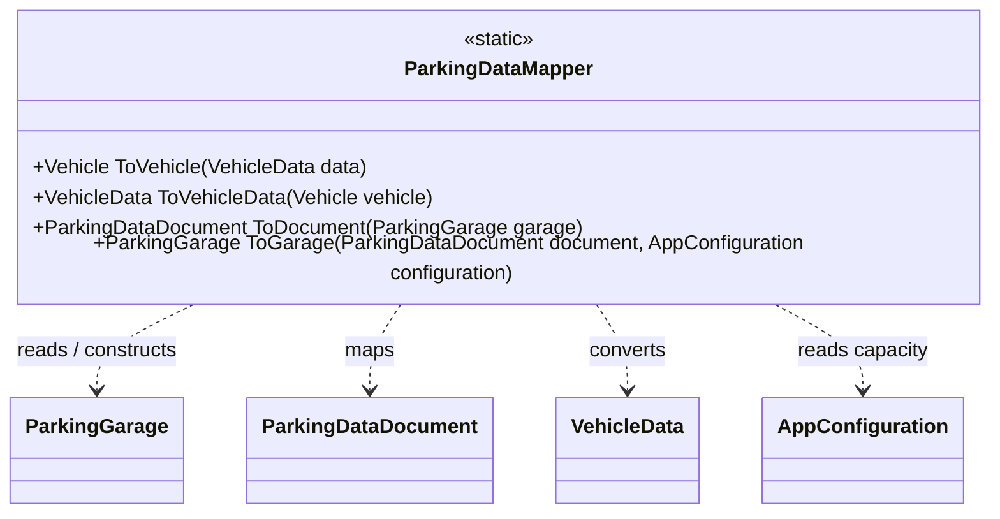

`ParkingDataMapper.ToDocument()` omvandlar `ParkingGarage` till DTO-objekt för sparning. `ToGarage()` bygger åter upp parkeringsplatser och fordon med samma `Identifier`, `VehicleType`, platsnummer och UTC-ankomsttid. För Bus återskapar V2.1:s mapper reservationerna med `ParkingGarage.ParkBusAtSpot()`.

**Arkitekturgränsen:** DTO:erna beskriver filformatet. Domänklasserna beslutar om parkering är tillåten. Mappern länkar samman dessa utan att lägga domänklasserna i `.Data`-projektet.

### 5.3 V2.1 – applikationsklasser och konfigurationsberoenden

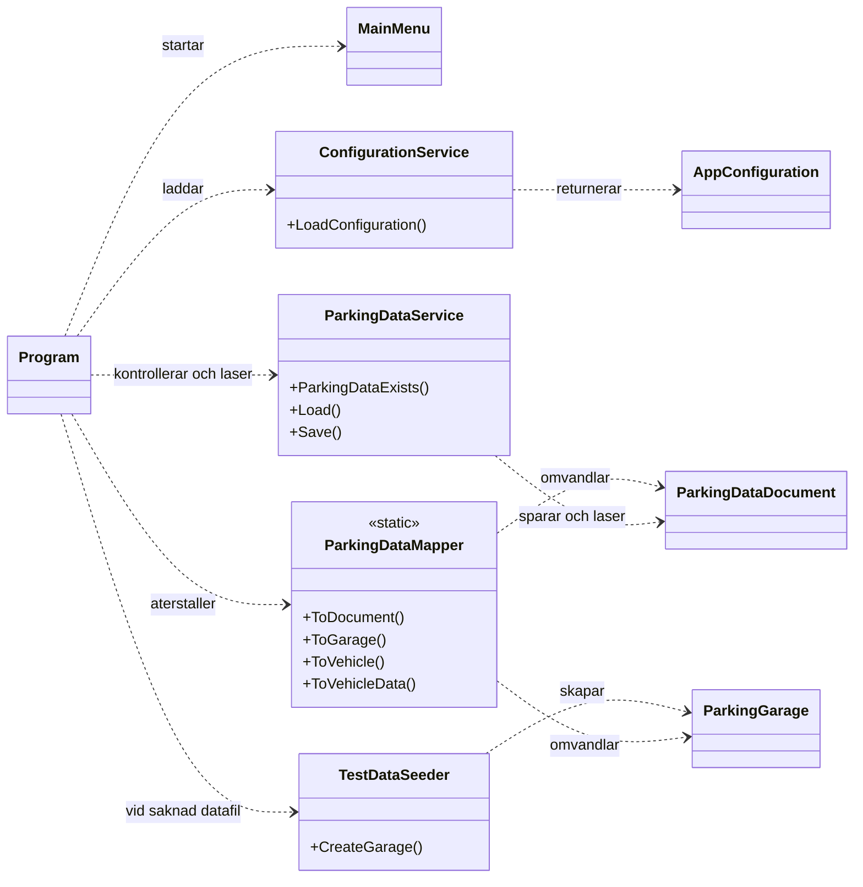

`Program.cs` visas som **Program** för översiktens skull; det innebär inte att projektet måste innehålla en särskild deklarerad `Program`-klass. Diagrammet visar viktiga beroenden och inte en exakt lista över metodanrop.

## 6. UI – meny, vyer och presentation

Alla användarflöden ligger i konsolprojektets UI-lager. Affärsreglerna ligger fortfarande i `ParkingGarage`, `ParkingSpot`, `ParkingFeeCalculator` och `CheckoutService`; vyerna hanterar användarinteraktion, återkoppling och anrop till applikations-/datalagren.

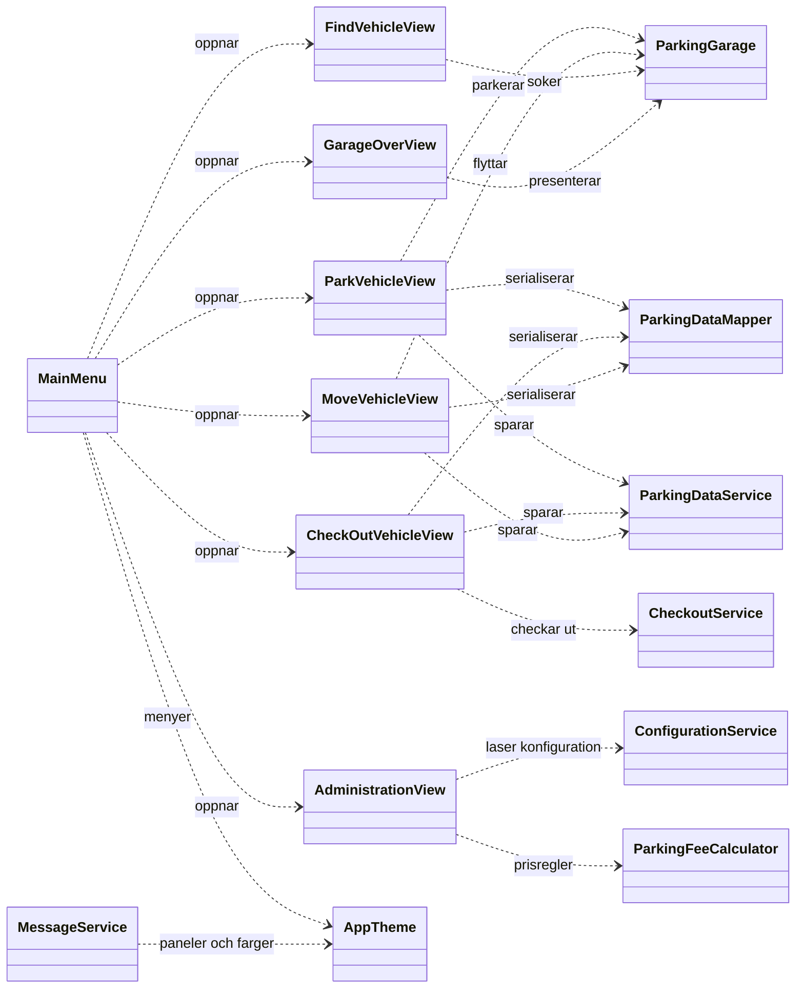

*Anmärkning:* Relationerna visar **ansvars- och anropssamband**, inte nödvändigtvis direkta objektfält eller exakta anropsriktningar för varje hjälpfunktion. `AppTheme` och `MessageService` samverkar i presentationen; `MessageService` använder temats panelhjälpmetoder. `AdministrationView` använder prisomläsning i G och både pris-/helkonfigurationsomläsning i VG.

- **`MainMenu`:** Navet för användarens menyval.
- **`ParkVehicleView`:** Incheckning, platsval och sparning.
- **`CheckOutVehicleView`:** Bekräftelse, avgift/kvitto och sparad borttagning.
- **`MoveVehicleView`:** Kontroll av målplats, flytt och sparning.
- **`FindVehicleView`:** Sökning utan att ändra garagets tillstånd.
- **`GarageOverView`:** Interaktiv `Grid`-karta med navigering, `SPOT DETAILS` och `GARAGE STATUS`.
- **`AdministrationView`:** `Reload Pricing` (G/VG) och `Reload Configuration` (VG).
- **`AppTheme` / `MessageService`:** Gemensamt färgtema, menyer och statuspaneler.

G-versionen har ett **blågult** tema. VG-versionen använder ett separat **Sunset-tema**. Kartans bakgrundsfärger visar **grönt** för ledig plats, **orange** för delvis belagd och **rött** för full eller bussreserverad plats. Den dynamiska garageöversikten har manuellt kontrollerats i G med 100, 200 och 1 000 platser och i VG bland annat med 500 platser.

## 7. Uppstart och omläsning av konfiguration

### 7.1 V2.1 – uppstart med befintlig eller saknad parkeringsfil

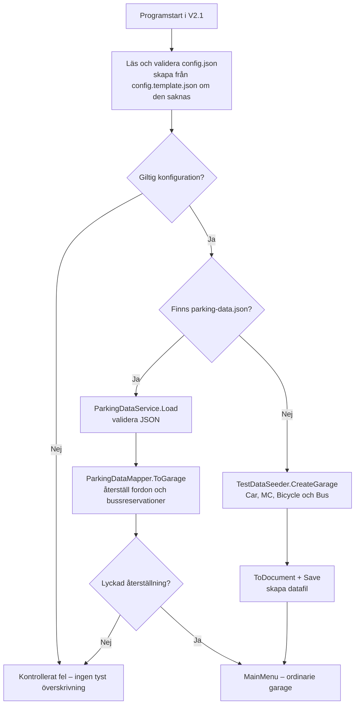

I **G** kan ett nytt, saknat `parking-data.json` innebära ett tomt garage. I **VG** skapar `TestDataSeeder` giltiga testfordon **endast om filen saknas**. En redan befintlig tom eller felaktig fil ersätts inte av ny testdata. Programmet använder separata runtime-mappar för G och VG.

### 7.2 V2.1 – `Reload Configuration` utan att förlora aktiva fordon

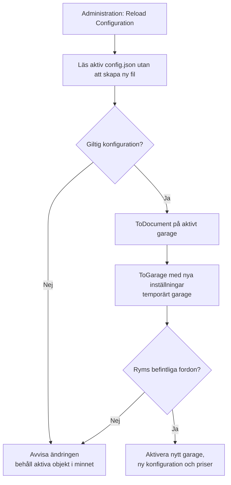

Detta kallas här en **validera-före-aktivering-princip**. Testerna visar bland annat att 100 → 200 och 500 platser kunde läsas om utan omstart, medan `SpotCapacity` **4 → 2** avvisades när en Car annars inte skulle få plats. Den gamla aktiva konfigurationen och garaget behölls i minnet vid avvisning. **Den ändrade filen på disken återställs inte automatiskt**; administratören behöver själv korrigera den innan en ny inläsning eller uppstart.

## 8. Live Demonstration – isolerad demonstrationsarkitektur (VG)

Live Demonstration färdigställdes och testades den **22 oktober 2026**. Den visar samma domänregler och UI-komponenter som det vanliga programmet, men i en **separat `ParkingGarage`-instans i minnet** med 100 platser.

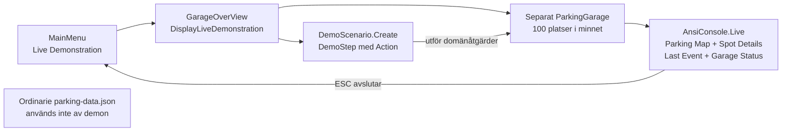

**`DemoScenario`** skapar en sekvens av **`DemoStep`**, där varje steg har en beskrivning, fokusplats, en `Action` som genomför åtgärden och en väntetid. `GarageOverView.DisplayLiveDemonstration()` kör stegen, renderar parkeringskartan med `AnsiConsole.Live()` och hanterar **ESC** för att avsluta. Scenariot innehåller **Car, MC, Bicycle och Bus**, incheckning, utcheckning och bussflytt med delvis överlappande reserverade platser. Det återställs till ett nytt demonstrationsgarage mellan sekvenserna.

Denna demo är **inte** samma sak som `TestDataSeeder`: seedern skapar ordinarie startdata när VG:s datafil saknas; demon har ingen anledning att ändra den ordinarie datafilen. I den dokumenterade implementationen bygger den på standardproportionerna `SpotCapacity = 4` och storlekarna 4/2/1/16; om konfigurationen inte passar scenariot visas ett kontrollerat fel i stället för att ändra den ordinarie garagedatan.

## 9. Manuell verifiering och utvecklingshistorik

Tabellen är en sammanfattning av **dokumenterade tester**, inte en lista över alla tänkbara gränsfall eller en automatiserad testsvit.

| Datum | Dokumenterad kontroll |
|---|---|
| **2026-10-05** | Projektstart. |
| **2026-10-11** | JSON-inläsning, DTO:er och grundläggande validering. |
| **2026-10-13–15** | G-karta, bilparkering, utcheckning och flytt; JSON-sparning och omstart. |
| **2026-10-16** | G:s negativa JSON-tester, två MC på samma plats efter omstart, rollback vid framprovocerade skrivfel, Reload Pricing och garageöversikt upp till 1 000 platser. |
| **2026-10-20** | Två separata VG-projekt etablerades och domänmodellen byggdes ut. |
| **2026-10-21** | VG: interfaces, bussreservationer, överlappande bussflytt, prisberäkning, blandad storlekskapacitet, JSON/omstart, Reload Configuration och TestDataSeeder. |
| **2026-10-22** | Live Demonstration färdigställd, äldre `VehiclesPerSpot`-beroenden rensade i VG, grön byggning och avslutad projektutveckling. |

Arkitekturen och dokumenterade normalflöden har kontrollerats manuellt. Det betyder inte att alla terminalstorlekar, fel i filsystemet eller plötsliga processavbrott har täckts av tester. Sådana tekniska avgränsningar förändrar inte den redovisade slutstatusen: **G och VG är färdigutvecklade och testade enligt den genomförda kursprojektgranskningen.**

## 10. Relaterad dokumentation

| Dokument | Vad jag dokumenterat där |
|---|---|
| [README](../README.md) | Översikt, körinstruktioner och projektstatus. |
| [LOGGBOK](../LOGGBOK.md) | Utvecklingshistorik och manuella tester, dag för dag. |
| [Kravanalys](requirements.md) | G- och VG-krav och uppföljning. |
| [Projektplan](project-plan.md) | Faser, milstolpar och avslut. |
| [Designbeslut](design-decisions.md) | Motiveringarna bakom mina arkitekturval. |
| [Konfiguration](configuration.md) | `config.json`, `config.template.json` och omläsning. |
| [Parkeringsdata](parking-data.md) | JSON-struktur, felhantering och återställning. |

**Inlämning:** Projektet lämnas in när dokumentationsgranskningen är klar. GitHub-repositoryt förblir **privat enligt lärarens individuella undantag**; läraren får åtkomst för bedömning.
