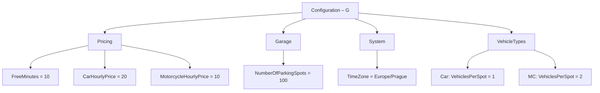
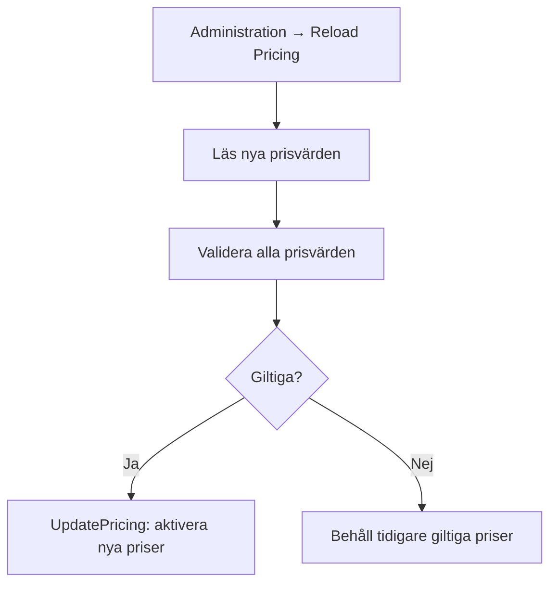
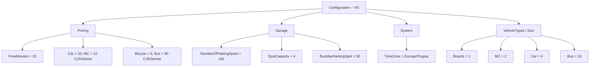
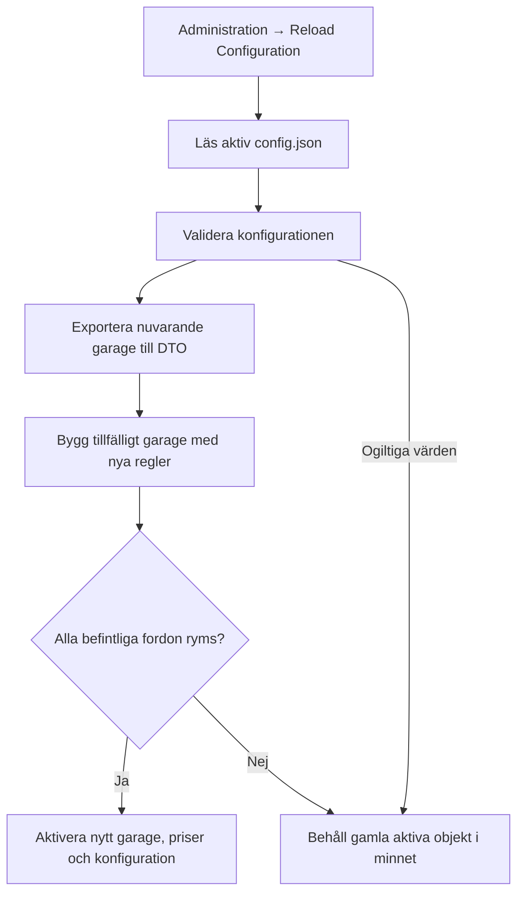

# Prague Parking V2 – Konfiguration

**Uppdaterad:** 2026-10-22  
**Projektperiod:** 2026-10-05–2026-10-22 (18 kalenderdagar inklusive start- och slutdatum)  
**Omfattning:** Konfiguration, validering och omläsning för Prague Parking V2.0 (G) och V2.1 (VG).  
**Projektstatus:** Båda programversionerna är färdigutvecklade och manuellt testade. Kraven har gåtts igenom inför inlämningen. Kodutvecklingen är avslutad; dokumentationen färdigställs före själva inlämningen.

> **Versionsgräns:** V2.0 och V2.1 är separata, körbara projekt i samma Visual Studio-solution. De har skilda Data-projekt, körkataloger och aktiva konfigurationsfiler. **G-versionens `VehiclesPerSpot` har behållits oförändrad.** I V2.1 har modellen ersatts av `SpotCapacity` och `VehicleTypes.Size`; föråldrade VG-referenser till `VehiclesPerSpot` har tagits bort vid slutstädningen den 22 oktober.

---

## 1. Syfte och ansvar

`Config/config.json` innehåller administrerbara regler för parkeringssystemet: priser, gratisminuter, garagekapacitet, tidszon och fordonskapacitet. Inställningarna läses med `ConfigurationService` från respektive versions separata Data-projekt. `System.Text.Json` används för JSON-hanteringen.

Konfigurationen beskriver **hur garaget ska fungera**, medan `Data/parking-data.json` beskriver **vilka fordon som faktiskt är parkerade**. Att dessa filer har olika ansvar gör det möjligt att ändra priser och regler utan att blanda samman dem med parkerade fordons identitet, plats och ankomsttid.

De aktiva inställningarna läses in i programmet. Ändringar i filen under pågående körning får effekt först när relevant omläsningsfunktion används; i G gäller det priser och i VG även hela konfigurationen.

| Område | V2.0 (G) | V2.1 (VG) |
|---|---|---|
| Fordonstyper | `Car`, `MC` | `Car`, `MC`, `Bicycle`, `Bus` |
| Kapacitetsmodell | `VehiclesPerSpot` per fordonstyp | `Garage.SpotCapacity` och `VehicleTypes.*.Size` |
| Standardantal parkeringsplatser | 100 | 100 |
| Kapacitet för en normal plats | En Car **eller** två MC | 4 storleksenheter |
| Omläsning i Administration | `Reload Pricing` | `Reload Pricing` och `Reload Configuration` |
| Standardkonfiguration | G-projektets konfigurationsvärden | Versionshanterad `config.template.json` |
| Saknad aktiv `config.json` | Standardkonfiguration kan skapas i körmiljön | Aktiv fil kopieras från mallen vid programstart |
| Permanenta parkeringsdata | Separat `parking-data.json` | Separat `parking-data.json` |

## 2. Prague Parking V2.0 (G)

### 2.1 Konfigurationsstruktur



Standardinställningen är 100 platser, men antalet är **konfigurerbart**. Varken parkeringslogiken eller garageöversiktens kolumnberäkning förutsätter att garaget alltid har just 100 platser.

### 2.2 Exempel på `config.json` för G

```json
{
  "Pricing": {
    "FreeMinutes": 10,
    "CarHourlyPrice": 20,
    "MotorcycleHourlyPrice": 10
  },
  "Garage": {
    "NumberOfParkingSpots": 100
  },
  "System": {
    "TimeZone": "Europe/Prague"
  },
  "VehicleTypes": {
    "Car": {
      "VehiclesPerSpot": 1
    },
    "MC": {
      "VehiclesPerSpot": 2
    }
  }
}
```

Detta är standardvärden, inte en ögonblicksbild av ett visst manuellt test.

### 2.3 `VehiclesPerSpot` och parkeringsregler

`VehicleTypes.Car.VehiclesPerSpot = 1` betyder att en parkeringsplats rymmer en bil. `VehicleTypes.MC.VehiclesPerSpot = 2` betyder att två motorcyklar kan dela en plats. I G får `Car` och `MC` **inte blandas** på samma parkeringsplats.

`ParkingSpot` kontrollerar placeringen genom domänreglerna, exempelvis `CanPark()`. Kapacitetsvärdet kommer från konfigurationen och skickas till parkeringslogiken; det är inte en fast verksamhetsregel i `ParkingSpot`.

**Manuellt verifierat 14–16 oktober:** Två MC fick dela plats 003 och återställdes efter omstart med samma identifierare och ursprungliga UTC-ankomsttider. Försök att blanda Car/MC och att läsa in tre MC på samma två-MC-plats avvisades. Flytt till en olämplig plats nekades.

### 2.4 Inläsning vid start och ändring av antal platser

G-versionens konfigurationsfil finns i projektets `PragueParkingV2/Config/config.json`; under körning används en aktiv kopia i `Config/config.json` **relativt `AppContext.BaseDirectory`**. Under en vanlig Debug-körning kan den exempelvis ligga under `bin/Debug/net10.0/Config/`.

En ändring i projektfilen påverkar därför inte nödvändigtvis en **redan befintlig runtime-fil**. Vid test ändras den fil som körningen faktiskt läser. Ändrat antal parkeringsplatser i G börjar användas vid **nästa programstart**, inte genom `Reload Pricing`.

`ConfigurationService` läser och validerar bland annat garageantal, priser, gratisminuter, tidszon och `VehiclesPerSpot`. Saknad runtime-konfiguration kan återskapas med standardvärden. En **befintlig, felaktig** konfigurationsfil skrivs däremot inte tyst över; programmet stoppar uppstarten kontrollerat och visar ett felmeddelande.

**Manuellt verifierat 13–16 oktober:** Garageöversikten har provats med 100, 200 och 1 000 konfigurerade platser. Vid 1 000 platser fungerade intern viewport, navigering till plats 1000 och tillbaka. Efter återställning till 100 platser fanns de tidigare parkerade fordonen på platserna 003 och 051 kvar efter omstart. Dessa tester avser konfigurerat platsantal och översikt, inte 1 000 samtidiga parkerade fordon.

### 2.5 `Reload Pricing` i Administration

I G laddar `AdministrationView` om **endast prisuppgifterna** från den aktiva runtime-`config.json` genom `ConfigurationService.LoadPricing()`. Efter validering uppdateras den befintliga, gemensamma `ParkingFeeCalculator` med `UpdatePricing()`. Ett giltigt prisbyte får därmed effekt vid efterföljande utcheckning **utan programomstart**.



**Verifierat 16 oktober:** Bilpriset ändrades från **20 till 30 CZK per påbörjad timme**. En parkering på 20 timmar och 20 minuter beräknades då som 21 påbörjade timmar × 30 CZK = **630 CZK** utan omstart. Ett efterföljande prisvärde på **−10 CZK** avvisades; det tidigare giltiga priset 30 CZK fortsatte användas. Slutligen återställdes bilpriset till 20 CZK.

**Avgränsning:** `Reload Pricing` i G laddar inte om antalet parkeringsplatser, tidszon eller fordonskapacitet. Detta är ett medvetet versionsskilt beteende, inte en ofärdig G-funktion.

---

## 3. Prague Parking V2.1 (VG)

### 3.1 Storleksbaserad konfigurationsmodell

I VG ersätts G-versionens antal fordon per plats med en **storleksbaserad kapacitetsmodell**. En vanlig plats rymmer som standard fyra enheter. Kapacitet och storlek hämtas från den aktiva konfigurationen.



| Fordon | `Size` | Hur kapaciteten används |
|---|---:|---|
| Bicycle | 1 | Upp till fyra cyklar på en normal plats, om inga andra fordon tar utrymme |
| MC | 2 | Upp till två MC på en normal plats |
| Car | 4 | En bil fyller en normal plats |
| Bus | 16 | Fyra sammanhängande, helt lediga platser reserveras |

Exempelvis kan **en MC och två Bicycle** dela en normal plats: `2 + 1 + 1 = 4`. Kombinationen **en MC och en Bicycle** upptar tre av fyra enheter och har testats i V2.1.

En `Func<IVehicle, int>` kan användas för att slå upp storleken hos ett fordon i konfigurationen. Därmed behöver `ParkingSpot` inte själv läsa JSON för att kontrollera kapacitet. De gamla VG-anropen med `maxVehiclesPerSpot` och den äldre egenskapen `VehiclesPerSpot` togs bort vid kodstädningen den 22 oktober. **V2.0:s motsvarande kod ändrades inte.**

### 3.2 Standardvärden i `config.template.json`

```json
{
  "Pricing": {
    "FreeMinutes": 10,
    "CarHourlyPrice": 20,
    "MotorcycleHourlyPrice": 10,
    "BicycleHourlyPrice": 5,
    "BusHourlyPrice": 80
  },
  "Garage": {
    "NumberOfParkingSpots": 100,
    "SpotCapacity": 4,
    "BusMaxParkingSpot": 50
  },
  "System": {
    "TimeZone": "Europe/Prague"
  },
  "VehicleTypes": {
    "Car": { "Size": 4 },
    "MC": { "Size": 2 },
    "Bicycle": { "Size": 1 },
    "Bus": { "Size": 16 }
  }
}
```

Mallen är **versionshanterad**, medan den aktiva `config.json` är den fil som administratören ändrar under körning. De båda filerna har samma konfigurationsstruktur, men olika roller.

### 3.3 `config.template.json` och aktiv runtime-konfiguration

| Fil | Ansvar |
|---|---|
| `PragueParkingV2_1/Config/config.template.json` | Projektets standardmall, kopieras till utmatningskatalogen vid byggning med `PreserveNewest` |
| `Config/config.template.json` under V2.1:s körkatalog | Tillgänglig mall när programmet startar |
| `Config/config.json` under V2.1:s körkatalog | **Aktiv konfiguration** som laddas, valideras och kan redigeras |
| `Data/parking-data.json` under V2.1:s körkatalog | Separata parkeringsdata; innehåller inte priser och garageinställningar |

`ConfigurationService.GetConfigurationPath()` och `GetTemplatePath()` bygger sökvägar från `AppContext.BaseDirectory` och `Path.Combine()`, inte från en hårdkodad sökväg på utvecklingsdatorn.

Vid normal start anropas `LoadConfiguration(createIfMissing: true)`. Om den aktiva konfigurationen saknas kopieras `config.template.json` till `config.json` med `File.Copy()` **utan att skriva över en befintlig fil**. En redan befintlig fil läses och valideras. Är den ogiltig visas fel; den ersätts inte med standardvärden.

**Historik 21 oktober:** En äldre G-liknande runtime-konfiguration saknade den nya storleksmodellen och gav felmeddelandet `Vehicle type 'Car' must have a size greater than zero`. Den gamla filen säkerhetskopierades som `config.backup-before-v2.1.json` innan den nya mallen användes. Detta var ett utvecklings- och migreringstest, inte ett fel i den färdiga standardmallen.

### 3.4 Bussens område och fyra platsreservationer

En `Bus` har standardstorleken 16 och behöver **fyra sammanhängande parkeringsplatser** med kapaciteten fyra enheter per plats. Samma buss behandlas som **ett fordon** vid sökning, avgift och JSON-lagring, även om fyra platser markeras som reserverade. Den detaljerade reservationsmodellen beskrivs i [`design-decisions.md`](design-decisions.md) och [`parking-data.md`](parking-data.md).

Enligt lärarens förtydligande får bussar använda **endast platserna 001–050**, både vid incheckning och flytt. Området är inte reserverat enbart för bussar: även andra fordon får parkera där. Standardvärdet `BusMaxParkingSpot = 50` följer denna regel.

`BusMaxParkingSpot` är en tekniskt konfigurerbar inställning, men möjligheten att ange ett annat värde innebär **inte** att en större busszon uppfyller kursens krav. V2.1:s standard- och inlämningskonfiguration använder gränsen 50.

### 3.5 `Reload Configuration` i Administration

V2.1 har en färdig funktion för omläsning av **hela** konfigurationen utan omstart. Utöver prisvärden omfattar den bland annat platsantal, kapacitet, fordonsstorlekar och tidszon. `AdministrationView` anropar en `Action` från `MainMenu` för att samordna omläsningen och bytet av aktivt garage.



Flödet bygger på följande principer:

1. `LoadConfiguration(createIfMissing: false)` läser runtime-filen. Vid **manuell** omläsning skapas ingen ny fil om `config.json` saknas.
2. Nya värden valideras utan att den redan aktiva garagemodellen byts ut.
3. Befintliga parkeringsdata översätts via `ParkingDataMapper.ToDocument()` och återställs i ett **tillfälligt garage** med `ToGarage()` enligt den nya konfigurationen.
4. Om samtliga fordon och eventuella bussreservationer går att återställa, aktiveras den nya konfigurationen, det nya garaget och prisuppgifterna tillsammans.
5. Om någon kontroll misslyckas fortsätter programmet använda **tidigare giltigt garage och tidigare aktiva inställningar i minnet**. Ett begripligt felmeddelande visas.

**Viktig begränsning:** Vid misslyckad omläsning återställer programmet **inte** automatiskt innehållet i den redigerade `config.json` på disken. Administratören måste rätta filen innan nästa omläsning eller programstart. Det är skillnad mellan att bevara säkert **aktivt minnestillstånd** och att återställa en användarredigerad fil.

**Verifierat 21 oktober:** Ändring från 100 till 200 och därefter test av 500 parkeringsplatser genomfördes utan omstart, med fungerande garageöversikt och bevarade fordon. Ett försök att ändra `SpotCapacity` från **4 till 2**, medan bilen `OEJ989` var parkerad på plats 002, avvisades. Det gamla aktiva garaget behölls.

### 3.6 Validering före aktivering

`ConfigurationService` validerar konfigurationens struktur och värden innan de används. Dokumenterade kontroller i V2.1 omfattar:

- Obligatoriska konfigurationsavsnitt för priser, garage, system och fordonstyper.
- `NumberOfParkingSpots` inom intervallet **1–1 000**.
- Positiv `SpotCapacity`.
- `BusMaxParkingSpot` minst **4** och högst `NumberOfParkingSpots`.
- Icke-negativa priser och tillåtet värde för gratisminuter.
- Angiven, giltig tidszon.
- De fyra nödvändiga fordonstyperna `Car`, `MC`, `Bicycle` och `Bus`.
- Positiv `Size` för varje nödvändig fordonstyp.
- Domänkontroll av att befintliga fordon, kapaciteter och bussreservationer kan återskapas under de nya reglerna.

En giltig JSON-struktur garanterar alltså inte att en **redan belagd** garagekonfiguration går att använda. Därför ingår även återställning av befintlig beläggning i kontrollen före aktivering.

En extra nyckel under `VehicleTypes` skapar inte automatiskt en ny C#-klass. Stöd för en femte fordonstyp skulle också kräva tillämplig fordonsklass, prissättning, UI och persistenshantering. Detta är en avgränsning för den färdiga lösningen, inte ett planerat kursmoment.

---

## 4. Prisregler och tidszon

### 4.1 Timpriser och gratisgräns

| Fordon | Standardpris per påbörjad timme |
|---|---:|
| Car | 20 CZK |
| MC | 10 CZK |
| Bicycle *(endast VG)* | 5 CZK |
| Bus *(endast VG)* | 80 CZK |

`ParkingFeeCalculator` beräknar avgifter utifrån **aktiva konfigurationsvärden**, inte utifrån en egen hårdkodad prislista. En buss debiteras som **ett** fordon, trots att den reserverar fyra parkeringsplatser. Vid ett dokumenterat VG-test kostade 1 timme och 38 minuters bussparkering **160 CZK** (två påbörjade timmar × 80 CZK).

Den färdiga och testade gratisregeln är **parkering kortare än 10 minuter är gratis** (`duration.TotalMinutes < FreeMinutes`). Vid **exakt 10 minuter** debiteras därför påbörjad timme. Att uppgiftstexten innehåller olika formuleringar (*högst tio minuter* respektive *mindre än tio minuter*) är dokumenterat i [`requirements.md`](requirements.md); detta avsnitt redovisar programmets faktiska, testade beteende.

### 4.2 UTC och `Europe/Prague`

`System.TimeZone` anger tidszonen vid **presentation** i exempelvis Garage Overview och Spot Details. Standardvärdet är `Europe/Prague`.

Fordons `ArrivalTime` registreras och sparas i **UTC**. Prisberäkningen utgår från UTC-ankomst och UTC-avgång för att undvika att sommar-/vintertidsomställningar förändrar parkeringslängden. Vid visning konverteras tidpunkten till konfigurerad tidszon. En omladdad tidszon påverkar därmed visningen, inte den ursprungliga UTC-tid som lagrats för fordonet.

---

## 5. Konfiguration jämfört med parkeringsdata

```text
Config/config.json
    ├── Pricing: priser och gratisminuter
    ├── Garage: antal platser och kapacitet
    ├── System: tidszon
    └── VehicleTypes: fordonsregler

Data/parking-data.json
    └── ParkingSpots
         └── SpotNumber
              └── Vehicles
                   ├── Identifier
                   ├── VehicleType
                   └── ArrivalTime (UTC)
```

`ParkingDataMapper.ToGarage()` återskapar parkerade fordon med samma identifierare, fordonstyp, plats och ursprungliga ankomsttid. För buss i V2.1 sparas bussobjektet bara vid primärplatsen; de ytterligare tre reservationerna återskapas genom domänreglerna. Ingen prisinformation eller tillfällig kvittoberäkning lagras i `parking-data.json`.

V2.1:s `TestDataSeeder` är en **separat funktion för parkeringsdata**, inte för konfiguration: om `parking-data.json` saknas vid uppstart skapas och sparas ett giltigt testgarage med Car, MC, Bicycle och Bus. Finns datafilen redan, även med tom lista, läggs inga nya testfordon till. Detta ändrar inte V2.0:s beteende.

---

## 6. Genomförda manuella tester och historik

| Datum | Område | Dokumenterat resultat |
|---|---|---|
| **2026-10-13** | G: Garageöversikt | 200 platser kunde visas i ett tillräckligt stort terminalfönster. |
| **2026-10-14–15** | G: Fordon och data | Incheckning, utcheckning och flytt sparades; beläggning verifierades efter omstart. |
| **2026-10-16** | G: Storlek på garage | 100, 200 och 1 000 konfigurerade platser; viewport till plats 1000; bevarade fordon vid återgång till 100. |
| **2026-10-16** | G: `Reload Pricing` | 20 → 30 CZK utan omstart; 630 CZK beräknades för 20 h 20 min; −10 CZK avvisades. |
| **2026-10-16** | G: Felaktiga parkeringsdata | Korrupt JSON, identifierardubbletter, platsnummer utanför garaget samt otillåten beläggning avvisades. Riktade skrivfel med kompensation testades. |
| **2026-10-21** | VG: Konfigurationsmall | Saknad aktiv konfiguration skapades från mallen; befintlig fil bevarades och validerades. |
| **2026-10-21** | VG: `Reload Configuration` | Utökning till 200 respektive 500 platser utan omstart; ändring 4 → 2 i `SpotCapacity` avvisades vid parkerad bil. |
| **2026-10-21** | VG: Fordons- och bussregler | Blandad MC/Bicycle-kapacitet, bussens fyra platser, JSON-återställning och bussavgift dokumenterades i funktionstester. |
| **2026-10-22** | VG: Slutkontroll | Föråldrad `VehiclesPerSpot`-konfiguration och äldre kapacitetsöverlagringar togs bort i V2.1; `config.template.json` och `ConfigurationService` kontrollerades och lösningen byggde utan kompileringsfel. G-versionen lämnades oförändrad. |

**Testernas omfattning:** Uppgifterna ovan avser dokumenterade manuella scenarier och byggresultat, inte en automatiserad testsvit eller uttömmande verifiering av alla möjliga kombinationer av priser, tidszoner, terminaler och filsystemsavbrott. Denna avgränsning förändrar inte slutstatusen: **båda kursversionerna är färdigutvecklade och testade.**

## 7. Relaterad dokumentation

- [`README.md`](../README.md) – projektöversikt och startinstruktioner.
- [`requirements.md`](requirements.md) – spårning och kontroll av G-/VG-krav.
- [`design-decisions.md`](design-decisions.md) – motivering till arkitektur och konfigurationsregler.
- [`parking-data.md`](parking-data.md) – JSON-persistens, validering och bussens återställning.
- [`project-plan.md`](project-plan.md) – milstolpar, genomförande och avslut.
- [`LOGGBOK.md`](../LOGGBOK.md) – daterade utvecklingsanteckningar och manuella tester.
