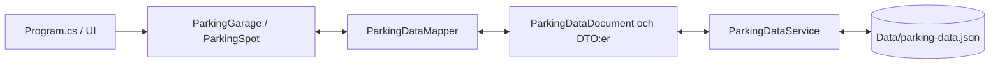
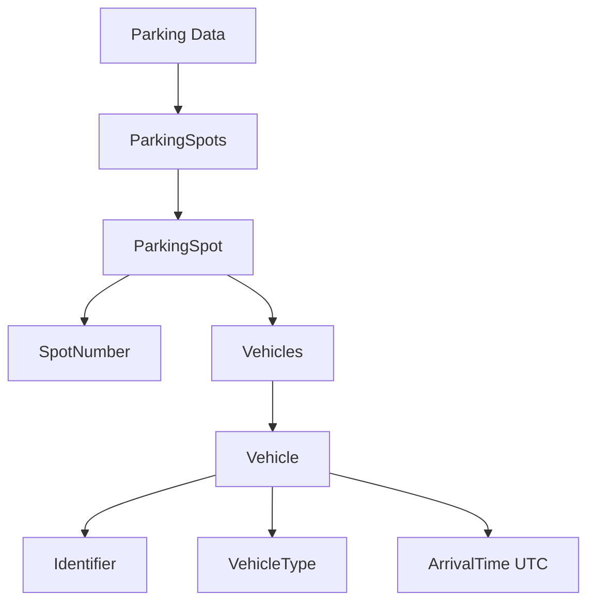

# Parkeringsdata – Prague Parking V2.0 och V2.1

**Senast uppdaterad:** 2026-10-22  
**Projektperiod:** 2026-10-05–2026-10-22 (18 kalenderdagar, inklusive start- och slutdatum)  
**Status:** Prague Parking V2.0 (G) och V2.1 (VG) är färdigutvecklade och testade.  
**Omfattning:** JSON-format, datalagring, återställning, validering, felhantering och dokumenterade tester.

> **Kort sammanfattning:** Båda versionerna sparar parkerade fordon i `Data/parking-data.json` och återställer identifierare, fordonstyp, parkeringsplats och ursprunglig ankomsttid efter omstart. V2.1 utökar modellen med `Bicycle`, `Bus`, storleksbaserad kapacitet, bussreservationer och automatisk testdata när datafilen saknas. De två körbara projekten använder separata körkataloger och därmed normalt separata datafiler.

---

## 1. Syfte och skillnader mellan versionerna

`parking-data.json` lagrar **garagets aktuella beläggning**, inte själva garagekonfigurationen. Antal parkeringsplatser, kapacitet, priser och tidszon anges i `Config/config.json`. I V2.1 skapas en saknad aktiv `config.json` från projektets `config.template.json`.

| Egenskap | Prague Parking V2.0 (G) | Prague Parking V2.1 (VG) |
|---|---|---|
| Fordonstyper | `Car`, `MC` | `Car`, `MC`, `Bicycle`, `Bus` |
| Kapacitetsmodell | `VehiclesPerSpot` per fordonstyp | `SpotCapacity` och `VehicleTypes.*.Size` |
| Normal platskapacitet | En bil eller två MC | Fyra storleksenheter |
| Permanent JSON-lagring | Implementerad och manuellt testad | Implementerad och manuellt testad |
| Lagring vid parkering, utcheckning och flytt | Ja | Ja |
| Återställning av ursprunglig UTC-ankomsttid | Ja | Ja, för samtliga fyra fordonstyper |
| Buss över fyra platser | Ingår inte | Ett bussobjekt på primärplatsen + tre ytterligare reservationer |
| Saknad `parking-data.json` | Tomt garage i minnet; fil skapas vid sparning | Testgarage skapas och sparas med giltiga testfordon |
| Befintlig tom datafil | Tomt garage | Tomt garage; ingen automatisk testdata läggs till |
| Befintlig ogiltig datafil | Avvisas vid normal uppstart | Avvisas vid normal uppstart |

**G-versionen har inte ändrats för att anpassas till VG.** De två versionerna använder samma grundformat för JSON men egna klassbibliotek och parkeringsregler.

## 2. Arkitektur och ansvar

Lagringen är separerad från domänmodellen för att filformat och filåtkomst inte ska styra parkeringsreglerna.

| Komponent | Ansvar |
|---|---|
| `ParkingDataService` | Kontrollerar om datafilen finns, läser och skriver JSON samt utför datavalidering. |
| `ParkingDataDocument` | DTO för hela parkeringsdokumentet. |
| `ParkingSpotData` | DTO för en sparad parkeringsplats och dess fordonslista. |
| `VehicleData` | DTO för identifierare, fordonstyp och UTC-ankomsttid. |
| `ParkingDataMapper` | Översätter mellan DTO:er och verkliga domänobjekt (`ToDocument()`, `ToGarage()`). |
| `ParkingGarage` | Återskapar platser, kontrollerar kapacitet, hanterar parkering/flytt och, i V2.1, bussreservationer. |
| `ParkingSpot` | Representerar en plats och tillämpar regler för fordon och beläggning. |
| `Program.cs` | Läser konfiguration, väljer startflöde och aktiverar garaget först efter lyckad inläsning/återställning. |
| `TestDataSeeder` (V2.1) | Skapar ett testgarage med giltiga fordon **endast när datafilen saknas**. |

**Projektgränser:**

- G: `PragueParkingV2` → `PragueParkingV2.Data`.
- VG: `PragueParkingV2_1` → `PragueParkingV2_1.Data`.
- DTO-klasserna ligger i respektive `.Data`-projekt. `ParkingDataMapper` ligger i huvudprojektets `Application`-lager.



Diagrammet visar ansvarsfördelningen, inte att UI ska hantera JSON eller att varje metod alltid anropas i just den ordningen.

## 3. Filformat och datastruktur

Båda versionerna använder följande grundstruktur:



| JSON-fält | Betydelse |
|---|---|
| `ParkingSpots` | Lista över **sparade, upptagna** parkeringsplatser. |
| `SpotNumber` | Parkeringsplatsens nummer. |
| `Vehicles` | Fordon som hör till den sparade platsen. |
| `Identifier` | Fordonets identifierare, till exempel ett registreringsnummer. |
| `VehicleType` | Text som avgör vilken konkret fordonsklass som ska återskapas. |
| `ArrivalTime` | Ursprunglig ankomsttid i UTC, till exempel `2026-10-05T14:30:00Z`. |

En tom parkeringsplats finns normalt **inte** som ett separat objekt i JSON. Garagets fullständiga uppsättning platser skapas utifrån konfigurationen när programmet startar. `ParkingSpots.Count` är därför inte ett mått på garagets totala kapacitet.

### Exempel från G-versionen

Exemplet visar en bil på plats 17 och två motorcyklar på plats 18:

```json
{
  "ParkingSpots": [
    {
      "SpotNumber": 17,
      "Vehicles": [
        {
          "Identifier": "ABC123",
          "VehicleType": "Car",
          "ArrivalTime": "2026-10-05T14:30:00Z"
        }
      ]
    },
    {
      "SpotNumber": 18,
      "Vehicles": [
        {
          "Identifier": "MC123",
          "VehicleType": "MC",
          "ArrivalTime": "2026-10-05T14:35:00Z"
        },
        {
          "Identifier": "MC456",
          "VehicleType": "MC",
          "ArrivalTime": "2026-10-05T14:42:00Z"
        }
      ]
    }
  ]
}
```

Ett tomt parkeringshus kan representeras av `{"ParkingSpots": []}`. I V2.1 leder **en befintlig** sådan fil inte till automatisk testdatagenerering.

## 4. Fordonstyper och ankomsttid

Vid inläsning används `VehicleType` för att välja klass:

| Sparat `VehicleType` | Återskapad klass | Version |
|---|---|---|
| `Car` | `Car` | G och VG |
| `MC` | `MC` | G och VG |
| `Bicycle` | `Bicycle` | VG |
| `Bus` | `Bus` | VG |

`VehicleType` är ett fält i **datalagringsmodellen**. Domänmodellen använder konkreta C#-klasser i stället för att behöva lagra fordonstypen som en separat strängegenskap i `Vehicle`.

`ArrivalTime` sparas i UTC. Vid visning konverteras tiden till konfigurerad tidszon, normalt `Europe/Prague`. Parkeringstiden beräknas utifrån den ursprungliga ankomsttiden: en omstart eller flytt får **inte** ersätta den med `DateTime.UtcNow`.

`Car` och `MC` har återställningskonstruktorer i G; `Bicycle` och `Bus` har motsvarande stöd i V2.1. I det dokumenterade omstartstestet den **16 oktober** återställdes `DEF123` och `EDF123` på plats **003**, med sina tidigare ankomsttider (tidigare visade lokalt som 15:50 respektive 16:11 den 15 oktober). Den **21 oktober** återställdes alla fyra VG-typerna från den testfil som visas nedan.

## 5. V2.1 – bussens fyra reservationer

I V2.1 är standardkapaciteten per vanlig plats **4 storleksenheter**:

| Fordon | Storlek | Exempel på beläggning |
|---|---:|---|
| `Bicycle` | 1 | Fyra cyklar motsvarar full normal kapacitet. |
| `MC` | 2 | Två MC motsvarar full normal kapacitet. |
| `Car` | 4 | En bil fyller en plats. |
| `Bus` | 16 | Kräver fyra sammanhängande, helt lediga platser. |

En vanlig parkeringsplats kan innehålla olika fordonstyper om den sammanlagda storleken ryms, exempelvis en MC (2) och en Bicycle (1) = **3/4**.

En buss fungerar annorlunda:

1. `ParkingGarage` hittar fyra sammanhängande lediga platser inom det tillåtna bussområdet. Enligt lärarens förtydligande gäller **001–050**, även vid flytt; standardkonfigurationen använder `BusMaxParkingSpot = 50`.
2. **Ett** `Bus`-objekt registreras på gruppens första plats (primärplatsen).
3. De fyra platserna markeras som upptagna av samma buss genom reservationsmodellen (`ReservedByBus`). Ingen busskopia skapas för varje plats.
4. När garaget sparas skriver `ParkingDataMapper.ToDocument()` bussen **en gång**, under primärplatsen. Reserverade följdplatser får inga egna bussrader i JSON.
5. Vid omstart läser `ParkingDataMapper.ToGarage()` den sparade bussen och återskapar gruppen genom `ParkingGarage.ParkBusAtSpot()`.
6. Vid normal utcheckning frigörs alla fyra platserna. En flytt använder bussens särskilda regler och bevarar samma ankomsttid.

Detta ger **ett fordon i datastrukturen och fyra upptagna platser i garaget**. Därför kan antalet upptagna platser vara större än antalet fordon i garageöversikten.

### Verifierad testfil – 21 oktober 2026

Följande JSON sparades av `TestDataSeeder` i en separat testkopia. De ursprungliga tidsstämplarna från testet är bevarade:

```json
{
  "ParkingSpots": [
    { "SpotNumber": 1, "Vehicles": [
      { "Identifier": "TESTBUS1", "VehicleType": "Bus", "ArrivalTime": "2026-10-21T18:35:05.6596577Z" }
    ] },
    { "SpotNumber": 5, "Vehicles": [
      { "Identifier": "TESTCAR1", "VehicleType": "Car", "ArrivalTime": "2026-10-21T18:35:05.6611311Z" }
    ] },
    { "SpotNumber": 6, "Vehicles": [
      { "Identifier": "TESTMC1", "VehicleType": "MC", "ArrivalTime": "2026-10-21T18:35:05.6616127Z" },
      { "Identifier": "TESTBIKE1", "VehicleType": "Bicycle", "ArrivalTime": "2026-10-21T18:35:05.6616417Z" }
    ] }
  ]
}
```

**Verifierat resultat:** `TESTBUS1` på **001–004**, `TESTCAR1` på **005** och `TESTMC1` samt `TESTBIKE1` på **006**. Vid 200 konfigurerade platser visades **FREE 194 / OCCUPIED 6 / VEHICLES 4**. Efter omstart fanns samma fordon på samma platser med bevarade UTC-ankomsttider.

Ett separat normalflödestest den **21 oktober** omfattade bussen `BUS001`: den flyttades från **004–007** till **006–009** med oförändrad ankomsttid och checkades sedan ut. Fyra platser frigjordes vid utcheckningen. Dessa normalflöden ska skiljas från andra typer av filskrivningsfel.

## 6. Programstart, saknade filer och återställning

### V2.0 (G)

1. Läs och validera `Config/config.json`.
2. Läs `Data/parking-data.json` med `ParkingDataService.Load()`. Om filen saknas används ett tomt datadokument i minnet.
3. Anropa `ParkingDataMapper.ToGarage(document, configuration)`.
4. Skapa platser enligt `Garage.NumberOfParkingSpots` och återställ varje `Car`/`MC` på **exakt angivet** `SpotNumber`, med G-versionens `VehiclesPerSpot`-regler och ursprunglig UTC-tid.
5. Visa huvudmenyn först efter att den återställda garageinformationen har accepterats.

En saknad fil i G skapas inte bara genom `Load()`; den kan skapas när `Save()` senare anropas.

### V2.1 (VG)

1. Läs och validera aktiv `Config/config.json` (skapas från `config.template.json` om den saknas vid första start).
2. Kontrollera om `Data/parking-data.json` finns via `ParkingDataService.ParkingDataExists()`.
3. **Om filen finns:** läs och validera den; återställ `Car`, `MC`, `Bicycle` och `Bus`. En befintlig tom fil ska förbli tom. En befintlig ogiltig fil avvisas i stället för att ersättas.
4. **Om filen saknas:** skapa ett giltigt testgarage med `TestDataSeeder.CreateGarage(configuration)` och spara dess tillstånd med `ParkingDataMapper.ToDocument()` och `ParkingDataService.Save()`.
5. Visa huvudmenyn med det återskapade eller nyskapade garaget.

Den automatiska testdatagenereringen är en **VG-funktion** och ska inte tillskrivas G-versionen. Utfallet för de fyra testfordonen verifierades med sparning och omstart den 21 oktober.

### Varför återställningen använder en bestämd plats

Inläsningen får inte anropa en vanlig metod som hittar *första lediga plats*, eftersom det skulle kunna flytta ett fordon vid omstart. Mappern återställer därför den sparade platsen uttryckligen: `ParkVehicleAtSpot()` för vanliga fordon och `ParkBusAtSpot()` för bussar i V2.1.

## 7. Sparning vid förändringar

Samma grundprincip används i G och VG: **en lyckad parkeringsåtgärd sparas innan programmet visar ett slutligt framgångsmeddelande**.

| Åtgärd | Domänförändring | JSON-uppdatering |
|---|---|---|
| **Park Vehicle** | Fordon läggs till på en giltig plats, eller på bussens fyra platser i VG. | Den nya beläggningen sparas. |
| **Check Out Vehicle** | Avgiften beräknas och fordonet tas bort; bussens fyra platser frigörs i VG. | Utcheckat fordon utelämnas från dokumentet. |
| **Move Vehicle** | Destinationsplats och kapacitet kontrolleras; identifierare och ankomsttid bevaras. | Ursprunglig och ny placering avspeglas i den sparade filen. |

`ParkingDataMapper.ToDocument()` skapar dokumentet från garagets aktuella tillstånd, och `ParkingDataService.Save()` skriver filen. `ParkingFeeResult` och `CheckoutResult` är resultatobjekt under körning och sparas **inte** i parkeringsfilen.

Den **14 oktober** sparades `UKB48K` på plats **002** och återkom efter omstart, medan `ABC123` var kvar på **001**. Den **15 oktober** verifierades sparad utcheckning av `UKB48K` och flytt av `ABC123` från **001 till 050**. Den **16 oktober** bevarades flytten **050 → 051** efter att det avsiktliga skrivhindret tagits bort.

## 8. Validering och felhantering

### Validering av inläst parkeringsdata

`ParkingDataService` kontrollerar dokumentets grundstruktur. `ParkingDataMapper` och domänklasserna kontrollerar dessutom att de sparade fordonen kan placeras enligt **den aktuella konfigurationen**.

Kontrollerna omfattar bland annat:

- Giltiga listor och fordonsobjekt samt tillåtna fordonstyper för respektive version.
- Positiva, unika `SpotNumber` inom det konfigurerade garagets gränser.
- Icke-tomma, giltiga fordonsidentifierare och dubblettkontroll oberoende av stora och små bokstäver.
- Giltiga UTC-ankomsttider som inte är standardvärdet för `DateTime`.
- Kapacitet och tillåtna fordonskombinationer; för buss också sammanhängande, giltiga platser och reservationer.

En befintlig felaktig datafil ska inte tyst ersättas av ett nytt, tomt garage under normal uppstart. De dokumenterade G-testerna den **16 oktober** omfattar korrupt JSON-syntax, skiftlägesokänsliga dubbletter, platsnummer **201** i ett garage med **200** platser, **tre MC** på en plats med kapacitet två samt otillåten blandning av bil och MC. Samtliga dessa testdata avvisades kontrollerat. Detta beskriver kontrollerade uppstartstester, inte ett generellt bevis för varje möjligt ogiltigt JSON-dokument.

### Filskrivning och återställningsförsök

`ParkingDataService.Save()` använder `AppContext.BaseDirectory` och `Path.Combine()` för sökvägen till `Data/parking-data.json`. Det finns ingen utvecklarspecifik, hårdkodad absolut sökväg. Skrivningen utförs enligt följande princip:

1. Dokumentet valideras och serialiseras med `System.Text.Json` (`WriteIndented = true`).
2. Innehållet skrivs först till en temporär fil, `parking-data.json.tmp`, i samma katalog.
3. Om huvudfilen saknas används `File.Move()`; om den finns används `File.Replace()`.
4. Kodens `try/finally` försöker rensa kvarvarande temporärfil.

Vid rapporterade `IOException`- eller `UnauthorizedAccessException`-fel försöker UI-flödena kompensera den genomförda ändringen i minnet, exempelvis genom att ta bort en misslyckad nyparkering eller återställa ett tidigare parkerat fordon.

**Test den 16 oktober (G):** En katalog med namnet `Data/parking-data.json.tmp` skapades tillfälligt för att blockera skrivningen. Resultaten var:

| Test | Resultat |
|---|---|
| Parkering av `ROLL123` | Sparningen misslyckades; fordonet blev inte kvar i minnet. |
| Utcheckning av `ABC123` | Sparningen misslyckades; bilen fanns kvar på plats **050**. |
| Flytt av `ABC123` **050 → 051** | Sparningen misslyckades; bilen återställdes till **050** och **051** förblev ledig. |
| Normal sparning efter borttaget skrivhinder | Flytten **050 → 051** lyckades; den nya placeringen fanns kvar efter omstart. |

Detta verifierar kompensationen vid **det specifika skrivfel som framkallades**. Det är inte ett påstående om atomisk transaktionssäkerhet i alla filsystem, alla fel under `File.Replace()` eller vid strömavbrott. Det dokumenterade bussflödet från den 21 oktober avser normal parkering, flytt, utcheckning och JSON-återställning, inte separat felinjektion för bussens samtliga skrivfelssituationer.

## 9. Tester och utvecklingshistorik

De tidigare datumen behålls för att visa vad som faktiskt gjordes och verifierades under projektet.

| Datum | Genomfört arbete och verifiering |
|---|---|
| **11 oktober 2026** | G: `Load()` med `ABC123`, UTC-kontroll, avvisning av okänd fordonstyp `Truck`, granskning av indenterad JSON. `Save()` var vid detta tillfälle ännu bara delvis verifierad. |
| **13 oktober 2026** | G: garageöversiktens kompakta layout utvecklades. UI-kartan läser från domänmodellen och ändrar inte JSON-formatet. |
| **14 oktober 2026** | G: `UKB48K` parkerades på 002, sparades och återställdes efter omstart; `ABC123` låg kvar på 001. |
| **15 oktober 2026** | G: sparad utcheckning och bilflytt 001 → 050 efter omstart; två MC kunde dela en plats. |
| **16 oktober 2026** | G: två MC återställdes på 003 med tidigare tider; negativ JSON-validering och riktade sparfel för Park, Check Out och Move. Normal flytt 050 → 051 fungerade efter återställd filåtkomst. |
| **20 oktober 2026** | VG: separata projekt och utökad typmappning för Bicycle/Bus påbörjades. Vid detta datum var VG:s fullständiga persistensflöden ännu inte verifierade. |
| **21 oktober 2026** | VG: buss på fyra reserverade platser, blandad kapacitet, `TestDataSeeder`, JSON-sparning och återställning av alla fyra fordonstyperna verifierades i normalflöden. |
| **22 oktober 2026** | G och VG färdigställda och testade. V2.1:s äldre `VehiclesPerSpot`-beroenden och överflödiga metodvarianter städades bort; dokumentationen sammanställdes inför inlämning. |

**Testernas omfattning:** Resultaten ovan är manuellt verifierade scenarier enligt loggboken. De ska inte tolkas som en fullständig automatiserad testsvit eller som bevis för fel som inte faktiskt injicerats. Projektets färdiga status påverkas inte av att dokumentationen avgränsar vad respektive test har visat.

## 10. Samband med garageöversikten

`GarageOverView` presenterar innehållet från `ParkingGarage`, **inte direkt från JSON-filen**. Kartans färger, markering, viewport och paneler hör därför till UI-lagret och ska inte kräva extra presentationsfält i parkeringsdata.

I G har garageöversikten manuellt testats med **100, 200 och 1 000 konfigurerade platser**. Det betyder inte att 1 000 fordon eller 1 000 upptagna platser har sparats. I VG har ytterligare test gjorts med **200 och 500 platser** samt bussreservationer och blandad beläggning. Den slutliga beläggningen beräknas från den återskapade domänmodellen.

## Se även

- [Kravanalys och kravstatus](requirements.md)
- [Konfiguration](configuration.md)
- [Designbeslut](design-decisions.md)
- [Klassdiagram](class-diagram.md)
- [Projektplan](project-plan.md)
- [README](../README.md)
- [Loggbok](../LOGGBOK.md)
