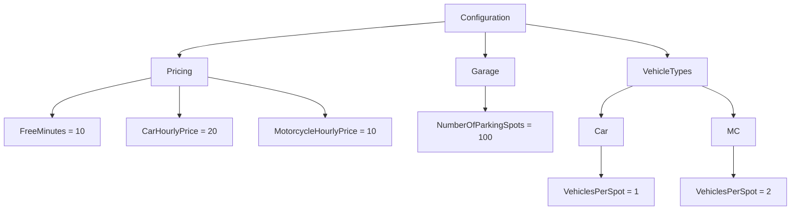

## Konfigurationsstruktur



## Exempel på `config.json`

```json
{
  "Pricing": {
    "FreeMinutes": 10,
    "CarHourlyPrice": 20,
    "MotorcycleHourlyPrice": 10
  },

  "Garage": {
    "NumberOfParkingSpots": 100
  },

  "VehicleTypes": {
    "Car": {
      "VehiclesPerSpot": 1
    },
    "MC": {
      "VehiclesPerSpot": 2
    }
  }
}
```

## Syfte

`config.json` innehåller inställningar som ska kunna ändras utan att programkoden behöver modifieras eller kompileras om.

Priser placeras överst för att de ska vara enkla att hitta och ändra även för en användare utan programmeringskunskaper.

Parkeringsdata lagras inte i denna fil utan separat i `parking-data.json`.

> Obs: Denna struktur gäller Prague Parking 2.0 (G-nivå). I 2.1/VG kommer fordonskapaciteten att generaliseras med storleksenheter.