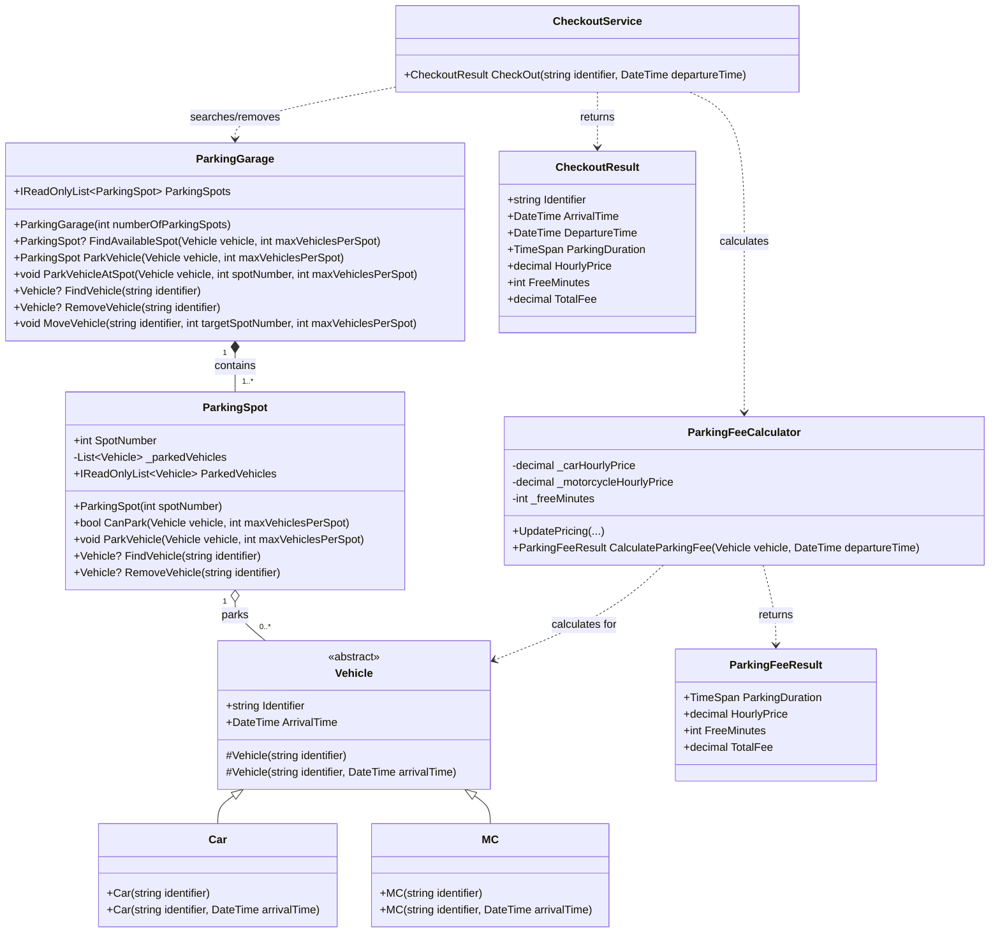
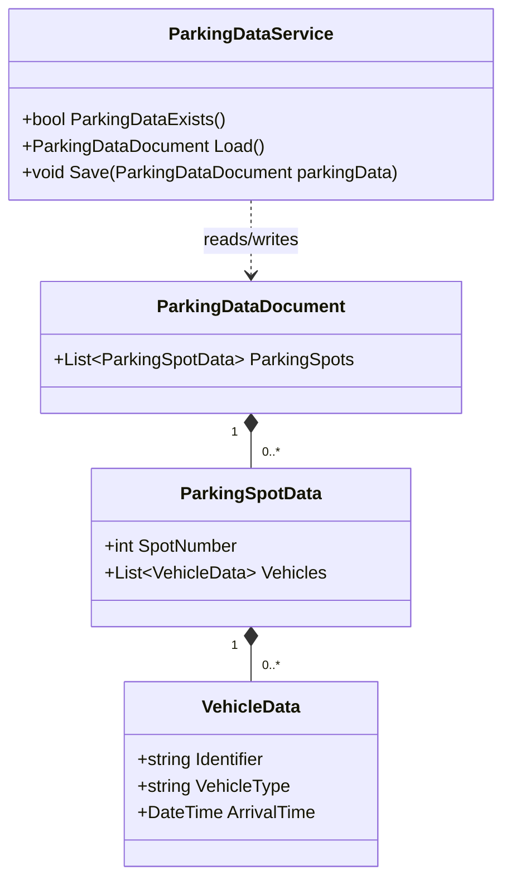
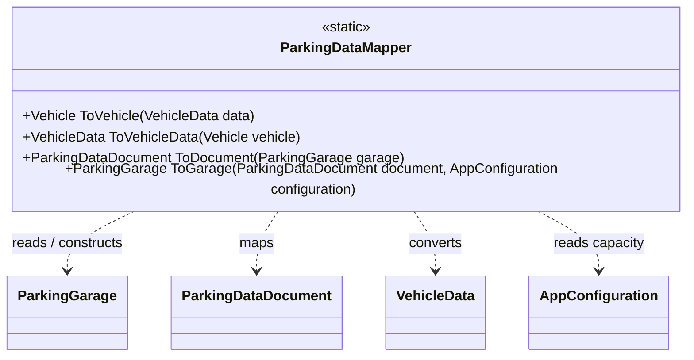
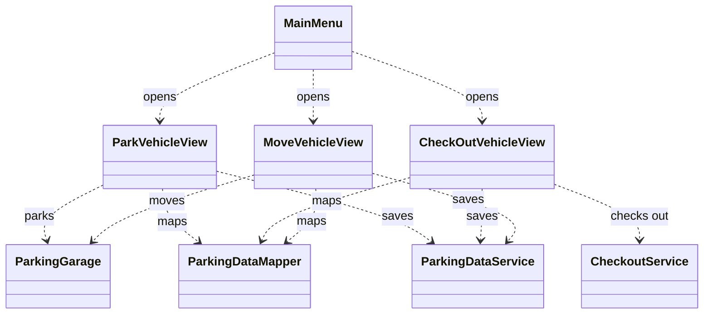

# Prague Parking V2 – Klassdiagram

**Uppdaterad:** 2026-10-15  
**Omfattning:** Domänmodellen för Prague Parking 2.0 (G), med avgränsningar inför Prague Parking 2.1 (VG).

Diagrammet visar domänklasserna och deras viktigaste relationer. JSON-persistensen och applikationens mapper visas separat nedan och blandas inte med domänmodellen. VG-utökningar ingår inte som implementerade klasser.

UI och konfiguration beskrivs översiktligt i detta dokument. JSON-persistensen har ett separat klassdiagram längre ned. Den 14 oktober tillkom `ParkingDataMapper` i huvudprojektets applikationslager och `ParkingGarage.ParkVehicleAtSpot()` för återställning. **Den 15 oktober** integrerades `CheckOutVehicleView` och `MoveVehicleView` med huvudmenyn och JSON-sparningen. `ParkingGarage.MoveVehicle()` tillkom för att flytta befintliga fordon utan att ändra ankomsttiden. `GarageOverView` behövde inte byggas om för detta.

## Aktuell domänmodell

**Läsanvisning:** `+` markerar publika medlemmar, `-` privata medlemmar och `#` skyddade konstruktorer. `?` markerar att ett returvärde kan vara `null`. Diagrammet beskriver den kod som har redovisats under utvecklingen; det är inte en ny fullständig granskning av hela det lokala repositoryt. `ParkingGarage.MoveVehicle()` har granskats mot den faktiska metod som implementerades den 15 oktober.

## Modellens ansvar

### Vehicle

`Vehicle` är en abstrakt basklass som innehåller de gemensamma egenskaperna:

- `Identifier`
- `ArrivalTime`

Alla fordon identifieras med en generell identifierare. Detta gör modellen mer flexibel inför framtida fordonstyper som inte nödvändigtvis har registreringsnummer.

Konstruktorn validerar identifieraren och ankomsttiden. Vid nyregistrering används `DateTime.UtcNow`, och ankomsttiden lagras internt i UTC.

Basklassen har även en skyddad konstruktor som tar emot en befintlig UTC-ankomsttid. Den är avsedd att användas när ett parkerat fordon återställs från JSON. Konstruktorsöverlagringar i `Car` och `MC` tar emot en befintlig UTC-ankomsttid och används nu i `ParkingDataMapper.ToVehicle()` vid återställning.

### Car

`Car` ärver från `Vehicle`.

Klassen representerar en bil och använder basklassens validering. Den kan skapas med antingen en ny `identifier` eller en befintlig `identifier` och UTC-ankomsttid för återställning.

### MC

`MC` ärver från `Vehicle`.

Klassen representerar en motorcykel och använder basklassens validering. Den kan skapas med antingen en ny `identifier` eller en befintlig `identifier` och UTC-ankomsttid för återställning.

### ParkingSpot

`ParkingSpot` representerar en individuell parkeringsplats.

Klassen ansvarar för:

- Parkeringsplatsens nummer.
- Intern lagring av parkerade fordon.
- Kontroll av parkeringskapacitet.
- Kontroll av tillåtna fordonstyper.
- Parkering av fordon.
- Sökning efter fordon.
- Borttagning av fordon.

Fordon lagras internt i `_parkedVehicles` och samlingen exponeras genom `IReadOnlyList<Vehicle> ParkedVehicles`.

Det innebär att andra klasser får läsåtkomst genom denna egenskap utan att kunna lägga till eller ta bort fordon via just det gränssnittet. `IReadOnlyList<T>` gör däremot inte den bakomliggande listan automatiskt oföränderlig.

### ParkingGarage

`ParkingGarage` representerar hela parkeringshuset.

Klassen ansvarar för:

- Att skapa parkeringsplatser.
- Att hålla reda på garagets parkeringsplatser.
- Att hitta första lämpliga parkeringsplats.
- Att parkera fordon.
- Att söka efter fordon.
- Att förhindra dubbla fordonsidentifierare.
- Att ta bort fordon.
- Att flytta ett befintligt fordon mellan två platser efter kontroll av målplats och kapacitet.

Garaget använder `ParkingSpot` för att utföra åtgärder på enskilda parkeringsplatser.

`ParkVehicle()` returnerar den parkeringsplats som tilldelades. `FindAvailableSpot()`, `FindVehicle()` och `RemoveVehicle()` kan returnera `null` när ingen träff finns.

Vid vanlig incheckning väljer `ParkVehicle()` första lämpliga platsen. Vid JSON-inläsning används `ParkVehicleAtSpot()` för att bevara **ursprungligt platsnummer** i stället för att placera om fordonet automatiskt.

`MoveVehicle(identifier, targetSpotNumber, maxVehiclesPerSpot)` kontrollerar att fordonet och båda platserna finns, att målet skiljer sig från ursprungsplatsen och att `ParkingSpot.CanPark()` godkänner flytten. Därefter flyttas **samma `Vehicle`-objekt**, så att `ArrivalTime` bevaras. Om parkeringen på målplatsen kastar ett undantag försöker metoden återställa fordonet till ursprungsplatsen. Detta är grundläggande kompensation och ännu inte fullständigt feltestad transaktionshantering.

### ParkingFeeCalculator

`ParkingFeeCalculator` ansvarar för prisberäkningen.

Klassen håller reda på aktiva prisvärden för:

- Car.
- MC.
- Gratisminuter.

Prisreglerna kan uppdateras med `UpdatePricing()`. Metoden validerar nya prisvärden innan de aktiveras.

Avgiften beräknas med `CalculateParkingFee()` utifrån:

- Fordonstyp.
- Ankomsttid.
- Avgångstid.
- Aktuellt timpris.
- Gratisgräns.
- Påbörjade timmar.

Resultatet returneras som ett `ParkingFeeResult`.

### ParkingFeeResult

`ParkingFeeResult` är ett resultatobjekt.

Klassen innehåller:

- `ParkingDuration`
- `HourlyPrice`
- `FreeMinutes`
- `TotalFee`

Resultatobjektet gör att prisberäkningen kan hållas separat från användargränssnittet.

### CheckoutService

`CheckoutService` ansvarar för själva utcheckningsprocessen.

Klassen samordnar:

1. Sökning efter fordon.
2. Prisberäkning.
3. Borttagning av fordon.
4. Skapande av ett utcheckningsresultat.

Prisberäkningen genomförs innan fordonet tas bort från parkeringshuset. Det förhindrar att ett fordon tas bort innan avgiften har kunnat beräknas korrekt.

Den 15 oktober integrerades `CheckOutVehicleView` med `CheckoutService`, prisvisning, användarbekräftelse och JSON-sparning. Normalflödet för utcheckning har testats, inklusive kontroll efter programomstart. Vid rapporterat sparfel försöker vyn återställa det utcheckade fordonsobjektet till den tidigare platsen. **Framprovocerade skrivfel och återställningen vid sådana fel är inte färdigtestade.**

### CheckoutResult

`CheckoutResult` innehåller information som behövs efter en lyckad utcheckning:

- Fordonsidentifierare.
- Ankomsttid.
- Avgångstid.
- Total parkeringstid.
- Timpris.
- Gratisminuter.
- Total avgift.

Objektet används för att lämna information från domänlagret till användargränssnittet. Det är inte avsett att lagras som permanent parkeringsdata.

## Relationer mellan klasser

### Arv

`Car` och `MC` ärver från den abstrakta basklassen `Vehicle`.

### ParkingGarage och ParkingSpot

`ParkingGarage` innehåller en samling `ParkingSpot`-objekt.

### ParkingSpot och Vehicle

Varje `ParkingSpot` kan innehålla noll eller flera fordon, inom de kapacitets- och fordonsregler som gäller för platsen.

### ParkingFeeCalculator och ParkingFeeResult

`ParkingFeeCalculator` använder ett fordons uppgifter för att beräkna avgiften och returnerar ett `ParkingFeeResult`.

### CheckoutService och CheckoutResult

`CheckoutService` använder `ParkingGarage` och `ParkingFeeCalculator` för att genomföra utcheckningen.

Efter en lyckad utcheckning returneras ett `CheckoutResult`.

### Flytt av fordon

`ParkingGarage.MoveVehicle()` samordnar en förflyttning med hjälp av befintliga `ParkingSpot`-metoder. `MoveVehicleView` står för inmatning, bekräftelse och anrop till domänmetoden samt `ParkingDataMapper.ToDocument()` och `ParkingDataService.Save()`. Ingen ny fordonsinstans skapas och ankomsttiden ska inte påverkas.

**Verifierat i normalflödet den 15 oktober:** En bil (`ABC123`) flyttades från plats 001 till 050. Efter omstart fanns placeringen kvar på plats 050. Två motorcyklar kunde dela en plats, medan flytt av MC till bilupptagen plats nekades. Test av två MC **efter omstart**, samt felinjicering vid JSON-sparning, återstår.

## Arkitektoniska avgränsningar

### Användargränssnitt

Följande klasser tillhör UI och ingår inte i domänklassdiagrammet:

- `AppTheme` – gemensamma färger, menyer och presentationskomponenter.
- `MainMenu` – huvudmenyn och navigering mellan funktioner.
- `ParkVehicleView` – användarflöde för fordonsincheckning.
- `CheckOutVehicleView` – utcheckning med avgift, bekräftelse och JSON-sparning.
- `MoveVehicleView` – flytt med platskontroll, bekräftelse och JSON-sparning.
- `GarageOverView` – dynamisk parkeringskarta, detaljer för vald plats och sammanfattande garagestatus.
- `MessageService` – informations-, varnings-, fel- och bekräftelsemeddelanden.

UI-komponenterna har refaktorerats för att minska duplicerad kod, bland annat genom gemensamma panelkomponenter i `AppTheme`. `AppTheme.WriteCenteredPanel()` används i de aktuella formulär- och bekräftelsevyerna. `MessageService` använder också den gemensamma centrerade panelpresentationen.

`MoveVehicleView` använder en `while`-loop för att kunna ange nytt platsnummer efter ogiltig inmatning. Kapacitet kontrolleras före bekräftelse genom `ParkingSpot.CanPark()`, men kontrolleras även i domänlagret. Endast den nedre delen av konsolen ritas om vid omförsök med `Console.SetCursorPosition()` och ANSI-rensning; terminalkompatibilitet utanför den använda miljön är inte verifierad. Tomt Enter avbryter inmatningen; omedelbar ESC-avbrytning i `TextPrompt` är inte implementerad.

**Garageöversiktens aktuella presentationslösning (2026-10-13):** `GarageOverView` använder ett kompakt `Spectre.Console.Grid` inuti en gemensam `Panel` för parkeringskartan i stället för en `Table` eller en egen `Panel` per parkeringsplats. Kartan och `SPOT DETAILS` ligger sida vid sida; målet är ungefär 80/20-fördelning av den tillgängliga bredden, med ett minsta läsbart utrymme för detaljpanelen. `GARAGE STATUS` visas under båda panelerna.

Antalet kolumner och synliga rader beräknas utifrån terminalens storlek och garagets faktiska antal platser. En intern visningsyta används när hela parkeringskartan inte får plats på höjden. Piltangenterna använder samma kolumnberäkning som rutnätet, och `AnsiConsole.Live()` uppdaterar vyn. Parkeringsplatsens bakgrundsfärg uttrycker ledig, delvis upptagen eller full plats enligt konfigurationen; en markerad plats får en avvikande textfärg utan att statusbakgrunden byts ut. Presentationen hämtar information från befintliga `ParkingGarage`, `ParkingSpot` och `Vehicle`, utan att införa nya domänklasser.

**Verifieringsstatus:** Den 14 oktober visades två fulla bilplatser (001 och 002) bland 200 konfigurerade platser, samt korrekt detaljpanel och statusräknare (`FREE 198`, `OCCUPIED 2`, `VEHICLES 2`). Den 15 oktober kontrollerades även en bil på plats 050 och två MC på en gemensam plats; garageöversikten visade `FREE 198`, `OCCUPIED 2`, `VEHICLES 3`. Navigeringens gränsfall, 500–1 000 platser och terminalstorleksändringar återstår att verifiera.

Parkeringslogiken har tidigare testats direkt från `Program.cs`. Incheckning, utcheckning och flytt har därefter kopplats till UI och JSON-sparning. Normala användarflöden har testats, men inte samtliga fel- och gränsfall.

### Konfiguration

Konfigurationshanteringen finns i det separata Data-projektet och omfattar bland annat:

- `AppConfiguration`
- `ConfigurationService`

`config.json` styr bland annat antal platser, tidszon, priser och fordonskapacitet. Domänmodellen får relevanta kapacitetsvärden som parametrar i stället för att läsa filen direkt.

### Persistens

Följande klasser är implementerade i det separata klassbiblioteket `PragueParkingV2.Data/Persistence`. Diagrammet nedan visar DTO-/filnivån. `ParkingDataMapper` visas i ett separat diagram eftersom den ligger i huvudprojektets `Application`-lager.

`ParkingDataService` läser och sparar `Data/parking-data.json`, validerar den interna dokumentstrukturen och kan skriva indenterad JSON via `WriteIndented = true`. Kontroller av dubbletter använder `HashSet<int>` respektive ett skiftlägesokänsligt `HashSet<string>`.

Grundläggande JSON-inläsning och avvisning av okänd fordonstyp har tidigare testats. Den 14 oktober verifierades ett komplett normalflöde för bil: ny parkering, JSON-sparning, omstart och återställning till samma plats och ankomsttid. Den 15 oktober testades även sparning efter utcheckning och flytt, inklusive en bilflytt som fanns kvar efter omstart. **Fullständiga filfelstester och återställning av två MC på samma plats efter omstart återstår.**

Konfigurationsberoende kontroller hör hemma i återställningsflödet utanför Data-projektet. En befintlig ogiltig datafil får inte automatiskt ersättas med tom data.

### Applikationslager – mappning och UI-sparning (uppdaterat 2026-10-15)

`Program.cs` läser konfiguration och DTO-dokument, sedan anropas `ParkingDataMapper.ToGarage()`. `ParkVehicleView`, `CheckOutVehicleView` och `MoveVehicleView` anropar `ToDocument()` följt av `ParkingDataService.Save()` efter respektive lyckad domänåtgärd. Två nästlade `foreach`-loopar används avsiktligt i `ToGarage()` eftersom varje fordon skapas och parkeras på en bestämd plats. `ToDocument()` använder LINQ för projektion till DTO:er. Det här valet prioriterar läsbarhet framför att använda LINQ överallt.

#### Anropsrelationer för aktiva UI-flöden

Diagrammet visar viktiga anropsberoenden i aktuella UI-flöden, inte hela uppsättningen konstruktorer eller alla möjliga metodanrop. `Find Vehicle` och `Administration` har fortfarande endast menyplatser, inga färdiga UI-flöden.

**Avgränsning:** Mappern är en översättningsklass, inte en transaktionshanterare. Grundläggande kompensation vid rapporterade sparfel ligger i respektive UI-vy och behöver robusthetstestas. Det är inte en fullständig transaktionsgaranti; eventuell centralisering i en applikationstjänst är framtida arbete.

### VG-versionen

Följande tillhör den framtida Prague Parking 2.1-versionen:

- `Bicycle` och `Bus` som nya fordonstyper.
- Minst två interfaces enligt VG-kraven. Användning av `IReadOnlyList<T>` dokumenterar samlingsåtkomst men ersätter inte automatiskt den planerade interfacebaserade domänarkitekturen.
- Storleksbaserad parkeringskapacitet: Bicycle = 1, MC = 2, Car = 4 och Bus = 16 enheter; en normal plats motsvarar 4 enheter.
- Fyra sammanhängande parkeringsplatser för en buss.
- **Vid nyparkering** tilldelas en buss fyra sammanhängande platser inom de första 50 parkeringsplatserna.
- **Vid förflyttning** får en redan parkerad buss flyttas även bortom plats 50, så länge den nya placeringen består av fyra sammanhängande lediga platser.
- Omläsning och validering av hela konfigurationen under körning.

Den planerade persistensen behöver kunna utökas så att en buss kan kopplas till flera upptagna platser utan att samma fordon behandlas som flera separata fordon. Detaljerna för den framtida JSON-representationen är inte fastställda här; formatet i `parking-data.md` gäller för 2.0.

VG-funktionaliteten implementeras först efter att G-versionen har färdigställts och verifierats.
