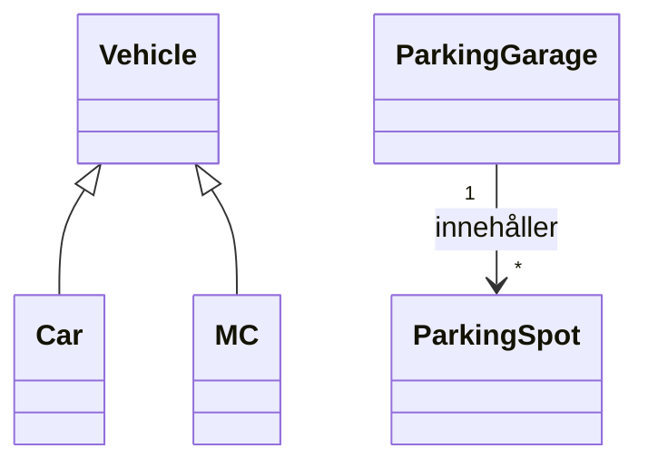

# Prague Parking V2 – Klassdiagram

## Version 0.1 – Grundstruktur



## Klassernas huvudansvar

```text
Vehicle:
Representerar gemensam information och egenskaper som alla fordon behöver,
exempelvis unik identifierare, ankomsttid och kapacitetsbehov.

Car:
Representerar ett fordon av typen bil och ärver den gemensamma fordonsinformationen från Vehicle.

MC:
Representerar ett fordon av typen MC och ärver den gemensamma fordonsinformationen från Vehicle.

ParkingSpot:
Representerar en fysisk parkeringsplats och ansvarar för sitt platsnummer,
sin kapacitet och vilka fordon som använder platsens kapacitet.

ParkingGarage:
Representerar hela parkeringshuset och ansvarar för samlingen av ParkingSpot
samt för operationer som kräver kunskap om flera parkeringsplatser.
```

## Version 0.2 – Skiss

```text
Vehicle
----------------
Identifier
ArrivalTime
      ▲
      │
 ┌────┴────┐
Car        MC


ParkingGarage
----------------
ParkingSpots
      │
      │ 1..*
      ▼
ParkingSpot
----------------
SpotNumber
ParkedVehicles
```

## Version 0.3 – ParkingSpot

```text
ParkingSpot
----------------
SpotNumber
Capacity
ParkedVehicles
```

## Version 0.4 – ParkingGarage

```text
ParkingGarage
----------------
ParkingSpots
```

## Version 0.5 – 