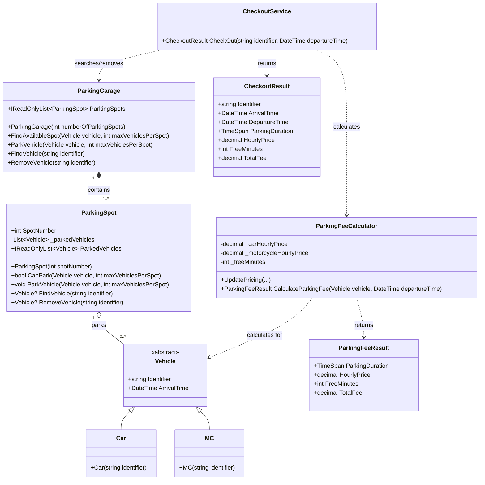

# Prague Parking V2 – Klassdiagram

**Uppdaterad:** 2026-10-09  
**Omfattning:** Domänmodellen för Prague Parking 2.0 (G).

Diagrammet visar domänklasserna och deras viktigaste relationer.

UI, konfiguration och persistens dokumenteras separat.

## Aktuell domänmodell

## Modellens ansvar

### Vehicle

`Vehicle` är en abstrakt basklass som innehåller de gemensamma egenskaperna:

- `Identifier`
- `ArrivalTime`

Alla fordon identifieras med en generell identifierare.

Detta gör modellen mer flexibel inför framtida fordonstyper som inte nödvändigtvis har registreringsnummer.

Ankomsttiden hanteras internt i UTC.

### Car

`Car` ärver från `Vehicle`.

Klassen representerar en bil och använder de gemensamma egenskaperna från basklassen.

### MC

`MC` ärver från `Vehicle`.

Klassen representerar en motorcykel och använder de gemensamma egenskaperna från basklassen.

### ParkingSpot

`ParkingSpot` representerar en individuell parkeringsplats.

Klassen ansvarar för:

- Parkeringsplatsens nummer.
- Intern lagring av parkerade fordon.
- Kontroll av parkeringskapacitet.
- Kontroll av tillåtna fordonstyper.
- Parkering av fordon.
- Sökning efter fordon.
- Borttagning av fordon.

Fordon lagras internt i:

`_parkedVehicles`

Samlingen exponeras genom:

`IReadOnlyList<Vehicle> ParkedVehicles`

Det innebär att andra klasser kan läsa beläggningen utan att direkt ändra den interna listan.

### ParkingGarage

`ParkingGarage` representerar hela parkeringshuset.

Klassen ansvarar för:

- Att skapa parkeringsplatser.
- Att hålla reda på garagets parkeringsplatser.
- Att hitta första lämpliga parkeringsplats.
- Att parkera fordon.
- Att söka efter fordon.
- Att förhindra dubbla fordonsidentifierare.
- Att ta bort fordon.

Garaget använder `ParkingSpot` för att utföra åtgärder på enskilda parkeringsplatser.

### ParkingFeeCalculator

`ParkingFeeCalculator` ansvarar för prisberäkningen.

Klassen håller reda på aktiva prisvärden för:

- Car.
- MC.
- Gratisminuter.

Prisreglerna kan uppdateras med:

`UpdatePricing()`

Metoden validerar nya prisvärden innan de aktiveras.

Avgiften beräknas med:

`CalculateParkingFee()`

Beräkningen använder:

- Fordonstyp.
- Ankomsttid.
- Avgångstid.
- Aktuellt timpris.
- Gratisgräns.
- Påbörjade timmar.

Resultatet returneras som ett `ParkingFeeResult`.

### ParkingFeeResult

`ParkingFeeResult` är ett resultatobjekt.

Klassen innehåller:

- `ParkingDuration`
- `HourlyPrice`
- `FreeMinutes`
- `TotalFee`

Resultatobjektet gör att prisberäkningen kan hållas separat från användargränssnittet.

### CheckoutService

`CheckoutService` ansvarar för själva utcheckningsprocessen.

Klassen samordnar:

1. Sökning efter fordon.
2. Prisberäkning.
3. Borttagning av fordon.
4. Skapande av ett utcheckningsresultat.

Prisberäkningen genomförs innan fordonet tas bort från parkeringshuset.

Detta förhindrar att ett fordon tas bort innan avgiften har kunnat beräknas korrekt.

### CheckoutResult

`CheckoutResult` innehåller information som behövs efter en lyckad utcheckning.

Resultatet innehåller:

- Fordonsidentifierare.
- Ankomsttid.
- Avgångstid.
- Total parkeringstid.
- Timpris.
- Gratisminuter.
- Total avgift.

Objektet används för att lämna information från domänlagret till användargränssnittet.

Det är inte avsett att lagras som permanent parkeringsdata.

## Relationer mellan klasser

### Arv

`Car` och `MC` ärver från den abstrakta basklassen `Vehicle`.

### ParkingGarage och ParkingSpot

`ParkingGarage` innehåller en samling `ParkingSpot`-objekt.

### ParkingSpot och Vehicle

Varje `ParkingSpot` kan innehålla noll eller flera fordon.

### ParkingFeeCalculator och ParkingFeeResult

`ParkingFeeCalculator` använder ett fordons uppgifter för att beräkna avgiften och returnerar ett `ParkingFeeResult`.

### CheckoutService och CheckoutResult

`CheckoutService` använder `ParkingGarage` och `ParkingFeeCalculator` för att genomföra utcheckningen.

Efter en lyckad utcheckning returneras ett `CheckoutResult`.

## Arkitektoniska avgränsningar

### Användargränssnitt

Följande klasser tillhör UI och ingår inte i domänklassdiagrammet:

- `GarageOverView`
- `MessageService`

### Konfiguration

Konfigurationshanteringen finns i det separata Data-projektet.

Den omfattar bland annat:

- `AppConfiguration`
- `ConfigurationService`

### Persistens

Permanent lagring av parkeringsdata i `parking-data.json` är ännu inte implementerad.

### VG-versionen

Följande tillhör den framtida Prague Parking 2.1-versionen:

- `Bicycle`
- `Bus`
- Minst två interfaces.
- Storleksbaserad parkeringskapacitet.
- Fyra sammanhängande parkeringsplatser för buss.
- Omläsning av hela konfigurationen under körning.

VG-funktionaliteten implementeras först efter att G-versionen har färdigställts och verifierats.