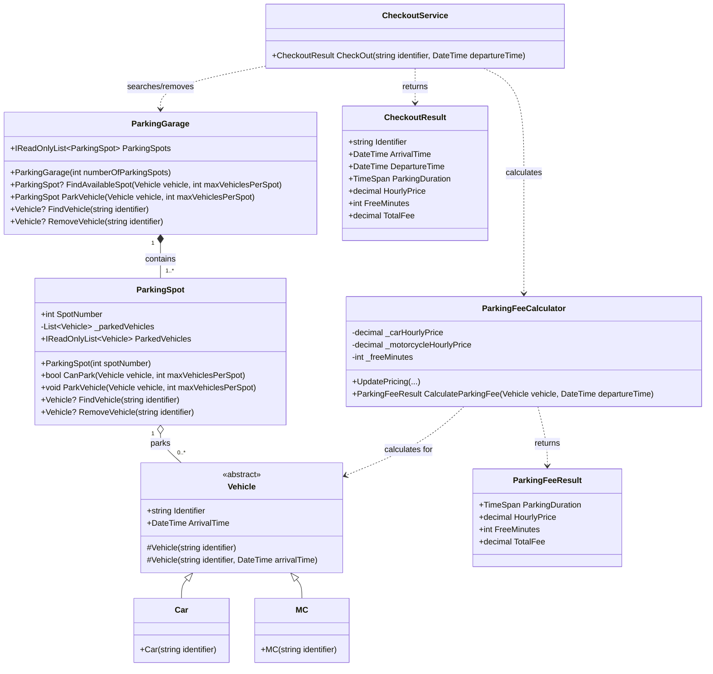
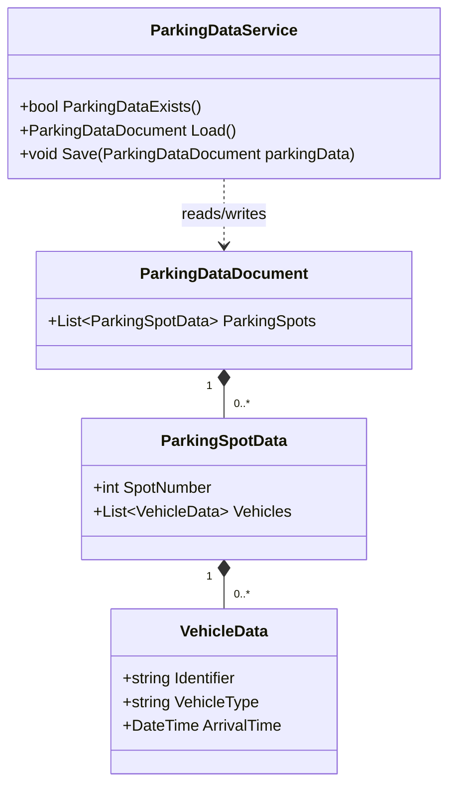

# Prague Parking V2 – Klassdiagram

**Uppdaterad:** 2026-10-11  
**Omfattning:** Domänmodellen för Prague Parking 2.0 (G), med avgränsningar inför Prague Parking 2.1 (VG).

Diagrammet visar domänklasserna och deras viktigaste relationer. Den påbörjade JSON-persistensen visas separat nedan och blandas inte med domänmodellen. VG-utökningar ingår inte som implementerade klasser.

UI, konfiguration och persistens dokumenteras separat.

## Aktuell domänmodell

**Läsanvisning:** `+` markerar publika medlemmar, `-` privata medlemmar och `#` skyddade konstruktorer. `?` markerar att ett returvärde kan vara `null`. Diagrammets prisberäknings- och utcheckningsdelar återger de tidigare dokumenterade metodsignaturerna; de har inte kontrollerats mot nya källkodsversioner i denna dokumentationsuppdatering.

## Modellens ansvar

### Vehicle

`Vehicle` är en abstrakt basklass som innehåller de gemensamma egenskaperna:

- `Identifier`
- `ArrivalTime`

Alla fordon identifieras med en generell identifierare. Detta gör modellen mer flexibel inför framtida fordonstyper som inte nödvändigtvis har registreringsnummer.

Konstruktorn validerar identifieraren och ankomsttiden. Vid nyregistrering används `DateTime.UtcNow`, och ankomsttiden lagras internt i UTC.

Basklassen har även en skyddad konstruktor som tar emot en befintlig UTC-ankomsttid. Den är avsedd att användas när ett parkerat fordon återställs från JSON. Motsvarande konstruktorsöverlagringar i `Car` och `MC` behöver verifieras eller färdigställas i samband med persistensen; de visas därför inte som bekräftat implementerade i diagrammet.

### Car

`Car` ärver från `Vehicle`.

Klassen representerar en bil och använder de gemensamma egenskaperna och valideringen från basklassen. Den verifierade konstruktorn tar emot `identifier`.

### MC

`MC` ärver från `Vehicle`.

Klassen representerar en motorcykel och använder de gemensamma egenskaperna och valideringen från basklassen. Den verifierade konstruktorn tar emot `identifier`.

### ParkingSpot

`ParkingSpot` representerar en individuell parkeringsplats.

Klassen ansvarar för:

- Parkeringsplatsens nummer.
- Intern lagring av parkerade fordon.
- Kontroll av parkeringskapacitet.
- Kontroll av tillåtna fordonstyper.
- Parkering av fordon.
- Sökning efter fordon.
- Borttagning av fordon.

Fordon lagras internt i `_parkedVehicles` och samlingen exponeras genom `IReadOnlyList<Vehicle> ParkedVehicles`.

Det innebär att andra klasser får läsåtkomst genom denna egenskap utan att kunna lägga till eller ta bort fordon via just det gränssnittet. `IReadOnlyList<T>` gör däremot inte den bakomliggande listan automatiskt oföränderlig.

### ParkingGarage

`ParkingGarage` representerar hela parkeringshuset.

Klassen ansvarar för:

- Att skapa parkeringsplatser.
- Att hålla reda på garagets parkeringsplatser.
- Att hitta första lämpliga parkeringsplats.
- Att parkera fordon.
- Att söka efter fordon.
- Att förhindra dubbla fordonsidentifierare.
- Att ta bort fordon.

Garaget använder `ParkingSpot` för att utföra åtgärder på enskilda parkeringsplatser.

`ParkVehicle()` returnerar den parkeringsplats som tilldelades. `FindAvailableSpot()`, `FindVehicle()` och `RemoveVehicle()` kan returnera `null` när ingen träff finns.

Vid vanlig incheckning väljer `ParkVehicle()` första lämpliga platsen. Vid framtida inläsning från JSON måste en separat återställningsväg kunna bevara **ursprungligt platsnummer** i stället för att placera om fordonet automatiskt.

### ParkingFeeCalculator

`ParkingFeeCalculator` ansvarar för prisberäkningen.

Klassen håller reda på aktiva prisvärden för:

- Car.
- MC.
- Gratisminuter.

Prisreglerna kan uppdateras med `UpdatePricing()`. Metoden validerar nya prisvärden innan de aktiveras.

Avgiften beräknas med `CalculateParkingFee()` utifrån:

- Fordonstyp.
- Ankomsttid.
- Avgångstid.
- Aktuellt timpris.
- Gratisgräns.
- Påbörjade timmar.

Resultatet returneras som ett `ParkingFeeResult`.

### ParkingFeeResult

`ParkingFeeResult` är ett resultatobjekt.

Klassen innehåller:

- `ParkingDuration`
- `HourlyPrice`
- `FreeMinutes`
- `TotalFee`

Resultatobjektet gör att prisberäkningen kan hållas separat från användargränssnittet.

### CheckoutService

`CheckoutService` ansvarar för själva utcheckningsprocessen.

Klassen samordnar:

1. Sökning efter fordon.
2. Prisberäkning.
3. Borttagning av fordon.
4. Skapande av ett utcheckningsresultat.

Prisberäkningen genomförs innan fordonet tas bort från parkeringshuset. Det förhindrar att ett fordon tas bort innan avgiften har kunnat beräknas korrekt.

Det fullständiga utcheckningsflödet via UI och sparande efter utcheckning återstår att integrera och verifiera.

### CheckoutResult

`CheckoutResult` innehåller information som behövs efter en lyckad utcheckning:

- Fordonsidentifierare.
- Ankomsttid.
- Avgångstid.
- Total parkeringstid.
- Timpris.
- Gratisminuter.
- Total avgift.

Objektet används för att lämna information från domänlagret till användargränssnittet. Det är inte avsett att lagras som permanent parkeringsdata.

## Relationer mellan klasser

### Arv

`Car` och `MC` ärver från den abstrakta basklassen `Vehicle`.

### ParkingGarage och ParkingSpot

`ParkingGarage` innehåller en samling `ParkingSpot`-objekt.

### ParkingSpot och Vehicle

Varje `ParkingSpot` kan innehålla noll eller flera fordon, inom de kapacitets- och fordonsregler som gäller för platsen.

### ParkingFeeCalculator och ParkingFeeResult

`ParkingFeeCalculator` använder ett fordons uppgifter för att beräkna avgiften och returnerar ett `ParkingFeeResult`.

### CheckoutService och CheckoutResult

`CheckoutService` använder `ParkingGarage` och `ParkingFeeCalculator` för att genomföra utcheckningen.

Efter en lyckad utcheckning returneras ett `CheckoutResult`.

## Arkitektoniska avgränsningar

### Användargränssnitt

Följande klasser tillhör UI och ingår inte i domänklassdiagrammet:

- `AppTheme` – gemensamma färger, menyer och presentationskomponenter.
- `MainMenu` – huvudmenyn och navigering mellan funktioner.
- `ParkVehicleView` – användarflöde för fordonsincheckning.
- `GarageOverView` – parkeringskarta och detaljer för vald plats.
- `MessageService` – informations-, varnings-, fel- och bekräftelsemeddelanden.

UI-komponenterna har refaktorerats för att minska duplicerad kod, bland annat genom gemensamma panelkomponenter i `AppTheme`.

Parkeringslogiken har tidigare testats direkt från `Program.cs`. Integrationen av det nya incheckningsflödet via `ParkVehicleView` är ännu inte bekräftad som testad.

### Konfiguration

Konfigurationshanteringen finns i det separata Data-projektet och omfattar bland annat:

- `AppConfiguration`
- `ConfigurationService`

`config.json` styr bland annat antal platser, tidszon, priser och fordonskapacitet. Domänmodellen får relevanta kapacitetsvärden som parametrar i stället för att läsa filen direkt.

### Persistens

Följande klasser är implementerade i det separata klassbiblioteket `PragueParkingV2.Data/Persistence`. Diagrammet nedan visar **DTO-/filnivån**, inte domänklassernas framtida återställningsflöde.

`ParkingDataService` läser och sparar `Data/parking-data.json`, validerar den interna dokumentstrukturen och kan skriva indenterad JSON via `WriteIndented = true`. Kontroller av dubbletter använder `HashSet<int>` respektive ett skiftlägesokänsligt `HashSet<string>`.

Den positiva JSON-inläsningen och avvisning av en ogiltig fordonstyp har testats manuellt. Slutlig filersättning, återställning av `Car` och `MC` till exakt samma plats samt automatisk sparning från parkeringsfunktionerna återstår.

Konfigurationsberoende kontroller hör hemma i återställningsflödet utanför Data-projektet. En befintlig ogiltig datafil får inte automatiskt ersättas med tom data.

### VG-versionen

Följande tillhör den framtida Prague Parking 2.1-versionen:

- `Bicycle` och `Bus` som nya fordonstyper.
- Minst två interfaces enligt VG-kraven. Användning av `IReadOnlyList<T>` dokumenterar samlingsåtkomst men ersätter inte automatiskt den planerade interfacebaserade domänarkitekturen.
- Storleksbaserad parkeringskapacitet: Bicycle = 1, MC = 2, Car = 4 och Bus = 16 enheter; en normal plats motsvarar 4 enheter.
- Fyra sammanhängande parkeringsplatser för en buss.
- **Vid nyparkering** tilldelas en buss fyra sammanhängande platser inom de första 50 parkeringsplatserna.
- **Vid förflyttning** får en redan parkerad buss flyttas även bortom plats 50, så länge den nya placeringen består av fyra sammanhängande lediga platser.
- Omläsning och validering av hela konfigurationen under körning.

Den planerade persistensen behöver kunna utökas så att en buss kan kopplas till flera upptagna platser utan att samma fordon behandlas som flera separata fordon. Detaljerna för den framtida JSON-representationen är inte fastställda här; formatet i `parking-data.md` gäller för 2.0.

VG-funktionaliteten implementeras först efter att G-versionen har färdigställts och verifierats.
