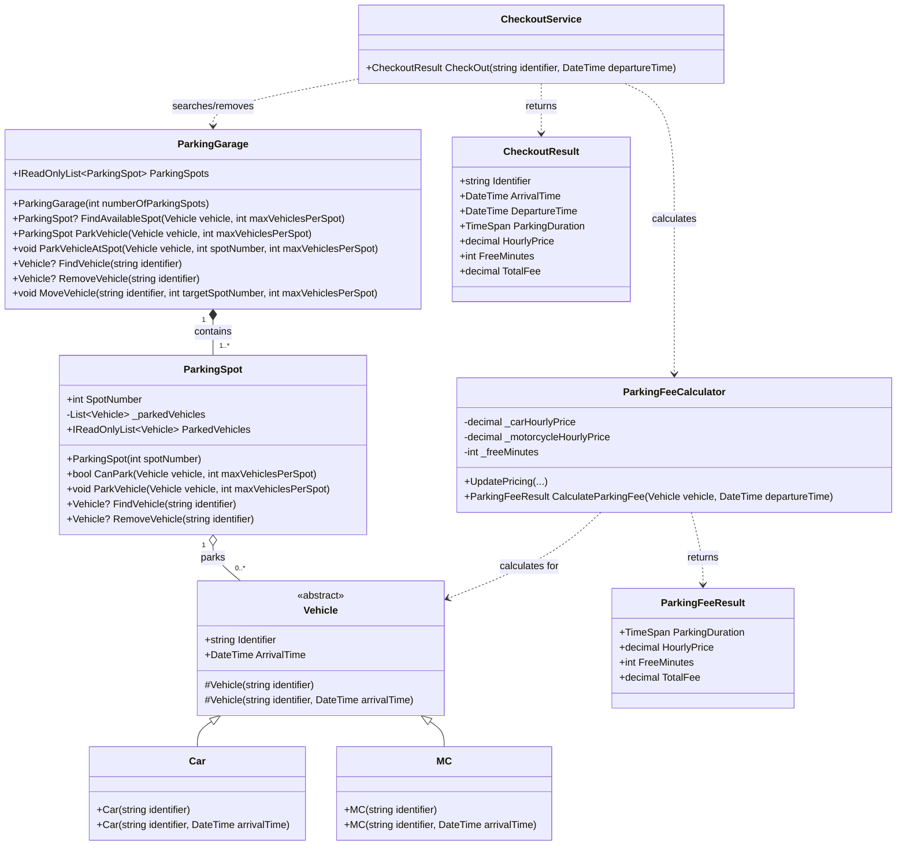
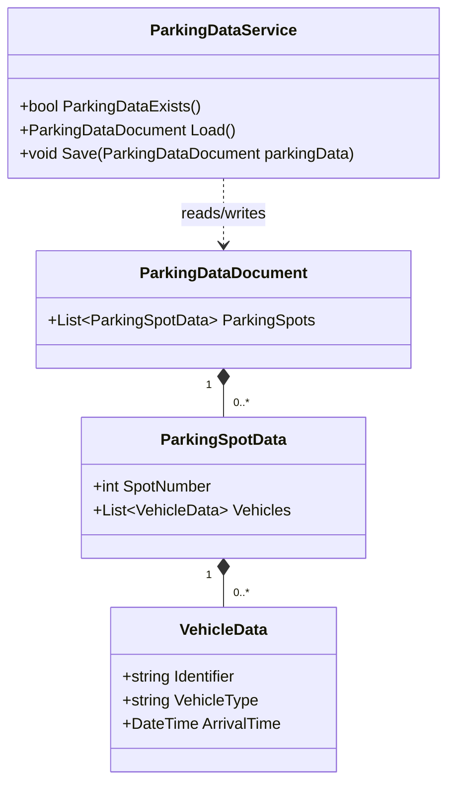
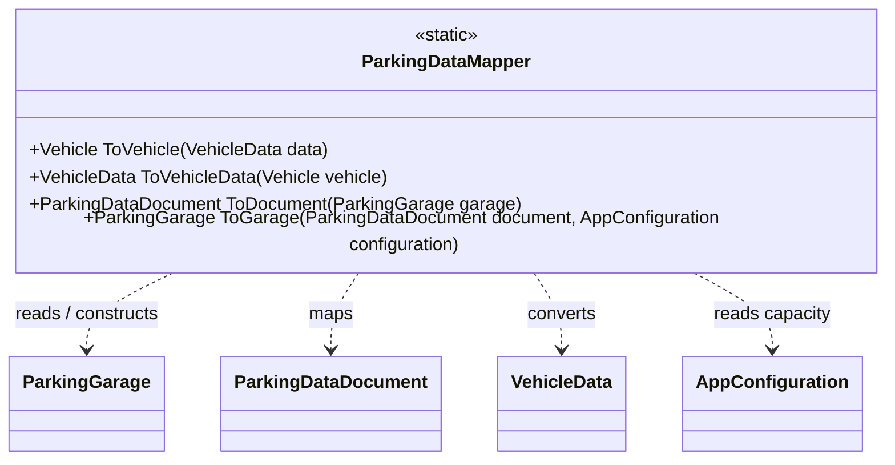
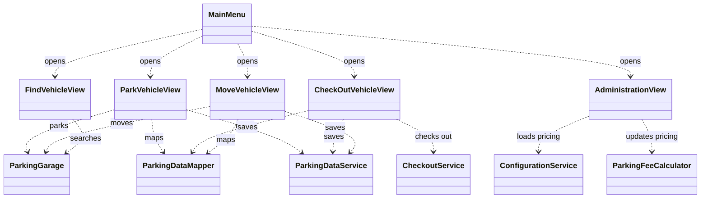
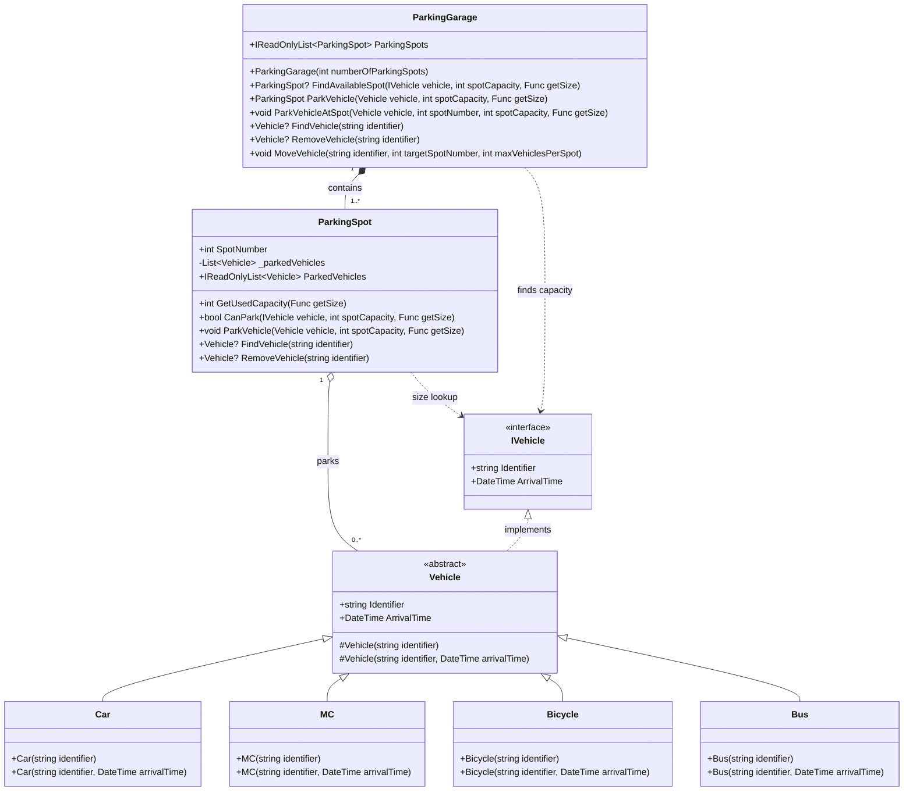
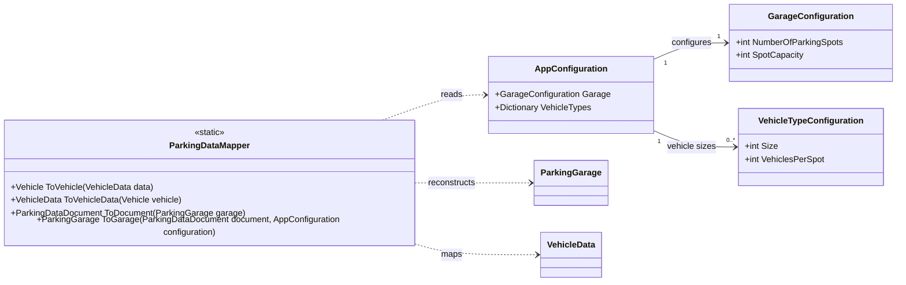

# Prague Parking V2 – Klassdiagram

**Uppdaterad:** 2026-10-20  
**Omfattning:** Separata klassdiagram för Prague Parking 2.0 (G) och den pågående vidareutvecklingen Prague Parking 2.1 (VG).

Dokumentet skiljer mellan **den befintliga, manuellt testade G-modellen** och **den delvis implementerade VG-modellen**. G-diagrammet och dess dokumenterade testhistorik är bevarade. V2.1 har egna projekt och ett eget diagram med de klasser, det interface och de metodöverlagringar som hittills har redovisats. Planerade funktioner visas inte som implementerade relationer.

JSON-persistens och applikationslagrets mapper dokumenteras separat från domänmodellen. Det som anges som *byggt/kompilerat* i V2.1 ska inte tolkas som *funktionstestat*.

UI och konfiguration beskrivs översiktligt i detta dokument. JSON-persistensen har ett separat klassdiagram längre ned. Den 14 oktober tillkom `ParkingDataMapper` i huvudprojektets applikationslager och `ParkingGarage.ParkVehicleAtSpot()` för återställning. **Den 15 oktober** integrerades `CheckOutVehicleView` och `MoveVehicleView` med huvudmenyn och JSON-sparningen. `ParkingGarage.MoveVehicle()` tillkom för att flytta befintliga fordon utan att ändra ankomsttiden. `GarageOverView` behövde inte byggas om för detta. **Den 16 oktober** verifierades även `FindVehicleView` och `AdministrationView` i UI, prisomläsning, återställning och negativa JSON-fall, rollback vid sparfel samt garageöversiktens viewport med 1 000 platser. Dokumentet beskriver den redovisade implementationen, inte en ny genomgång av hela repositoryt.

## Prague Parking 2.0 (G) – befintlig domänmodell



**Läsanvisning:** `+` markerar publika medlemmar, `-` privata medlemmar och `#` skyddade konstruktorer. `?` markerar att ett returvärde kan vara `null`. Diagrammet beskriver den kod som har redovisats under utvecklingen; det är inte en ny fullständig granskning av hela det lokala repositoryt. `ParkingGarage.MoveVehicle()` har granskats mot den faktiska metod som implementerades den 15 oktober.

## Modellens ansvar – Prague Parking 2.0 (G)

### Vehicle

`Vehicle` är en abstrakt basklass som innehåller de gemensamma egenskaperna:

- `Identifier`
- `ArrivalTime`

I G-versionen identifieras alla fordon med en generell identifierare. Detta gör modellen utbyggbar även för fordonstyper som inte nödvändigtvis har registreringsnummer.

Konstruktorn validerar identifieraren och ankomsttiden. Vid nyregistrering används `DateTime.UtcNow`, och ankomsttiden lagras internt i UTC.

Basklassen har även en skyddad konstruktor som tar emot en befintlig UTC-ankomsttid. Den är avsedd att användas när ett parkerat fordon återställs från JSON. Konstruktorsöverlagringar i `Car` och `MC` tar emot en befintlig UTC-ankomsttid och används nu i `ParkingDataMapper.ToVehicle()` vid återställning.

### Car

`Car` ärver från `Vehicle`.

Klassen representerar en bil och använder basklassens validering. Den kan skapas med antingen en ny `identifier` eller en befintlig `identifier` och UTC-ankomsttid för återställning.

### MC

`MC` ärver från `Vehicle`.

Klassen representerar en motorcykel och använder basklassens validering. Den kan skapas med antingen en ny `identifier` eller en befintlig `identifier` och UTC-ankomsttid för återställning.

### ParkingSpot

`ParkingSpot` representerar en individuell parkeringsplats.

Klassen ansvarar för:

- Parkeringsplatsens nummer.
- Intern lagring av parkerade fordon.
- Kontroll av parkeringskapacitet.
- Kontroll av tillåtna fordonstyper.
- Parkering av fordon.
- Sökning efter fordon.
- Borttagning av fordon.

Fordon lagras internt i `_parkedVehicles` och samlingen exponeras genom `IReadOnlyList<Vehicle> ParkedVehicles`.

Det innebär att andra klasser får läsåtkomst genom denna egenskap utan att kunna lägga till eller ta bort fordon via just det gränssnittet. `IReadOnlyList<T>` gör däremot inte den bakomliggande listan automatiskt oföränderlig.

### ParkingGarage

`ParkingGarage` representerar hela parkeringshuset.

Klassen ansvarar för:

- Att skapa parkeringsplatser.
- Att hålla reda på garagets parkeringsplatser.
- Att hitta första lämpliga parkeringsplats.
- Att parkera fordon.
- Att söka efter fordon.
- Att förhindra dubbla fordonsidentifierare.
- Att ta bort fordon.
- Att flytta ett befintligt fordon mellan två platser efter kontroll av målplats och kapacitet.

Garaget använder `ParkingSpot` för att utföra åtgärder på enskilda parkeringsplatser.

`ParkVehicle()` returnerar den parkeringsplats som tilldelades. `FindAvailableSpot()`, `FindVehicle()` och `RemoveVehicle()` kan returnera `null` när ingen träff finns.

Vid vanlig incheckning väljer `ParkVehicle()` första lämpliga platsen. Vid JSON-inläsning används `ParkVehicleAtSpot()` för att bevara **ursprungligt platsnummer** i stället för att placera om fordonet automatiskt.

`MoveVehicle(identifier, targetSpotNumber, maxVehiclesPerSpot)` kontrollerar att fordonet och båda platserna finns, att målet skiljer sig från ursprungsplatsen och att `ParkingSpot.CanPark()` godkänner flytten. Därefter flyttas **samma `Vehicle`-objekt**, så att `ArrivalTime` bevaras. Om parkeringen på målplatsen kastar ett undantag försöker metoden återställa fordonet till ursprungsplatsen. Detta är grundläggande kompensation. Ett separat manuellt test den 16 oktober verifierade återflytt i UI när JSON-sparning nekades; ingen fullständig transaktionsgaranti har påvisats.

### ParkingFeeCalculator

`ParkingFeeCalculator` ansvarar för prisberäkningen.

Klassen håller reda på aktiva prisvärden för:

- Car.
- MC.
- Gratisminuter.

Prisreglerna kan uppdateras med `UpdatePricing()`. Metoden validerar nya prisvärden innan de aktiveras.

Avgiften beräknas med `CalculateParkingFee()` utifrån:

- Fordonstyp.
- Ankomsttid.
- Avgångstid.
- Aktuellt timpris.
- Gratisgräns.
- Påbörjade timmar.

Resultatet returneras som ett `ParkingFeeResult`.

### ParkingFeeResult

`ParkingFeeResult` är ett resultatobjekt.

Klassen innehåller:

- `ParkingDuration`
- `HourlyPrice`
- `FreeMinutes`
- `TotalFee`

Resultatobjektet gör att prisberäkningen kan hållas separat från användargränssnittet.

### CheckoutService

`CheckoutService` ansvarar för själva utcheckningsprocessen.

Klassen samordnar:

1. Sökning efter fordon.
2. Prisberäkning.
3. Borttagning av fordon.
4. Skapande av ett utcheckningsresultat.

Prisberäkningen genomförs innan fordonet tas bort från parkeringshuset. Det förhindrar att ett fordon tas bort innan avgiften har kunnat beräknas korrekt.

Den 15 oktober integrerades `CheckOutVehicleView` med `CheckoutService`, prisvisning, användarbekräftelse och JSON-sparning. Normalflödet för utcheckning har testats, inklusive kontroll efter programomstart. Vid rapporterat sparfel försöker vyn återställa det utcheckade fordonsobjektet till den tidigare platsen. **Den 16 oktober verifierades kompensation vid ett framprovocerat `UnauthorizedAccessException`: fordonet fanns fortfarande på ursprungsplatsen efter avbruten utcheckning. Detta är inte ett bevis för transaktionssäkerhet vid alla typer av avbrott.**

### CheckoutResult

`CheckoutResult` innehåller information som behövs efter en lyckad utcheckning:

- Fordonsidentifierare.
- Ankomsttid.
- Avgångstid.
- Total parkeringstid.
- Timpris.
- Gratisminuter.
- Total avgift.

Objektet används för att lämna information från domänlagret till användargränssnittet. Det är inte avsett att lagras som permanent parkeringsdata.

## Relationer mellan klasser – Prague Parking 2.0 (G)

### Arv

`Car` och `MC` ärver från den abstrakta basklassen `Vehicle`.

### ParkingGarage och ParkingSpot

`ParkingGarage` innehåller en samling `ParkingSpot`-objekt.

### ParkingSpot och Vehicle

Varje `ParkingSpot` kan innehålla noll eller flera fordon, inom de kapacitets- och fordonsregler som gäller för platsen.

### ParkingFeeCalculator och ParkingFeeResult

`ParkingFeeCalculator` använder ett fordons uppgifter för att beräkna avgiften och returnerar ett `ParkingFeeResult`.

### CheckoutService och CheckoutResult

`CheckoutService` använder `ParkingGarage` och `ParkingFeeCalculator` för att genomföra utcheckningen.

Efter en lyckad utcheckning returneras ett `CheckoutResult`.

### Flytt av fordon

`ParkingGarage.MoveVehicle()` samordnar en förflyttning med hjälp av befintliga `ParkingSpot`-metoder. `MoveVehicleView` står för inmatning, bekräftelse och anrop till domänmetoden samt `ParkingDataMapper.ToDocument()` och `ParkingDataService.Save()`. Ingen ny fordonsinstans skapas och ankomsttiden ska inte påverkas.

**Verifierat i normalflödet den 15 oktober:** En bil (`ABC123`) flyttades från plats 001 till 050. Efter omstart fanns placeringen kvar på plats 050. Två motorcyklar kunde dela en plats, medan flytt av MC till bilupptagen plats nekades. Den 16 oktober verifierades båda motorcyklarna efter omstart med bibehållna UTC-tider. Vid simulerat sparfel återställdes en misslyckad flytt från plats 050 till 051 i minnet. En senare lyckad flytt till plats 051 kvarstod efter omstart. Fullständig atomisk transaktionshantering är inte verifierad.

## Arkitektoniska avgränsningar – Prague Parking 2.0 (G)

### Användargränssnitt

Följande klasser tillhör UI och ingår inte i domänklassdiagrammet:

- `AppTheme` – gemensamma färger, menyer och presentationskomponenter.
- `MainMenu` – huvudmenyn och navigering mellan funktioner.
- `ParkVehicleView` – användarflöde för fordonsincheckning.
- `CheckOutVehicleView` – utcheckning med avgift, bekräftelse och JSON-sparning.
- `MoveVehicleView` – flytt med platskontroll, bekräftelse och JSON-sparning.
- `GarageOverView` – dynamisk parkeringskarta, detaljer för vald plats och sammanfattande garagestatus.
- `MessageService` – informations-, varnings-, fel- och bekräftelsemeddelanden.
- `FindVehicleView` – skiftlägesokänslig sökning och visning av parkerat fordon utan ändring av data.
- `AdministrationView` – omläsning av prislista utan omstart via befintlig `ConfigurationService` och gemensam `ParkingFeeCalculator`.

UI-komponenterna har refaktorerats för att minska duplicerad kod, bland annat genom gemensamma panelkomponenter i `AppTheme`. `AppTheme.WriteCenteredPanel()` används i de aktuella formulär- och bekräftelsevyerna. `MessageService` använder också den gemensamma centrerade panelpresentationen. Den 16 oktober justerades även vänstermarginalen för `Press any key to continue...` när `waitForKey` används. `FindVehicleView` och `AdministrationView` är nu implementerade och testade, inte platshållare.

`MoveVehicleView` använder en `while`-loop för att kunna ange nytt platsnummer efter ogiltig inmatning. Kapacitet kontrolleras före bekräftelse genom `ParkingSpot.CanPark()`, men kontrolleras även i domänlagret. Endast den nedre delen av konsolen ritas om vid omförsök med `Console.SetCursorPosition()` och ANSI-rensning; terminalkompatibilitet utanför den använda miljön är inte verifierad. Tomt Enter avbryter inmatningen; omedelbar ESC-avbrytning i `TextPrompt` är inte implementerad.

**Garageöversiktens aktuella presentationslösning (2026-10-13):** `GarageOverView` använder ett kompakt `Spectre.Console.Grid` inuti en gemensam `Panel` för parkeringskartan i stället för en `Table` eller en egen `Panel` per parkeringsplats. Kartan och `SPOT DETAILS` ligger sida vid sida; målet är ungefär 80/20-fördelning av den tillgängliga bredden, med ett minsta läsbart utrymme för detaljpanelen. `GARAGE STATUS` visas under båda panelerna.

Antalet kolumner och synliga rader beräknas utifrån terminalens storlek och garagets faktiska antal platser. En intern visningsyta används när hela parkeringskartan inte får plats på höjden. Piltangenterna använder samma kolumnberäkning som rutnätet, och `AnsiConsole.Live()` uppdaterar vyn. Parkeringsplatsens bakgrundsfärg uttrycker ledig, delvis upptagen eller full plats enligt konfigurationen; en markerad plats får en avvikande textfärg utan att statusbakgrunden byts ut. Presentationen hämtar information från befintliga `ParkingGarage`, `ParkingSpot` och `Vehicle`, utan att införa nya domänklasser.

**Verifieringsstatus:** Den 14 oktober visades två fulla bilplatser (001 och 002) bland 200 konfigurerade platser, samt korrekt detaljpanel och statusräknare (`FREE 198`, `OCCUPIED 2`, `VEHICLES 2`). Den 15 oktober kontrollerades även en bil på plats 050 och två MC på en gemensam plats; garageöversikten visade `FREE 198`, `OCCUPIED 2`, `VEHICLES 3`. Den 16 oktober verifierades 1 000 platser med intern viewport, navigering till plats 1000 och tillbaka till början samt korrekt statistik (`FREE 998`, `OCCUPIED 2`, `VEHICLES 3`). Efter återgång till 100 platser visades `FREE 98`, `OCCUPIED 2`, `VEHICLES 3`, med oförändrade fordon på plats 003 och 051. Test vid ändrad terminalstorlek under körning och andra konsolmiljöer återstår; nedre navigeringsgränsen har inte separat dokumenterats som testad för försök bortom plats 001.

Parkeringslogiken har tidigare testats direkt från `Program.cs`. Incheckning, utcheckning och flytt har därefter kopplats till UI och JSON-sparning. Normala användarflöden har testats, men inte samtliga fel- och gränsfall.

### Konfiguration

Konfigurationshanteringen finns i det separata Data-projektet och omfattar bland annat:

- `AppConfiguration`
- `ConfigurationService`

`config.json` styr bland annat antal platser, tidszon, priser och fordonskapacitet. Domänmodellen får relevanta kapacitetsvärden som parametrar i stället för att läsa filen direkt.

### Persistens – G-versionens DTO- och filmodell

Följande klasser är implementerade i det separata klassbiblioteket `PragueParkingV2.Data/Persistence`. Diagrammet nedan visar DTO-/filnivån. `ParkingDataMapper` visas i ett separat diagram eftersom den ligger i huvudprojektets `Application`-lager.



`ParkingDataService` läser och sparar `Data/parking-data.json`, validerar den interna dokumentstrukturen och kan skriva indenterad JSON via `WriteIndented = true`. Kontroller av dubbletter använder `HashSet<int>` respektive ett skiftlägesokänsligt `HashSet<string>`.

Grundläggande JSON-inläsning och avvisning av okänd fordonstyp har tidigare testats. Den 14 oktober verifierades ett komplett normalflöde för bil: ny parkering, JSON-sparning, omstart och återställning till samma plats och ankomsttid. Den 15 oktober testades även sparning efter utcheckning och flytt, inklusive en bilflytt som fanns kvar efter omstart. **Den 16 oktober verifierades återställning av två MC på samma plats efter omstart, med ursprungliga ankomsttider. Negativa JSON-test omfattade korrupt fil, dubblettidentifierare, platsnummer 201 i ett 200-platsgarage, tre MC på samma plats och blandning av Car/MC. Felen stoppade uppstarten utan att den felaktiga filen skrevs över. Ett framprovocerat skrivfel via en katalog på `.tmp`-sökvägen användes för att testa kompensation i Park, Check Out och Move. Testerna täcker inte alla filsystemfel eller strömavbrott.**

Konfigurationsberoende kontroller hör hemma i återställningsflödet utanför Data-projektet. En befintlig ogiltig datafil får inte automatiskt ersättas med tom data.

### Applikationslager – G-versionens mappning och UI-sparning (uppdaterat 2026-10-15)



`Program.cs` läser konfiguration och DTO-dokument, sedan anropas `ParkingDataMapper.ToGarage()`. `ParkVehicleView`, `CheckOutVehicleView` och `MoveVehicleView` anropar `ToDocument()` följt av `ParkingDataService.Save()` efter respektive lyckad domänåtgärd. Två nästlade `foreach`-loopar används avsiktligt i `ToGarage()` eftersom varje fordon skapas och parkeras på en bestämd plats. `ToDocument()` använder LINQ för projektion till DTO:er. Det här valet prioriterar läsbarhet framför att använda LINQ överallt.

#### Anropsrelationer för aktiva UI-flöden



Diagrammet visar viktiga anropsberoenden i aktuella UI-flöden, inte hela uppsättningen konstruktorer eller alla möjliga metodanrop. `Find Vehicle` och `Administration` är nu färdiga UI-flöden och har manuellt verifierats. `FindVehicleView` hittar `DEF123` även vid sökning med `def123` och hanterar utebliven träff; `AdministrationView` aktiverar nytt bilpris under körning och behåller tidigare pris när ett negativt värde avvisas.

**Avgränsning:** Mappern är en översättningsklass, inte en transaktionshanterare. Grundläggande kompensation vid rapporterade sparfel ligger i respektive UI-vy och har testats genom ett särskilt framprovocerat skrivfel den 16 oktober. Det är inte en fullständig transaktionsgaranti; eventuell centralisering i en applikationstjänst är framtida arbete.

### Genomförd G-verifiering 2026-10-16 och kvarstående avgränsningar

Följande är manuellt verifierade integrationstester av den redovisade G-implementationen, inte nya domänklasser eller automatiska enhetstester:

| Område | Observerat testresultat |
|---|---|
| Inläsning/persistens | Två MC (`DEF123`, `EDF123`) på plats 003 återkom efter omstart med oförändrade ankomsttider. Bilen `ABC123` återfanns efter lyckad flytt på plats 051. |
| Filvalidering | Korrupt JSON, dubbletter, plats utanför kapaciteten, tre MC på samma plats och Car/MC-blandning avvisades vid uppstart. |
| Sparfel | Vid framprovocerat `UnauthorizedAccessException` för `.tmp` nekades parkering (`ROLL123`), utcheckning och flytt. Det testade garagetillståndet återställdes i minnet. |
| Find Vehicle | Skiftlägesokänslig sökning och hantering av saknad identifierare verifierades i UI. |
| Administration | Omläsning av pris från 20 till 30 CZK utan omstart; ogiltigt pris −10 CZK avvisades och tidigare giltigt pris behölls. |
| Garage Overview | 100, 200 och 1 000 platser; viewport för 1 000 platser; navigering till slutet och tillbaka; korrekta totalsiffror. |
| MessageService | `Press any key to continue...` justerades och kontrollerades visuellt under centrerad felpanel. |

**Återstår inför slutlig leverans:** oberoende körning på annan dator, kontroll av fler terminalstorlekar och komplett avstämning av inlämningskraven. Testerna visar inte att alla tänkbara krasch- eller filsystemfel hanteras atomiskt. Projektets klassdiagram är baserade på redovisad kod; en fullständig kodgranskning av repositoryt har inte gjorts i detta steg.

## Prague Parking 2.1 (VG) – aktuell domänmodell under utveckling

**Status 2026-10-20:** `PragueParkingV2_1` och `PragueParkingV2_1.Data` är skapade som separata projekt i samma solution som G-versionen. Namnrymderna har anpassats till V2.1, och samtliga fyra projekt har byggts utan kompileringsfel. V2.1:s huvudmeny har startats. Detta är **inte** en verifiering av hela det nya parkeringsflödet.

### Klassdiagram – redovisad kodnivå i V2.1



**Signaturnotering:** `Func` i Mermaid-diagrammet är en förenklad etikett. Den **faktiska C#-typen** är `Func<IVehicle, int>`. Detta behövs eftersom kommatecknet i den generiska typen gör metodbeteckningar svårlästa eller problematiska i vissa Mermaid-renderare. Metoderna för storleksbaserad kapacitet tar alltså emot en funktion som får ett `IVehicle` och returnerar dess storlek (`int`).

**Överlagringar:** De gamla, antalsbaserade metoderna med `maxVehiclesPerSpot` finns tills vidare **parallellt** med de nya. Diagrammet betonar de tillagda metoderna; det ska inte läsas som att de gamla redan har tagits bort. `MoveVehicle()` använder ännu den gamla parametern och återstår att migrera. Metodöverlagring bygger på **olika parameterlistor**, inte enbart på skillnad i returtyp.

### Implementerade förändringar och ansvar

| Typ/komponent | Redovisat i V2.1 | Avgränsning |
|---|---|---|
| `IVehicle` | Interface med `Identifier` och `ArrivalTime`; basklassen `Vehicle` implementerar det | Första av minst två nödvändiga interfaces. `IParkingSpot` är **inte** implementerat. |
| `Car`, `MC`, `Bicycle`, `Bus` | Ärver från `Vehicle`; `Bicycle` och `Bus` har konstruktorer både för nyregistrering och återställning med UTC-tid | Klasserna finns men Bicycle/Bus-flödena är inte end-to-end-testade. |
| `ParkingSpot` | `GetUsedCapacity()` summerar storleksenheter. Nya överlagringar av `CanPark()` och `ParkVehicle()` använder `spotCapacity` och en storleksdelegat. | `_parkedVehicles` är fortfarande `List<Vehicle>`. Interfacebaserat arbete är därför bara delvis infört. |
| `ParkingGarage` | Nya överlagringar av `FindAvailableSpot()`, `ParkVehicle()` och `ParkVehicleAtSpot()` använder storleksmodellen. Dubblettkontrollen återanvänds. | Flytt, utcheckning och reservation av flera platser är inte färdiga för den nya modellen. |
| `ParkVehicleView` | Använder `Garage.SpotCapacity` och en `Func<IVehicle, int>` för storleksuppslagning. | Den redovisade fordonsmenyn innehåller ännu `Car` och `MC`, inte ett komplett Bicycle/Bus-flöde. |

Exempel på hur UI:t levererar storleken till domänlogiken:

```csharp
int spotCapacity = configuration.Garage!.SpotCapacity;

Func<IVehicle, int> getSize = vehicle =>
    configuration.VehicleTypes![vehicle.GetType().Name].Size;

ParkingSpot assignedSpot = parkingGarage.ParkVehicle(
    vehicle,
    spotCapacity,
    getSize);
```

`ParkingSpot` behöver då **inte** känna till `config.json` eller någon filväg. Klassen ber bara den inskickade funktionen om fordonsstorleken. **Konfigurationsvalidering** (t.ex. okända fordonstyper och ogiltiga storlekar) måste fortfarande hanteras; själva delegaten garanterar inte giltiga värden.

### Konfiguration och storleksmodell

I V2.1 har `VehicleTypeConfiguration` fått `Size` och `GarageConfiguration` fått `SpotCapacity`. Den tidigare egenskapen `VehiclesPerSpot` finns tillfälligt kvar under migreringen. Följande är **avsedd konfiguration**, inte verifierat fungerande parkering för samtliga typer:

| Fordon | Avsedd storlek | Antal på en tom standardplats med kapacitet 4 |
|---|---:|---:|
| `Bicycle` | 1 | Högst 4 |
| `MC` | 2 | Högst 2 |
| `Car` | 4 | 1 |
| `Bus` | 16 | **Kräver specialhantering över fyra platser** |

En `Bus` med storlek 16 kan **inte** parkeras med den vanliga enplatsmetoden när `SpotCapacity` är 4. Att `Bus` har en klass och en post i konfigurationen innebär därför inte att bussparkering redan fungerar.

### Klassdiagram – beroenden mot V2.1:s Data-projekt



**Mapper-status:** `ParkingDataMapper.ToVehicle()` och `ToVehicleData()` har utökats med `Bicycle` och `Bus`. `ToGarage()` använder vid den senaste genomgången ännu `VehiclesPerSpot` och den äldre `ParkVehicleAtSpot()`-överlagringen; övergången till `SpotCapacity`, `Size` och den nya överlagringen är **nästa kodsteg**. `ParkingDataService` måste också tillåta de nya typerna innan de kan laddas från JSON. DTO-strukturen i G-diagrammet längre ned är fortfarande utgångspunkt, men bussens representation är **inte fastställd**.

### Bussparkering – ännu inte implementerad relation

Bussens planerade sökning ska undersöka grupper om fyra **sammanhängande och helt lediga** parkeringsplatser i intervallet **1–50**, med möjliga startplatser **1–47**. Andra fordon får parkera där. En buss ska finnas som **ett logiskt fordon** med en bevarad identifierare och UTC-ankomsttid, samtidigt som fyra platser markeras upptagna.

Hur de fyra platserna ska knytas till bussobjektet i minnet, hanteras vid flytt/utcheckning och representeras i JSON är ännu inte beslutat. Därför finns **ingen påhittad klass eller associationslinje för bussreservationer** i diagrammet. Regeln för bussflytt utanför plats 50 är inte slutligt klarlagd.

**Återstående V2.1-arbete:** inför ett andra faktiskt använt interface, migrera gamla kapacitetsanrop, färdigställ parkering/flytt/utcheckning/garageöversikt, definiera sammanhängande bussreservationer, komplettera priser och fullständig konfigurationsomläsning, implementera testdatagenerering samt verifiera JSON och användarflöden med tester. Se även [`configuration.md`](configuration.md), [`parking-data.md`](parking-data.md), [`requirements.md`](requirements.md) och [`design-decisions.md`](design-decisions.md).

---

## Sammanfattning av versionsgränsen den 20 oktober 2026

**Prague Parking 2.0 (G):** Klassdiagrammet ovan beskriver den bevarade G-implementationen. De manuella testerna från den 16 oktober gäller G-versionen. Krav på körning i en annan dator och vissa terminal-/filgränsfall är ännu inte slutverifierade.

**Prague Parking 2.1 (VG):** Det separata V2.1-diagrammet visar de **redovisade** nya klasserna, `IVehicle` och de nya överlagrade kapacitetsmetoderna. Det finns ännu **inte** ett andra implementerat interface, en fungerande fyrplatsreservation för `Bus` eller en färdig migration av alla UI- och persistensflöden. Fullständig konfigurationsomläsning och automatisk testdatagenerering återstår också. Den slutliga arkitekturen ska uppdateras i detta dokument först när den är implementerad.

Dokumentationen grundas på redovisad kod och manuella kontroller, inte en ny fullständig inspektion av ditt lokala repository. En kompilerad V2.1-version betraktas inte automatiskt som funktionstestad eller VG-godkänd.
