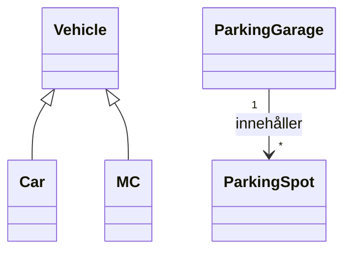
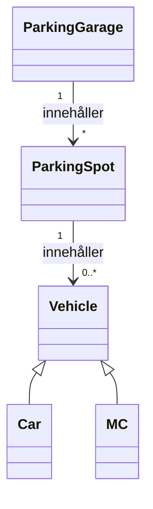

# Prague Parking V2 – Klassdiagram

## Version 0.1 – Grundstruktur



## Klassernas huvudansvar

```text
Vehicle:
Representerar gemensam information och egenskaper som alla fordon behöver,
exempelvis unik identifierare och ankomsttid.

Car:
Representerar ett fordon av typen bil och ärver den gemensamma fordonsinformationen från Vehicle.

MC:
Representerar ett fordon av typen MC och ärver den gemensamma fordonsinformationen från Vehicle.

ParkingSpot:
Representerar en fysisk parkeringsplats och ansvarar för sitt platsnummer
samt vilka fordon som är parkerade på platsen.

ParkingGarage:
Representerar hela parkeringshuset och ansvarar för samlingen av ParkingSpot
samt för operationer som kräver kunskap om flera parkeringsplatser.
```

## Version 0.2 – Skiss

```text
Vehicle
----------------
Identifier
ArrivalTime
      ▲
      │
 ┌────┴────┐
Car        MC


ParkingGarage
----------------
ParkingSpots
      │
      │ 1..*
      ▼
ParkingSpot
----------------
SpotNumber
ParkedVehicles
```

## Version 0.3 – ParkingSpot

```text
ParkingSpot
----------------
SpotNumber
ParkedVehicles
```

> Kapacitetsregler lagras inte som hårdkodade värden i `ParkingSpot`.  
> På G-nivå hämtas de från konfigurationens `VehiclesPerSpot`.  
> I VG ersätts detta med den generella storleksmodellen.

## Version 0.4 – ParkingGarage

```text
ParkingGarage
----------------
ParkingSpots
```

## Version 0.5 – Relationer



## Version 0.6 – ParkingSpot beteenden

```text
ParkingSpot
----------------
SpotNumber
ParkedVehicles
----------------
CanPark(vehicle)
AddVehicle(vehicle)
RemoveVehicle(vehicle)
```

> `ParkingSpot` ansvarar endast för sin egen beläggning.  
> Sökning mellan flera parkeringsplatser hanteras av `ParkingGarage`.

## Version 0.7 – ParkingGarage beteenden

```text
ParkingGarage
----------------
ParkingSpots
----------------
FindAvailableSpot(vehicle)
FindVehicle(identifier)
ParkVehicle(vehicle)
RemoveVehicle(identifier)
MoveVehicle(identifier, targetSpotNumber)
```

> `ParkingGarage` ansvarar för operationer som kräver kunskap om flera parkeringsplatser.  
> Regler för om ett fordon får plats på en specifik plats hanteras av `ParkingSpot`.

## Version 0.8 – Implementerade beteenden

```text
Vehicle
----------------
Identifier
ArrivalTime

Car : Vehicle
MC  : Vehicle


ParkingSpot
----------------
SpotNumber
_parkedVehicles
----------------
CanPark(vehicle, maxVehiclesPerSpot)
ParkVehicle(vehicle, maxVehiclesPerSpot)


ParkingGarage
----------------
ParkingSpots
----------------
ParkingGarage(numberOfParkingSpots) 
