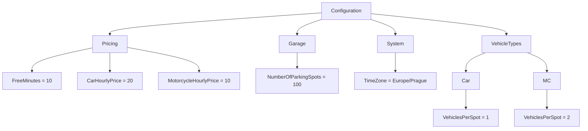

# Prague Parking V2 – Konfiguration

## Konfigurationsstruktur



## Exempel på `config.json`

```json
{
  "Pricing": {
    "FreeMinutes": 10,
    "CarHourlyPrice": 20,
    "MotorcycleHourlyPrice": 10
  },
  "Garage": {
    "NumberOfParkingSpots": 100
  },
  "System": {
    "TimeZone": "Europe/Prague"
  },
  "VehicleTypes": {
    "Car": {
      "VehiclesPerSpot": 1
    },
    "MC": {
      "VehiclesPerSpot": 2
    }
  }
}
```

## Syfte

`config.json` innehåller inställningar som styr hur applikationen fungerar och
som ska kunna ändras utan att programkoden behöver modifieras eller kompileras om.

Konfigurationen innehåller bland annat:

- priser
- gratis parkeringstid
- antal parkeringsplatser
- tidszon
- fordonsrelaterade kapacitetsregler

Priser och andra administrerbara värden placeras i konfigurationen för att
undvika hårdkodade inställningar i domänlogiken.

## Inläsning av konfiguration

Konfigurationen läses in vid programstart genom `ConfigurationService`.

Den inlästa konfigurationen valideras innan värdena används för att skapa
och konfigurera övriga delar av applikationen.

Exempel på värden som valideras:

- antal parkeringsplatser
- Car-pris
- MC-pris
- antal gratisminuter
- tidszon
- `VehiclesPerSpot` för respektive fordonstyp

En befintlig men ogiltig konfigurationsfil skrivs inte över automatiskt.
Programmet ska i stället stoppa uppstarten kontrollerat och presentera ett
felmeddelande.

Om runtime-versionen av `config.json` saknas kan den återskapas med
systemets standardvärden.

## Prisregler vid körning

Prisinställningarna läses från `config.json` vid programstart.

De aktiva värdena för:

- `CarHourlyPrice`
- `MotorcycleHourlyPrice`
- `FreeMinutes`

överförs till `ParkingFeeCalculator`.

`ParkingFeeCalculator` lagrar de aktiva prisreglerna i minnet och använder
dem vid beräkning av parkeringsavgifter.

Det innebär att `config.json` inte behöver läsas från disk vid varje
prisberäkning.

Prisberäkningen använder aktuell fordonstyp för att välja rätt timpris:

```text
Car
    ↓
CarHourlyPrice

MC
    ↓
MotorcycleHourlyPrice
```

Gratisgränsen används gemensamt för de fordonstyper som stöds i
Prague Parking 2.0.

## Uppdatering av prisregler

`ParkingFeeCalculator` innehåller `UpdatePricing()` för kontrollerad
uppdatering av aktiva prisregler.

Vid en framtida omläsning av prislistan ska flödet följa principen:

```text
config.json
    ↓
läs nya värden
    ↓
validera samtliga värden
    ↓
giltiga?
    ├── Ja  → ersätt aktiva prisregler
    └── Nej → behåll tidigare giltiga prisregler
```

Alla nya prisvärden ska alltså valideras innan något av de aktiva värdena
ersätts.

Detta minskar risken för att applikationen hamnar i ett delvis uppdaterat
eller ogiltigt tillstånd.

Den menybaserade omläsningen av prislistan är ännu inte implementerad.

## Tidszon

`System.TimeZone` anger vilken tidszon som ska användas när tider presenteras
för användaren.

Ankomsttider lagras internt i UTC och kan senare konverteras till den
konfigurerade tidszonen vid presentation.

Standardvärdet är:

```text
Europe/Prague
```

`ParkingFeeCalculator` arbetar med UTC-baserade tider för att beräkningen
mellan `ArrivalTime` och `departureTime` ska vara entydig.

## Konfiguration och parkeringsdata

Konfiguration och parkeringsdata har olika ansvar.

```text
config.json
    ↓
Hur systemet ska fungera

parking-data.json
    ↓
Vilka fordon som faktiskt är parkerade
```

`config.json` ska därför inte innehålla det aktuella tillståndet i
parkeringshuset.

Parkerade fordon kommer i stället att sparas separat i
`parking-data.json`.

Prisregler och gratisgränser sparas inte i `parking-data.json` utan hämtas
från `config.json`.

## Kapacitetsmodell i Prague Parking 2.0

På G-nivå används `VehiclesPerSpot`.

Exempel:

```text
Car → 1 fordon per plats
MC  → 2 fordon per plats
```

Dessa värden hämtas från konfigurationen och skickas till parkeringslogiken
vid behov.

Kapacitetsvärdena ska därför inte hårdkodas i `ParkingSpot`.

> Den generella storleksmodellen med storleksenheter för Bicycle, MC, Car
> och Bus införs först i Prague Parking 2.1/VG.