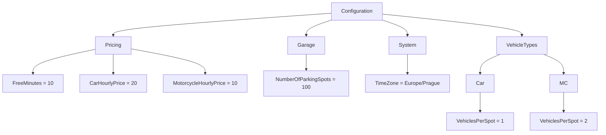

# Prague Parking V2 – Konfiguration

**Uppdaterad:** 2026-10-15  
**Omfattning:** Konfiguration för Prague Parking 2.0 (G), med avgränsningar inför Prague Parking 2.1 (VG).

## Konfigurationsstruktur



Diagrammet beskriver **standardkonfigurationen för G-versionen**. Värdet `NumberOfParkingSpots = 100` är ett exempelvärde, inte ett fast antal platser i programkoden. Fordonstyperna `Bicycle` och `Bus` ingår ännu inte.

## Exempel på `config.json`

```json
{
  "Pricing": {
    "FreeMinutes": 10,
    "CarHourlyPrice": 20,
    "MotorcycleHourlyPrice": 10
  },
  "Garage": {
    "NumberOfParkingSpots": 100
  },
  "System": {
    "TimeZone": "Europe/Prague"
  },
  "VehicleTypes": {
    "Car": {
      "VehiclesPerSpot": 1
    },
    "MC": {
      "VehiclesPerSpot": 2
    }
  }
}
```

Exemplet visar standardvärden, inte nödvändigtvis de värden som användes vid det senaste manuella testet.

## Syfte

`config.json` innehåller inställningar som styr hur applikationen fungerar och
som ska kunna ändras utan att programkoden behöver modifieras eller kompileras om.

Konfigurationen innehåller bland annat:

- priser
- gratis parkeringstid
- antal parkeringsplatser
- tidszon
- fordonsrelaterade kapacitetsregler

Priser och andra administrerbara värden placeras i konfigurationen för att
undvika hårdkodade inställningar i domänlogiken.

Att redigera en konfigurationsfil innebär inte automatiskt att ett redan
startat program använder de nya värdena. För G-versionen återstår ett menyval
för omläsning av prislistan under körning.

## Inläsning av konfiguration

Konfigurationen läses in vid programstart genom `ConfigurationService` i
det separata projektet `PragueParkingV2.Data`.

Projektets ursprungliga konfigurationsfil finns under
`PragueParkingV2/Config/config.json` och kopieras till körmiljön. Under körning
används `Config/config.json` relativt `AppContext.BaseDirectory`.

**Skillnad mellan projektfil och runtime-fil:** Vid test med 200 platser upptäcktes
att en ändring av projektets `Config/config.json` inte nödvändigtvis motsvarade
innehållet i den redan existerande kopian under `bin/Debug/net10.0/Config/`.
Kontrollera därför vilken fil som faktiskt läses vid körning. Ändringar av
antalet parkeringsplatser behöver därefter läsas in vid en ny programstart.

Den inlästa konfigurationen valideras innan värdena används för att skapa
och konfigurera övriga delar av applikationen.

Exempel på värden som valideras:

- antal parkeringsplatser
- Car-pris
- MC-pris
- antal gratisminuter
- tidszon
- `VehiclesPerSpot` för respektive fordonstyp

En befintlig men ogiltig konfigurationsfil skrivs inte över automatiskt.
Programmet stoppar i stället uppstarten kontrollerat och presenterar ett
felmeddelande via `MessageService`.

Om runtime-versionen av `config.json` saknas kan `ConfigurationService`
återskapa den med systemets standardvärden. Detta gäller körmiljön och ska
inte förväxlas med projektets ursprungliga fil.

## Antal parkeringsplatser och Garage Overview

`Garage.NumberOfParkingSpots` avgör hur många `ParkingSpot`-objekt
`ParkingGarage` skapar vid uppstart. Antalet platser är inte låst till
100 i domänmodellen eller i garageöversiktens kolumnberäkning.

Under utvecklingen den **13 oktober 2026** visades **200 konfigurerade
parkeringsplatser (001–200)** samtidigt i ett tillräckligt stort
terminalfönster. Det verifierades visuellt, men är inte ett fullständigt
automatiserat test av samtliga terminalstorlekar och garagekapaciteter.

`GarageOverView` använder ett kompakt Spectre.Console-`Grid` i en panel
för parkeringskartan. Antalet kolumner och den synliga ytan beräknas med
hänsyn till terminalens bredd och höjd; parkeringskartan prioriteras med
ungefär **80 % av bredden** och detaljpanelen med ungefär **20 %**,
med en minsta läsbar bredd för detaljerna.

När fler parkeringsplatser finns än terminalen kan visa samtidigt
används en intern visningsyta (viewport) för kartan. Tanken är att
undvika oönskad scrollning av hela terminalen och låta piltangenterna
flytta markeringen. Den aktuella implementationen kräver ett
terminalfönster på minst **80 kolumner och 18 rader** för att visa
översikten; annars visas en uppmaning om att förstora fönstret.

**Teststatus 2026-10-15:** Den 13 oktober kontrollerades 200 lediga platser. Den 14 oktober visades två fulla bilplatser och korrekt beläggningsstatistik. Den 15 oktober kontrollerades också en bil på plats 050 och två motorcyklar på plats 003: `FREE 198`, `OCCUPIED 2`, `VEHICLES 3`. `SPOT DETAILS` visade båda motorcyklarna och beläggning `2/2`. Navigeringsgränser, olika terminalstorlekar, 500–1 000 platser samt återställning av två MC på samma plats **efter omstart** behöver fortfarande verifieras.

## Prisregler vid körning

Prisinställningarna läses från `config.json` vid programstart.

De aktiva värdena för:

- `CarHourlyPrice`
- `MotorcycleHourlyPrice`
- `FreeMinutes`

överförs till `ParkingFeeCalculator`.

`ParkingFeeCalculator` lagrar de aktiva prisreglerna i minnet och använder
dem vid beräkning av parkeringsavgifter.

Det innebär att `config.json` inte behöver läsas från disk vid varje
prisberäkning. **Check Out Vehicle** använder konfigurerade priser och gratisminuter vid beräkningen av avgiften; ett komplett normalt utcheckningsflöde med JSON-sparning har testats manuellt den 15 oktober. **Menybaserad omläsning av prislistan är fortfarande inte implementerad**.

Prisberäkningen använder aktuell fordonstyp för att välja rätt timpris:

```text
Car
    ↓
CarHourlyPrice = 20 CZK

MC
    ↓
MotorcycleHourlyPrice = 10 CZK
```

Avgiften beräknas per påbörjad timme. Parkering **kortare än 10 minuter** är
gratis enligt grundregeln; därefter tillämpas timpriset för respektive
fordonstyp.

Gratisgränsen används gemensamt för de fordonstyper som stöds i
Prague Parking 2.0.

## Uppdatering av prisregler

`ParkingFeeCalculator` innehåller `UpdatePricing()` för kontrollerad
uppdatering av aktiva prisregler. Metoden är implementerad och har testats
i domänlogiken.

Vid den planerade menybaserade omläsningen av prislistan ska flödet följa
principen:

```text
config.json
    ↓
läs nya prisvärden
    ↓
validera samtliga prisvärden
    ↓
giltiga?
    ├── Ja  → ersätt aktiva prisregler
    └── Nej → behåll tidigare giltiga prisregler
```

Alla nya prisvärden ska valideras innan något av de aktiva värdena
ersätts.

Detta minskar risken för att applikationen hamnar i ett delvis uppdaterat
eller ogiltigt tillstånd.

**Status:** `UpdatePricing()` finns, men den menybaserade omläsningen av
prislistan är ännu inte implementerad. Att läsa om **hela** konfigurationen
under körning är en separat utökning i Prague Parking 2.1 (VG).

## Tidszon

`System.TimeZone` anger vilken tidszon som ska användas när tider presenteras
för användaren.

Ankomsttider lagras internt i UTC och konverteras till den konfigurerade
tidszonen vid presentation, bland annat i `GarageOverView`.

Standardvärdet är:

```text
Europe/Prague
```

`ParkingFeeCalculator` arbetar med UTC-baserade tider för att beräkningen
mellan `ArrivalTime` och `departureTime` ska vara entydig, även vid byte
mellan sommar- och vintertid.

Tidszonen påverkar alltså hur klockslag **visas**, inte den sparade
ankomsttidens ursprungliga UTC-värde.

## Konfiguration och parkeringsdata

Konfiguration och parkeringsdata har olika ansvar.

```text
config.json
    ↓
Hur systemet ska fungera

parking-data.json
    ↓
Vilka fordon som faktiskt är parkerade
```

`config.json` ska därför inte innehålla det aktuella tillståndet i
parkeringshuset.

Parkerade fordon ska i stället sparas separat i `parking-data.json`,
enligt det redan dokumenterade formatet i `docs/parking-data.md`:

```text
ParkingSpots
    └── SpotNumber
         └── Vehicles
              ├── Identifier
              ├── VehicleType
              └── ArrivalTime
```

Endast upptagna parkeringsplatser ska skrivas till datafilen. Tomma platser återskapas nu från konfigurationen vid programstart genom `ParkingDataMapper.ToGarage()`.

Prisregler och gratisgränser sparas inte i `parking-data.json`, utan hämtas
från `config.json`. `ArrivalTime` i parkeringsdata ska bevaras i UTC så att
parkeringstiden förblir korrekt efter omstart.

**Status 2026-10-15:** `ParkingDataMapper.ToGarage()` skapar det konfigurerade antalet platser och återställer sparade fordon till angivet platsnummer med rätt ankomsttid. Platsnummer utanför garagets storlek och otillåten beläggning avvisas via domänregler vid återställning, men negativa tester av dessa fall återstår. Normala flöden för **incheckning, utcheckning och flytt** är nu kopplade till JSON-sparning och har testats manuellt. En bil flyttades från plats 001 till 050, och placeringen fanns kvar efter omstart. Standardvärdet för en ny konfiguration är fortfarande **100** platser; de aktuella UI-testerna använder **200** genom konfigurationen. Återställning av två MC på samma plats **efter omstart**, framprovocerade skrivfel och fullständig kompensation/filersättningssäkerhet är ännu inte verifierade.

## Kapacitetsmodell i Prague Parking 2.0

På G-nivå används `VehiclesPerSpot`.

Exempel:

```text
Car → 1 fordon per plats
MC  → 2 fordon per plats
```

Dessa värden hämtas från konfigurationen och skickas till parkeringslogiken
vid behov, exempelvis till `ParkingGarage.ParkVehicle()` och
`ParkingSpot.CanPark()`.

Kapacitetsvärdena ska därför inte hårdkodas i `ParkingSpot`.

`ParkingSpot` ansvarar fortfarande för att kontrollera om ett fordon får
parkeras på platsen. Olika fordonstyper får inte blandas på samma plats i
den nuvarande G-modellen.

**Verifiering 2026-10-15:** `MoveVehicleView` avgör om det befintliga objektet är `Car` eller `MC` och hämtar motsvarande `VehiclesPerSpot` från `configuration.VehicleTypes`. Innan användaren får bekräfta en flytt kontrolleras destinationsplatsen via `ParkingSpot.CanPark()`. Tester visar att en MC kan flyttas till en plats med en annan MC (två totalt), medan flytt av MC till en bilupptagen plats nekas. Detta är verifierade kapacitetsregler, inte stöd för VG-versionens storleksenheter.

> Den generella storleksmodellen med storleksenheter för Bicycle, MC, Car
> och Bus införs först i Prague Parking 2.1 (VG).

## Avgränsning inför Prague Parking 2.1 (VG)

I VG-versionen ska konfigurationen kunna utökas med fler fordonstyper,
priser och kapacitetsregler, utan att G-versionens nuvarande
konfigurationsformat ändras i förtid.

Den planerade storleksmodellen är:

```text
Bicycle = 1 storleksenhet
MC      = 2 storleksenheter
Car     = 4 storleksenheter
Bus     = 16 storleksenheter

Normal parkeringsplats = 4 storleksenheter
```

De planerade timpriserna för de nya fordonstyperna är 5 CZK för `Bicycle`
och 80 CZK för `Bus`, enligt VG-kraven. Dessa värden ingår **inte** i
ovanstående `config.json` för G-versionen.

En buss behöver fyra sammanhängande parkeringsplatser. Vid **nyparkering**
ska dessa hittas inom de första 50 platserna. En redan parkerad buss ska
kunna **flyttas** till fyra sammanhängande lediga platser även längre ner
i parkeringshuset. Den skillnaden måste respekteras när placeringsreglerna
senare implementeras.

VG-versionen ska också kunna läsa om hela konfigurationen under körning.
En omläsning måste valideras mot det aktuella garagetillståndet innan nya
regler aktiveras, så att redan parkerade fordon inte hamnar i ett ogiltigt
tillstånd.

Dessa VG-funktioner är **planerade, inte implementerade**. De dokumenteras
här för att den befintliga arkitekturen ska kunna vidareutvecklas utan
onödiga format- eller strukturbyten.
