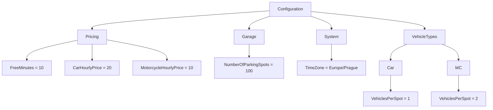

# Prague Parking V2 – Konfiguration

**Uppdaterad:** 2026-10-21  
**Omfattning:** Gemensam dokumentation för Prague Parking 2.0 (G) och Prague Parking 2.1 (VG). Konfiguration och kördata hålls åtskilda mellan versionernas projekt.

**Aktuellt läge 2026-10-21:** G-versionens konfiguration och menybaserade **Reload Pricing** är manuellt testade. V2.1 har en separat konfigurationsmall, storleksbaserad kapacitet, priser för fyra fordonstyper och menyvalet **Reload Configuration**. Full omläsning har testats med ändrat antal parkeringsplatser och avvisning av en otillåten kapacitetsändring. Fler negativa tester och granskning av äldre `VehiclesPerSpot`-referenser återstår.

> **Läsanvisning:** Fram till avsnittet **”Prague Parking 2.1 (VG) – Ny konfigurationsmodell”** dokumenteras den **befintliga G-versionen** och dess tester. G-konfigurationens JSON-exempel ska inte användas för att ersätta V2.1:s konfiguration.

**Historisk status från tidigare steg 2026-10-21 (se aktuell status nedan):** V2.1 använder nu en **separat `config.template.json` som mall**. `ConfigurationService` kopierar mallen till aktiv runtime-`config.json` vid saknad fil, men bevarar/validerar befintliga inställningar. Konfigurationsklasser och validering är kompletterade för Bicycle, Bus, `SpotCapacity` och `BusMaxParkingSpot`. V2.1 har startat med den nya mallen. **Fullständig omläsning under körning och färdig prisberäkning för Bicycle/Bus återstår.** Anteckningar med status 2026-10-20 nedan beskriver tidigare läge.

## Prague Parking 2.0 (G) – Konfigurationsstruktur



Diagrammet beskriver **standardkonfigurationen för G-versionen**. `NumberOfParkingSpots = 100` är det faktiska standardvärdet, men inte ett fast antal platser i programkoden: administratören kan ändra det via konfigurationen. Fordonstyperna `Bicycle` och `Bus` ingår ännu inte.

## G – Exempel på `config.json`

```json
{
  "Pricing": {
    "FreeMinutes": 10,
    "CarHourlyPrice": 20,
    "MotorcycleHourlyPrice": 10
  },
  "Garage": {
    "NumberOfParkingSpots": 100
  },
  "System": {
    "TimeZone": "Europe/Prague"
  },
  "VehicleTypes": {
    "Car": {
      "VehiclesPerSpot": 1
    },
    "MC": {
      "VehiclesPerSpot": 2
    }
  }
}
```

Exemplet visar standardvärden, inte nödvändigtvis de värden som användes vid det senaste manuella testet.

## Syfte

`config.json` innehåller inställningar som styr hur applikationen fungerar och
som ska kunna ändras utan att programkoden behöver modifieras eller kompileras om.

Konfigurationen innehåller bland annat:

- priser
- gratis parkeringstid
- antal parkeringsplatser
- tidszon
- fordonsrelaterade kapacitetsregler

Priser och andra administrerbara värden placeras i konfigurationen för att
undvika hårdkodade inställningar i domänlogiken.

Att redigera en konfigurationsfil innebär inte automatiskt att ett redan
startat program använder de nya värdena. **I G-versionen finns nu ett menyval
för omläsning av prislistan under körning**, men övriga inställningar, till
exempel garagekapaciteten, kräver fortfarande omstart. Omläsning av hela
konfigurationen tillhör VG-versionen.

## Inläsning av konfiguration

Konfigurationen läses in vid programstart genom `ConfigurationService` i
det separata projektet `PragueParkingV2.Data`.

Projektets ursprungliga konfigurationsfil finns under
`PragueParkingV2/Config/config.json` och kopieras till körmiljön. Under körning
används `Config/config.json` relativt `AppContext.BaseDirectory`.

**Skillnad mellan projektfil och runtime-fil:** Vid test med 200 platser upptäcktes
att en ändring av projektets `Config/config.json` inte nödvändigtvis motsvarade
innehållet i den redan existerande kopian under `bin/Debug/net10.0/Config/`.
Den körande applikationen använder **runtime-filen**. Om en ny garagekapacitet
ska testas måste rätt fil ändras och applikationen startas om.

**Test 2026-10-16:** Runtime-konfigurationen användes för att växla från 200
till 1 000 och därefter till standardvärdet 100 platser. Befintliga fordon
på platserna 003 och 051 behöll sina placeringar efter omstart. Detta visar
att garagets storlek kan ändras när sparade platsnummer fortfarande är
giltiga inom den nya kapaciteten.

Den inlästa konfigurationen valideras innan värdena används för att skapa
och konfigurera övriga delar av applikationen.

Exempel på värden som valideras:

- antal parkeringsplatser
- Car-pris
- MC-pris
- antal gratisminuter
- tidszon
- `VehiclesPerSpot` för respektive fordonstyp

En befintlig men ogiltig konfigurationsfil skrivs inte över automatiskt.
Programmet stoppar i stället uppstarten kontrollerat och presenterar ett
felmeddelande via `MessageService`.

Om runtime-versionen av `config.json` saknas kan `ConfigurationService`
återskapa den med systemets standardvärden. Detta gäller körmiljön och ska
inte förväxlas med projektets ursprungliga fil.

## Antal parkeringsplatser och Garage Overview

`Garage.NumberOfParkingSpots` avgör hur många `ParkingSpot`-objekt
`ParkingGarage` skapar vid uppstart. Antalet platser är inte låst till
100 i domänmodellen eller i garageöversiktens kolumnberäkning.

Under utvecklingen den **13 oktober 2026** visades **200 konfigurerade
parkeringsplatser (001–200)** samtidigt i ett tillräckligt stort
terminalfönster. Det verifierades visuellt, men är inte ett fullständigt
automatiserat test av samtliga terminalstorlekar och garagekapaciteter.

`GarageOverView` använder ett kompakt Spectre.Console-`Grid` i en panel
för parkeringskartan. Antalet kolumner och den synliga ytan beräknas med
hänsyn till terminalens bredd och höjd; parkeringskartan prioriteras med
ungefär **80 % av bredden** och detaljpanelen med ungefär **20 %**,
med en minsta läsbar bredd för detaljerna.

När fler parkeringsplatser finns än terminalen kan visa samtidigt
används en intern visningsyta (viewport) för kartan. Tanken är att
undvika oönskad scrollning av hela terminalen och låta piltangenterna
flytta markeringen. Den aktuella implementationen kräver ett
terminalfönster på minst **80 kolumner och 18 rader** för att visa
översikten; annars visas en uppmaning om att förstora fönstret.

**Teststatus 2026-10-16:** Tidigare testades 200 platser med en bil och två MC på samma plats. Två MC på plats 003 har därefter återställts korrekt efter omstart, med oförändrade identifierare och UTC-ankomsttider. En bil står efter en sparad flytt på plats 051.

- **200 platser:** `FREE 198`, `OCCUPIED 2`, `VEHICLES 3`.
- **1 000 platser:** `FREE 998`, `OCCUPIED 2`, `VEHICLES 3`. Den interna viewporten visade först intervallet 001–234 och senare 768–1000. Navigering till plats 1000, stopp vid den övre platsgränsen och återgång mot början har testats.
- **100 platser:** `FREE 98`, `OCCUPIED 2`, `VEHICLES 3`. Standardkapaciteten återställdes utan att fordonen på 003 och 051 försvann.

**Fortfarande öppet:** Anpassning till flera små terminalstorlekar och ändring av fönsterstorlek medan översikten är öppen är inte fullständigt verifierade. Testerna ovan visar visuell funktion, inte automatiserade tester för alla terminalmiljöer.

## Prisregler vid körning

Prisinställningarna läses från `config.json` vid programstart.

De aktiva värdena för:

- `CarHourlyPrice`
- `MotorcycleHourlyPrice`
- `FreeMinutes`

överförs till `ParkingFeeCalculator`.

`ParkingFeeCalculator` lagrar de aktiva prisreglerna i minnet och använder
dem vid beräkning av parkeringsavgifter.

Det innebär att `config.json` inte behöver läsas från disk vid varje
prisberäkning. **Check Out Vehicle** använder konfigurerade priser och gratisminuter vid beräkningen av avgiften; ett normalt utcheckningsflöde med JSON-sparning testades den 15 oktober.

**Administrationsmenyn har nu en fungerande Reload Pricing-funktion.**
`AdministrationView` anropar `ConfigurationService.LoadPricing()` och uppdaterar
den **befintliga, gemensamma** `ParkingFeeCalculator` via `UpdatePricing()`.
Ny prissättning gäller alltså även vid utcheckning i samma programkörning,
utan att garaget behöver skapas om.

Prisberäkningen använder aktuell fordonstyp för att välja rätt timpris:

```text
Car
    ↓
CarHourlyPrice = 20 CZK

MC
    ↓
MotorcycleHourlyPrice = 10 CZK
```

Avgiften beräknas per påbörjad timme. Den nuvarande implementationen ger
gratis parkering vid en tid **kortare än 10 minuter** (`duration.TotalMinutes <
FreeMinutes`); därefter tillämpas timpriset för respektive fordonstyp.
Gratisgränsen används gemensamt för de fordonstyper som stöds i
Prague Parking 2.0.

**Kravtolkning att stämma av:** Uppgiftstexten har både formuleringen
*högst tio minuter* och *mindre än tio minuter*. Den nu implementerade och
testade gränsen följer *mindre än tio minuter*. Exakt 10:00 är därmed inte
gratis enligt nuvarande kod. Regeln ändras inte utan ett uttryckligt beslut.

## Uppdatering av prisregler

`ParkingFeeCalculator` innehåller `UpdatePricing()` för kontrollerad
uppdatering av aktiva prisregler. Funktionen är nu även **integrerad med
Administration-vyn** och manuellt verifierad utan programomstart.

Det implementerade omläsningsflödet följer principen:

```text
config.json
    ↓
läs nya prisvärden
    ↓
validera samtliga prisvärden
    ↓
giltiga?
    ├── Ja  → ersätt aktiva prisregler
    └── Nej → behåll tidigare giltiga prisregler
```

Alla nya prisvärden ska valideras innan något av de aktiva värdena
ersätts.

Detta minskar risken för att applikationen hamnar i ett delvis uppdaterat
eller ogiltigt tillstånd.

**Verifiering 2026-10-16:** Bilpriset ändrades i runtime-`config.json` från
20 till **30 CZK/timme** och aktiverades genom **Administration → Reload Pricing**
utan omstart. Utcheckningens förhandsvisning använde det nya priset: 20 timmar
20 minuter beräknades till 21 påbörjade timmar × 30 CZK = **630 CZK**.
Ett försök att läsa in **−10 CZK/timme** avvisades med felmeddelande; det
tidigare giltiga priset **30 CZK/timme** användes fortsatt. Därefter
återställdes bilpriset till **20 CZK/timme**.

**Avgränsning:** G-versionens meny läser endast om **prissättningen** (inklusive
gratisminuter). Garageantal, tidszon och fordonskapaciteter läses inte om
under körning. Att läsa om **hela** konfigurationen och pröva den mot
befintliga fordon är ett separat VG-krav.

## Tidszon

`System.TimeZone` anger vilken tidszon som ska användas när tider presenteras
för användaren.

Ankomsttider lagras internt i UTC och konverteras till den konfigurerade
tidszonen vid presentation, bland annat i `GarageOverView`.

Standardvärdet är:

```text
Europe/Prague
```

`ParkingFeeCalculator` arbetar med UTC-baserade tider för att beräkningen
mellan `ArrivalTime` och `departureTime` ska vara entydig, även vid byte
mellan sommar- och vintertid.

Tidszonen påverkar alltså hur klockslag **visas**, inte den sparade
ankomsttidens ursprungliga UTC-värde.

## Konfiguration och parkeringsdata

Konfiguration och parkeringsdata har olika ansvar.

```text
config.json
    ↓
Hur systemet ska fungera

parking-data.json
    ↓
Vilka fordon som faktiskt är parkerade
```

`config.json` ska därför inte innehålla det aktuella tillståndet i
parkeringshuset.

Parkerade fordon ska i stället sparas separat i `parking-data.json`,
enligt det redan dokumenterade formatet i `docs/parking-data.md`:

```text
ParkingSpots
    └── SpotNumber
         └── Vehicles
              ├── Identifier
              ├── VehicleType
              └── ArrivalTime
```

Endast upptagna parkeringsplatser ska skrivas till datafilen. Tomma platser återskapas nu från konfigurationen vid programstart genom `ParkingDataMapper.ToGarage()`.

Prisregler och gratisgränser sparas inte i `parking-data.json`, utan hämtas
från `config.json`. `ArrivalTime` i parkeringsdata ska bevaras i UTC så att
parkeringstiden förblir korrekt efter omstart.

**Status 2026-10-16:** `ParkingDataMapper.ToGarage()` skapar det konfigurerade antalet platser och återställer fordon med ursprungligt platsnummer och UTC-ankomsttid. Återställning med **två MC på plats 003** har verifierats efter omstart. Bilen `ABC123` flyttades i ett separat lyckat test från 050 till **051**, och den nya placeringen fanns kvar efter omstart. När garaget ändrades från 1 000 till 100 platser kvarstod dessa tre fordon.

**Negativa tester:** En korrupt JSON-fil avvisades utan att skrivas över. Inläsning av dubbletter (`ABC123`/`abc123`), platsnummer 201 i ett garage med 200 platser, tre MC på en två-MC-plats och blandad Car/MC-beläggning på samma plats gav kontrollerade fel. Framprovocerad skrivvägran via en katalog med namnet `parking-data.json.tmp` testade kompensationen efter Park, Check Out och Move; programmet gav fel och återställde det observerade garagetillståndet i minnet. Dessa tester bevisar **inte** fullständig atomisk filhantering eller kraschåterhämtning. Mer detaljer finns i `parking-data.md`.

## Kapacitetsmodell i Prague Parking 2.0

På G-nivå används `VehiclesPerSpot`.

Exempel:

```text
Car → 1 fordon per plats
MC  → 2 fordon per plats
```

Dessa värden hämtas från konfigurationen och skickas till parkeringslogiken
vid behov, exempelvis till `ParkingGarage.ParkVehicle()` och
`ParkingSpot.CanPark()`.

Kapacitetsvärdena ska därför inte hårdkodas i `ParkingSpot`.

`ParkingSpot` ansvarar fortfarande för att kontrollera om ett fordon får
parkeras på platsen. Olika fordonstyper får inte blandas på samma plats i
den nuvarande G-modellen.

**Verifiering till och med 2026-10-16:** `MoveVehicleView` avgör om det befintliga objektet är `Car` eller `MC` och hämtar motsvarande `VehiclesPerSpot` från `configuration.VehicleTypes`. Innan användaren får bekräfta en flytt kontrolleras destinationsplatsen via `ParkingSpot.CanPark()`. En MC har kunnat flyttas till en plats med en annan MC (två totalt), medan MC på en bilupptagen plats har nekats. Dessutom har en sparad fil med tre MC på samma två-MC-plats avvisats vid uppstart, liksom en fil som blandar Car och MC på samma plats. Dessa är G-regler; de utgör inte stöd för VG-versionens storleksenheter.

> Den generella storleksmodellen med storleksenheter för Bicycle, MC, Car
> och Bus införs först i Prague Parking 2.1 (VG).

## V2.1 – aktuell driftkonfiguration och Reload Configuration (2026-10-21)

Den tidigare texten som säger att fullständig reload saknas avser **tidigare delsteg**, före eftermiddagens implementation och tester. Nu finns en separat funktion **Administration → Reload Configuration** utöver **Reload Pricing**. `MainMenu` levererar en `Action` som läser config, bygger ett nytt garage från `ParkingDataMapper.ToDocument()` / `ToGarage()` och aktiverar garaget samt prisinställningarna först när återuppbyggnaden godkänts.

`ConfigurationService.LoadConfiguration(createIfMissing: true)` används vid normal start. Då kopieras `Config/config.template.json` till `Config/config.json` om den aktiva filen saknas. Vid manuell reload används `createIfMissing: false`: en saknad aktiv fil avvisas utan att ersätta löpande inställningar.

**Aktuell V2.1-standard (mall):**

```json
{
  "Pricing": {
    "FreeMinutes": 10,
    "CarHourlyPrice": 20,
    "MotorcycleHourlyPrice": 10,
    "BicycleHourlyPrice": 5,
    "BusHourlyPrice": 80
  },
  "Garage": {
    "NumberOfParkingSpots": 100,
    "SpotCapacity": 4,
    "BusMaxParkingSpot": 50
  },
  "System": { "TimeZone": "Europe/Prague" },
  "VehicleTypes": {
    "Car": { "Size": 4 },
    "MC": { "Size": 2 },
    "Bicycle": { "Size": 1 },
    "Bus": { "Size": 16 }
  }
}
```

Enligt lärarens förtydligande får bussar endast använda platserna **001–050**, både vid incheckning och vid flytt. Standardfilens `BusMaxParkingSpot=50` följer detta. Att egenskapen är konfigurerbar innebär inte att större värden är godkända i inlämningen.

**Testutfall:** 100→200 platser, därefter navigering i 500 platser, utan omstart och med bevarade fordon. Vid ändring `SpotCapacity=4→2` nekades reload eftersom Car `OEJ989` på 002 inte fick plats. Det gamla garaget användes fortsatt. Vid misslyckad reload ändras inte konfigurationsfilen på disken tillbaka automatiskt: administratören måste återställa giltiga värden innan nästa start. Prisändring via **full** reload, bussens ändrade områdesgräns, tidszonsändring och flera storleksvarianter ska fortfarande testas separat.

`VehicleTypes.Size` gäller de fyra existerande fordonstyperna. Att lägga till ett femte namn i JSON skapar inte en ny C#-klass eller UI-stöd. Den gamla egenskapen `VehiclesPerSpot` finns kvar i den kopierade V2.1-konfigurationsklassen för tillfället; ta inte bort den förrän alla referenser är granskade.

---

### Filer och ansvar

| Sökväg | Funktion |
|---|---|
| `PragueParkingV2_1/Config/config.template.json` | Versionshanterad standardmall i projektet |
| `PragueParkingV2_1/bin/Debug/net10.0/Config/config.template.json` | Mall kopierad av byggsystemet (`None Update`, `PreserveNewest`) |
| `PragueParkingV2_1/bin/Debug/net10.0/Config/config.json` | Aktiv, administrerbar runtime-konfiguration |

`ConfigurationService.GetConfigurationPath()` använder `AppContext.BaseDirectory/Config/config.json`. `GetTemplatePath()` använder motsvarande `config.template.json`. När den aktiva filen saknas kontrolleras mallen och kopieras med `File.Copy(templatePath, path)` **utan overwrite**. Sedan läses JSON in till `AppConfiguration` och valideras. En befintlig ogiltig konfiguration ska fortfarande orsaka ett tydligt uppstartsfel; den ersätts inte automatiskt med standardvärden.

En äldre runtime-`config.json` från G-liknande struktur orsakade `Vehicle type 'Car' must have a size greater than zero`. Den säkerhetskopierades som `config.backup-before-v2.1.json`; den uppdaterade mallen kunde sedan användas. PowerShell bekräftade att mallen fanns i körkatalogen, och programmet startade efteråt.

### Mallens värden

- `Pricing`: `FreeMinutes = 10`, `CarHourlyPrice = 20`, `MotorcycleHourlyPrice = 10`, `BicycleHourlyPrice = 5`, `BusHourlyPrice = 80`.
- `Garage`: `NumberOfParkingSpots = 100`, `SpotCapacity = 4`, `BusMaxParkingSpot = 50`.
- `System.TimeZone = Europe/Prague`.
- `VehicleTypes`: `Car.Size = 4`, `MC.Size = 2`, `Bicycle.Size = 1`, `Bus.Size = 16`.

**Validering på kodnivå:** Required sections, antal platser 1–1 000, positiv `SpotCapacity`, `BusMaxParkingSpot` minst 4 och högst `NumberOfParkingSpots`, icke-negativa priser, tidszon, fyra obligatoriska fordonstyper och positiv `Size` per typ.

**Avgränsning:** Det är fortfarande inte möjligt att få en helt ny fordonsklass i programmet enbart genom en ny JSON-nyckel. `ParkingFeeCalculator` och UI måste också stödja fordonstypen. Full omläsning under körning, inklusive kontroll mot redan parkerade fordon, är implementerad. Förutom verifierade ändringar av antal platser och avvisning av ogiltig kapacitet återstår riktade tester av övriga konfigurationsfält. Storlek för bussens fyra platser kontrolleras för närvarande i `ParkingGarage` som `busSize == spotCapacity * 4`.
