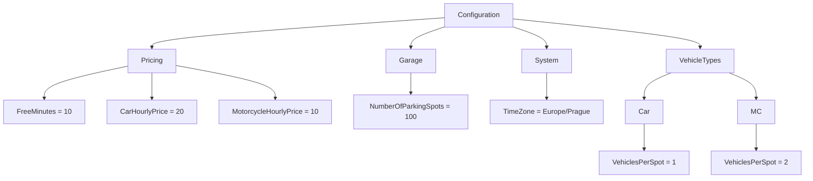

# Prague Parking V2 – Konfiguration

## Konfigurationsstruktur



## Exempel på `config.json`

```json
{
  "Pricing": {
    "FreeMinutes": 10,
    "CarHourlyPrice": 20,
    "MotorcycleHourlyPrice": 10
  },
  "Garage": {
    "NumberOfParkingSpots": 100
  },
  "System": {
    "TimeZone": "Europe/Prague"
  },
  "VehicleTypes": {
    "Car": {
      "VehiclesPerSpot": 1
    },
    "MC": {
      "VehiclesPerSpot": 2
    }
  }
}
```

## Syfte

`config.json` innehåller inställningar som styr hur applikationen fungerar och
som ska kunna ändras utan att programkoden behöver modifieras eller kompileras om.

Konfigurationen innehåller bland annat:

- priser
- gratis parkeringstid
- antal parkeringsplatser
- tidszon
- fordonsrelaterade kapacitetsregler

Priser placeras tydligt i konfigurationen så att de är enkla att hitta och ändra.

## Tidszon

`System.TimeZone` anger vilken tidszon som ska användas när tider presenteras
för användaren.

Ankomsttider lagras internt i UTC och kan senare konverteras till den
konfigurerade tidszonen vid presentation.

Standardvärdet är:

```text
Europe/Prague
```

## Konfiguration och parkeringsdata

Konfiguration och parkeringsdata har olika ansvar.

```text
config.json
    ↓
Hur systemet ska fungera

parking-data.json
    ↓
Vilka fordon som faktiskt är parkerade
```

`config.json` ska därför inte innehålla det aktuella tillståndet i
parkeringshuset.

Parkerade fordon kommer i stället att sparas separat i
`parking-data.json`.

## Kapacitetsmodell i Prague Parking 2.0

På G-nivå används `VehiclesPerSpot`.

Exempel:

```text
Car → 1 fordon per plats
MC  → 2 fordon per plats
```

Dessa värden hämtas från konfigurationen och ska inte hårdkodas i
`ParkingSpot`.

> Den generella storleksmodellen med storleksenheter för Bicycle, MC, Car
> och Bus införs först i Prague Parking 2.1/VG.