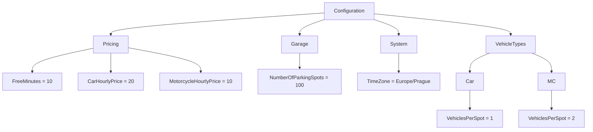

# Prague Parking V2 – Konfiguration

**Uppdaterad:** 2026-10-20  
**Omfattning:** Gemensam dokumentation för Prague Parking 2.0 (G) och Prague Parking 2.1 (VG). Konfiguration och kördata hålls åtskilda mellan versionernas projekt.

**Aktuellt läge:** G-versionens `VehiclesPerSpot`, JSON-validering och menybaserade **Reload Pricing** är implementerade och manuellt testade. V2.1 är skapad i samma solution och migreringen till storleksbaserad kapacitet har **påbörjats**. `Size`, `SpotCapacity` och flera överlagrade parkeringsmetoder finns på kodnivå, men gamla anrop återstår. Fullständig konfigurationsomläsning, stöd för alla nya prisregler och genomgående VG-tester är **inte verifierade**.

> **Läsanvisning:** Fram till avsnittet **”Prague Parking 2.1 (VG) – Ny konfigurationsmodell”** dokumenteras den **befintliga G-versionen** och dess tester. G-konfigurationens JSON-exempel ska inte användas för att ersätta V2.1:s konfiguration.

## Prague Parking 2.0 (G) – Konfigurationsstruktur



Diagrammet beskriver **standardkonfigurationen för G-versionen**. `NumberOfParkingSpots = 100` är det faktiska standardvärdet, men inte ett fast antal platser i programkoden: administratören kan ändra det via konfigurationen. Fordonstyperna `Bicycle` och `Bus` ingår ännu inte.

## G – Exempel på `config.json`

```json
{
  "Pricing": {
    "FreeMinutes": 10,
    "CarHourlyPrice": 20,
    "MotorcycleHourlyPrice": 10
  },
  "Garage": {
    "NumberOfParkingSpots": 100
  },
  "System": {
    "TimeZone": "Europe/Prague"
  },
  "VehicleTypes": {
    "Car": {
      "VehiclesPerSpot": 1
    },
    "MC": {
      "VehiclesPerSpot": 2
    }
  }
}
```

Exemplet visar standardvärden, inte nödvändigtvis de värden som användes vid det senaste manuella testet.

## Syfte

`config.json` innehåller inställningar som styr hur applikationen fungerar och
som ska kunna ändras utan att programkoden behöver modifieras eller kompileras om.

Konfigurationen innehåller bland annat:

- priser
- gratis parkeringstid
- antal parkeringsplatser
- tidszon
- fordonsrelaterade kapacitetsregler

Priser och andra administrerbara värden placeras i konfigurationen för att
undvika hårdkodade inställningar i domänlogiken.

Att redigera en konfigurationsfil innebär inte automatiskt att ett redan
startat program använder de nya värdena. **I G-versionen finns nu ett menyval
för omläsning av prislistan under körning**, men övriga inställningar, till
exempel garagekapaciteten, kräver fortfarande omstart. Omläsning av hela
konfigurationen tillhör VG-versionen.

## Inläsning av konfiguration

Konfigurationen läses in vid programstart genom `ConfigurationService` i
det separata projektet `PragueParkingV2.Data`.

Projektets ursprungliga konfigurationsfil finns under
`PragueParkingV2/Config/config.json` och kopieras till körmiljön. Under körning
används `Config/config.json` relativt `AppContext.BaseDirectory`.

**Skillnad mellan projektfil och runtime-fil:** Vid test med 200 platser upptäcktes
att en ändring av projektets `Config/config.json` inte nödvändigtvis motsvarade
innehållet i den redan existerande kopian under `bin/Debug/net10.0/Config/`.
Den körande applikationen använder **runtime-filen**. Om en ny garagekapacitet
ska testas måste rätt fil ändras och applikationen startas om.

**Test 2026-10-16:** Runtime-konfigurationen användes för att växla från 200
till 1 000 och därefter till standardvärdet 100 platser. Befintliga fordon
på platserna 003 och 051 behöll sina placeringar efter omstart. Detta visar
att garagets storlek kan ändras när sparade platsnummer fortfarande är
giltiga inom den nya kapaciteten.

Den inlästa konfigurationen valideras innan värdena används för att skapa
och konfigurera övriga delar av applikationen.

Exempel på värden som valideras:

- antal parkeringsplatser
- Car-pris
- MC-pris
- antal gratisminuter
- tidszon
- `VehiclesPerSpot` för respektive fordonstyp

En befintlig men ogiltig konfigurationsfil skrivs inte över automatiskt.
Programmet stoppar i stället uppstarten kontrollerat och presenterar ett
felmeddelande via `MessageService`.

Om runtime-versionen av `config.json` saknas kan `ConfigurationService`
återskapa den med systemets standardvärden. Detta gäller körmiljön och ska
inte förväxlas med projektets ursprungliga fil.

## Antal parkeringsplatser och Garage Overview

`Garage.NumberOfParkingSpots` avgör hur många `ParkingSpot`-objekt
`ParkingGarage` skapar vid uppstart. Antalet platser är inte låst till
100 i domänmodellen eller i garageöversiktens kolumnberäkning.

Under utvecklingen den **13 oktober 2026** visades **200 konfigurerade
parkeringsplatser (001–200)** samtidigt i ett tillräckligt stort
terminalfönster. Det verifierades visuellt, men är inte ett fullständigt
automatiserat test av samtliga terminalstorlekar och garagekapaciteter.

`GarageOverView` använder ett kompakt Spectre.Console-`Grid` i en panel
för parkeringskartan. Antalet kolumner och den synliga ytan beräknas med
hänsyn till terminalens bredd och höjd; parkeringskartan prioriteras med
ungefär **80 % av bredden** och detaljpanelen med ungefär **20 %**,
med en minsta läsbar bredd för detaljerna.

När fler parkeringsplatser finns än terminalen kan visa samtidigt
används en intern visningsyta (viewport) för kartan. Tanken är att
undvika oönskad scrollning av hela terminalen och låta piltangenterna
flytta markeringen. Den aktuella implementationen kräver ett
terminalfönster på minst **80 kolumner och 18 rader** för att visa
översikten; annars visas en uppmaning om att förstora fönstret.

**Teststatus 2026-10-16:** Tidigare testades 200 platser med en bil och två MC på samma plats. Två MC på plats 003 har därefter återställts korrekt efter omstart, med oförändrade identifierare och UTC-ankomsttider. En bil står efter en sparad flytt på plats 051.

- **200 platser:** `FREE 198`, `OCCUPIED 2`, `VEHICLES 3`.
- **1 000 platser:** `FREE 998`, `OCCUPIED 2`, `VEHICLES 3`. Den interna viewporten visade först intervallet 001–234 och senare 768–1000. Navigering till plats 1000, stopp vid den övre platsgränsen och återgång mot början har testats.
- **100 platser:** `FREE 98`, `OCCUPIED 2`, `VEHICLES 3`. Standardkapaciteten återställdes utan att fordonen på 003 och 051 försvann.

**Fortfarande öppet:** Anpassning till flera små terminalstorlekar och ändring av fönsterstorlek medan översikten är öppen är inte fullständigt verifierade. Testerna ovan visar visuell funktion, inte automatiserade tester för alla terminalmiljöer.

## Prisregler vid körning

Prisinställningarna läses från `config.json` vid programstart.

De aktiva värdena för:

- `CarHourlyPrice`
- `MotorcycleHourlyPrice`
- `FreeMinutes`

överförs till `ParkingFeeCalculator`.

`ParkingFeeCalculator` lagrar de aktiva prisreglerna i minnet och använder
dem vid beräkning av parkeringsavgifter.

Det innebär att `config.json` inte behöver läsas från disk vid varje
prisberäkning. **Check Out Vehicle** använder konfigurerade priser och gratisminuter vid beräkningen av avgiften; ett normalt utcheckningsflöde med JSON-sparning testades den 15 oktober.

**Administrationsmenyn har nu en fungerande Reload Pricing-funktion.**
`AdministrationView` anropar `ConfigurationService.LoadPricing()` och uppdaterar
den **befintliga, gemensamma** `ParkingFeeCalculator` via `UpdatePricing()`.
Ny prissättning gäller alltså även vid utcheckning i samma programkörning,
utan att garaget behöver skapas om.

Prisberäkningen använder aktuell fordonstyp för att välja rätt timpris:

```text
Car
    ↓
CarHourlyPrice = 20 CZK

MC
    ↓
MotorcycleHourlyPrice = 10 CZK
```

Avgiften beräknas per påbörjad timme. Den nuvarande implementationen ger
gratis parkering vid en tid **kortare än 10 minuter** (`duration.TotalMinutes <
FreeMinutes`); därefter tillämpas timpriset för respektive fordonstyp.
Gratisgränsen används gemensamt för de fordonstyper som stöds i
Prague Parking 2.0.

**Kravtolkning att stämma av:** Uppgiftstexten har både formuleringen
*högst tio minuter* och *mindre än tio minuter*. Den nu implementerade och
testade gränsen följer *mindre än tio minuter*. Exakt 10:00 är därmed inte
gratis enligt nuvarande kod. Regeln ändras inte utan ett uttryckligt beslut.

## Uppdatering av prisregler

`ParkingFeeCalculator` innehåller `UpdatePricing()` för kontrollerad
uppdatering av aktiva prisregler. Funktionen är nu även **integrerad med
Administration-vyn** och manuellt verifierad utan programomstart.

Det implementerade omläsningsflödet följer principen:

```text
config.json
    ↓
läs nya prisvärden
    ↓
validera samtliga prisvärden
    ↓
giltiga?
    ├── Ja  → ersätt aktiva prisregler
    └── Nej → behåll tidigare giltiga prisregler
```

Alla nya prisvärden ska valideras innan något av de aktiva värdena
ersätts.

Detta minskar risken för att applikationen hamnar i ett delvis uppdaterat
eller ogiltigt tillstånd.

**Verifiering 2026-10-16:** Bilpriset ändrades i runtime-`config.json` från
20 till **30 CZK/timme** och aktiverades genom **Administration → Reload Pricing**
utan omstart. Utcheckningens förhandsvisning använde det nya priset: 20 timmar
20 minuter beräknades till 21 påbörjade timmar × 30 CZK = **630 CZK**.
Ett försök att läsa in **−10 CZK/timme** avvisades med felmeddelande; det
tidigare giltiga priset **30 CZK/timme** användes fortsatt. Därefter
återställdes bilpriset till **20 CZK/timme**.

**Avgränsning:** G-versionens meny läser endast om **prissättningen** (inklusive
gratisminuter). Garageantal, tidszon och fordonskapaciteter läses inte om
under körning. Att läsa om **hela** konfigurationen och pröva den mot
befintliga fordon är ett separat VG-krav.

## Tidszon

`System.TimeZone` anger vilken tidszon som ska användas när tider presenteras
för användaren.

Ankomsttider lagras internt i UTC och konverteras till den konfigurerade
tidszonen vid presentation, bland annat i `GarageOverView`.

Standardvärdet är:

```text
Europe/Prague
```

`ParkingFeeCalculator` arbetar med UTC-baserade tider för att beräkningen
mellan `ArrivalTime` och `departureTime` ska vara entydig, även vid byte
mellan sommar- och vintertid.

Tidszonen påverkar alltså hur klockslag **visas**, inte den sparade
ankomsttidens ursprungliga UTC-värde.

## Konfiguration och parkeringsdata

Konfiguration och parkeringsdata har olika ansvar.

```text
config.json
    ↓
Hur systemet ska fungera

parking-data.json
    ↓
Vilka fordon som faktiskt är parkerade
```

`config.json` ska därför inte innehålla det aktuella tillståndet i
parkeringshuset.

Parkerade fordon ska i stället sparas separat i `parking-data.json`,
enligt det redan dokumenterade formatet i `docs/parking-data.md`:

```text
ParkingSpots
    └── SpotNumber
         └── Vehicles
              ├── Identifier
              ├── VehicleType
              └── ArrivalTime
```

Endast upptagna parkeringsplatser ska skrivas till datafilen. Tomma platser återskapas nu från konfigurationen vid programstart genom `ParkingDataMapper.ToGarage()`.

Prisregler och gratisgränser sparas inte i `parking-data.json`, utan hämtas
från `config.json`. `ArrivalTime` i parkeringsdata ska bevaras i UTC så att
parkeringstiden förblir korrekt efter omstart.

**Status 2026-10-16:** `ParkingDataMapper.ToGarage()` skapar det konfigurerade antalet platser och återställer fordon med ursprungligt platsnummer och UTC-ankomsttid. Återställning med **två MC på plats 003** har verifierats efter omstart. Bilen `ABC123` flyttades i ett separat lyckat test från 050 till **051**, och den nya placeringen fanns kvar efter omstart. När garaget ändrades från 1 000 till 100 platser kvarstod dessa tre fordon.

**Negativa tester:** En korrupt JSON-fil avvisades utan att skrivas över. Inläsning av dubbletter (`ABC123`/`abc123`), platsnummer 201 i ett garage med 200 platser, tre MC på en två-MC-plats och blandad Car/MC-beläggning på samma plats gav kontrollerade fel. Framprovocerad skrivvägran via en katalog med namnet `parking-data.json.tmp` testade kompensationen efter Park, Check Out och Move; programmet gav fel och återställde det observerade garagetillståndet i minnet. Dessa tester bevisar **inte** fullständig atomisk filhantering eller kraschåterhämtning. Mer detaljer finns i `parking-data.md`.

## Kapacitetsmodell i Prague Parking 2.0

På G-nivå används `VehiclesPerSpot`.

Exempel:

```text
Car → 1 fordon per plats
MC  → 2 fordon per plats
```

Dessa värden hämtas från konfigurationen och skickas till parkeringslogiken
vid behov, exempelvis till `ParkingGarage.ParkVehicle()` och
`ParkingSpot.CanPark()`.

Kapacitetsvärdena ska därför inte hårdkodas i `ParkingSpot`.

`ParkingSpot` ansvarar fortfarande för att kontrollera om ett fordon får
parkeras på platsen. Olika fordonstyper får inte blandas på samma plats i
den nuvarande G-modellen.

**Verifiering till och med 2026-10-16:** `MoveVehicleView` avgör om det befintliga objektet är `Car` eller `MC` och hämtar motsvarande `VehiclesPerSpot` från `configuration.VehicleTypes`. Innan användaren får bekräfta en flytt kontrolleras destinationsplatsen via `ParkingSpot.CanPark()`. En MC har kunnat flyttas till en plats med en annan MC (två totalt), medan MC på en bilupptagen plats har nekats. Dessutom har en sparad fil med tre MC på samma två-MC-plats avvisats vid uppstart, liksom en fil som blandar Car och MC på samma plats. Dessa är G-regler; de utgör inte stöd för VG-versionens storleksenheter.

> Den generella storleksmodellen med storleksenheter för Bicycle, MC, Car
> och Bus införs först i Prague Parking 2.1 (VG).

## Prague Parking 2.1 (VG) – Ny konfigurationsmodell

**Status 2026-10-20: Under utveckling.** V2.1 har egna projekt (`PragueParkingV2_1` och `PragueParkingV2_1.Data`) och utgår från G-versionen utan att dess konfiguration skrivs om. V2.1 ska styra parkeringskapaciteten med **storleksenheter** i stället för antalet fordon per plats.

### Skillnaden mellan G och VG

| Inställning | V2.0 (G) | V2.1 (VG) |
|---|---|---|
| Vanlig parkeringsplats | Antal fordon begränsas per typ | `Garage.SpotCapacity = 4` storleksenheter |
| Bil | `VehiclesPerSpot = 1` | `VehicleTypes.Car.Size = 4` |
| Motorcykel | `VehiclesPerSpot = 2` | `VehicleTypes.MC.Size = 2` |
| Cykel | Stöds inte | `VehicleTypes.Bicycle.Size = 1` |
| Buss | Stöds inte | `VehicleTypes.Bus.Size = 16`, kräver fyra platser |
| Garageantal | `NumberOfParkingSpots = 100` | `NumberOfParkingSpots = 100` som utgångsvärde |
| Prisomläsning | Endast priser via **Reload Pricing** | Hela konfigurationen ska kunna läsas om – **återstår** |

**Viktigt:** Den nya storleksmodellen gör det möjligt att kontrollera kombinationer av fordonsstorlekar genom att summera deras kapacitetsenheter. Det betyder inte att allt stöd för blandad parkering, cyklar eller bussar redan är färdigt i UI, persistens och flyttflöden.

### Målsatt exempel på `PragueParkingV2_1/Config/config.json`

```json
{
  "Pricing": {
    "FreeMinutes": 10,
    "CarHourlyPrice": 20,
    "MotorcycleHourlyPrice": 10,
    "BicycleHourlyPrice": 5,
    "BusHourlyPrice": 80
  },
  "Garage": {
    "NumberOfParkingSpots": 100,
    "SpotCapacity": 4,
    "BusMaxParkingSpot": 50
  },
  "System": {
    "TimeZone": "Europe/Prague"
  },
  "VehicleTypes": {
    "Car": { "Size": 4 },
    "MC": { "Size": 2 },
    "Bicycle": { "Size": 1 },
    "Bus": { "Size": 16 }
  }
}
```

Detta är **målstrukturen för V2.1**, inte ett bevis på att samtliga värden redan kan användas i alla flöden. `Size` och `SpotCapacity` har införts i V2.1:s konfigurationsmodell och används i den nya kapacitetslogiken. De extra priserna, `BusMaxParkingSpot`, standardkonfigurationen som skapas om runtime-filen saknas och fullständig validering måste slutkontrolleras mot den faktiska koden innan exemplet betraktas som verifierat.

`BusMaxParkingSpot` uttrycker den **avsedda gränsen 50** för bussens nyparkering. Detta fält är ett förslag till konfigurerbar regel tills dess användning och validering är bekräftad i implementationen. En buss får vid nyparkering bara använda en grupp om fyra *helt lediga, sammanhängande* platser som ryms inom 1–50; sista möjliga startplatsen är därför 47. **Övriga fordon får också parkera på platserna 1–50** – området är inte exklusivt reserverat för bussar. Regeln för bussflytt utanför området är inte slutligt fastställd.

### Så används fordonsstorlekarna i koden

I V2.1 har `VehicleTypeConfiguration` fått egenskapen `Size` och `GarageConfiguration` fått `SpotCapacity`. `ParkingSpot` kan räkna hur mycket kapacitet som redan används via:

```csharp
public int GetUsedCapacity(Func<IVehicle, int> getSize)
```

V2.1:s `ParkVehicleView` skickar in den konfigurerade platskapaciteten och en funktion som slår upp storleken:

```csharp
int spotCapacity = configuration.Garage!.SpotCapacity;

Func<IVehicle, int> getSize = vehicle =>
    configuration.VehicleTypes![vehicle.GetType().Name].Size;

ParkingSpot assignedSpot = parkingGarage.ParkVehicle(
    vehicle,
    spotCapacity,
    getSize);
```

`Func<IVehicle, int>` är en **delegattyp**: funktionen tar emot ett `IVehicle` och returnerar en `int`. `ParkingSpot` anropar delegaten utan att känna till JSON-filens struktur eller `ConfigurationService`. Den mottagna funktionen hämtar storleken via den redan inlästa konfigurationsmodellen – **den läser inte JSON-filen vid varje anrop**.

Metoderna `CanPark()`, `ParkVehicle()`, `FindAvailableSpot()` och `ParkVehicleAtSpot()` har överlagringar under migreringen. Överlagring betyder att metoderna har samma namn men **olika parameterlistor**; det räcker inte att enbart ändra returtypen. Den gamla `VehiclesPerSpot`-varianten finns tillfälligt kvar i V2.1 för anrop som ännu inte flyttats över. G-versionens kod ska inte ändras i denna migrering.

**Bussens storlek 16 överskrider en vanlig platskapacitet på 4.** Därför kan bussen inte parkeras korrekt via den vanliga enplatsmetoden: den behöver särskild garagelogik som samordnar fyra sammanhängande lediga platser och registrerar **en buss**, med en konsekvent hantering av sökning, flytt, borttagning och JSON.

### Konfigurationsvalidering – nuvarande och återstående arbete

**Genomfört i V2.1 på kodnivå:** `ConfigurationService.ValidateConfiguration()` har ändrats för att gå igenom posterna i `VehicleTypes` med `foreach`. Kontrollen avser bland annat att det finns fordonstyper, att typen har ett giltigt namn och att varje `Size` är större än noll. Därmed är den tidigare hårdkodade Car/MC-kontrollen delvis ersatt av en generell storlekskontroll.

**Återstår att implementera eller verifiera:**

- Att `Garage.SpotCapacity` är positiv och används konsekvent i samtliga flöden.
- Att alla fordonstyper som ska gå att parkera faktiskt finns i konfigurationen och har giltiga storlekar; saknad nyckel i `VehicleTypes` får inte resultera i ett obehandlat uppslagsfel.
- Att cykel- och busspriser finns i både konfigurationsmodellen, standardkonfigurationen och prisberäkningen samt valideras.
- Att en eventuell inställning för bussområdet motsvarar ett giltigt intervall inom garaget och tillåter fyra sammanhängande platser.
- Att `ConfigurationService.CreateDefaultConfiguration()` skapar **V2.1-värden** och inte återgår till G-versionens gamla `VehiclesPerSpot`-standard vid saknad runtime-fil.
- Att återställning från `parking-data.json`, flytt, utcheckning och `GarageOverView` använder den nya kapacitetsmodellen innan gamla V2.1-överlagringar tas bort.

Att skriva en ny post i `VehicleTypes` gör **inte automatiskt** att C# kan skapa en godtycklig ny fordonsklass. Skapande av fordonsobjekt, menyval, priser, datavalidering och återställning måste stödja typen. Möjligheten att lägga till helt nya fordonstyper enbart via JSON är därför ännu inte etablerad.

### Fullständig omläsning under körning – VG-krav som återstår

I G fungerar **Administration → Reload Pricing** och ändrar endast aktiva priser. **V2.1 ska däremot kunna läsa om hela konfigurationen** utan omstart.

Planerat säkert flöde:

1. Läs in en ny konfiguration separat, utan att direkt ersätta den aktiva.
2. Validera filens värden, priser, storlekar, platsantal och övriga regler.
3. Kontrollera de nya reglerna mot **redan parkerade fordon**, inklusive varje upptagen plats och en eventuell buss fyra sammanhängande reservationer.
4. Om allt är giltigt: aktivera förändringarna samordnat så att domänmodell, priser och UI använder samma konfiguration.
5. Vid fel: behåll föregående giltiga inställningar och garagets nuvarande tillstånd och visa ett begripligt felmeddelande.

**Detta är en målbeskrivning, inte en implementerad eller testad funktion.** Om `NumberOfParkingSpots` sänks under numret för en redan upptagen plats får ändringen exempelvis inte genomföras. Den nya prislistan får inte heller aktiveras delvis om övriga inställningar är ogiltiga.

### Runtime-filer och versionsgräns

- **V2.0:** `PragueParkingV2/Config/config.json` som projektfil; vid körning används G-projektets kopia under `AppContext.BaseDirectory/Config/`.
- **V2.1:** `PragueParkingV2_1/Config/config.json` som projektfil; vid körning används V2.1-projektets motsvarande kopia under dess **egna** `AppContext.BaseDirectory/Config/`.
- Båda versionerna kan därför ha olika aktiva inställningar. Ändringar i en projektfil behöver inte vara identiska med en redan befintlig runtime-kopia under `bin/Debug/net10.0/Config/`.
- `parking-data.json` är en **separat fil** med parkerade fordon. För V2.1 återstår VG-kravet att skapa och fylla en saknad datafil med giltiga testfordon; detta är **inte** en uppgift för `config.json`.

### Status och planerade verifieringar

| Kontroll | Status 2026-10-20 |
|---|---|
| G: Prisomläsning 20 → 30 CZK och avvisning av −10 CZK | **Manuellt verifierad 2026-10-16** |
| G: Garage med 100, 200 och 1 000 platser | **Manuellt verifierat 2026-10-16** |
| VG: Nya storleksegenskaper och överlagrade metoder | **Kod skapad, byggning lyckad** |
| VG: `ParkVehicleView` använder `SpotCapacity` och `Func` | **Kodändring genomförd; fullständigt flödestest återstår** |
| VG: `ParkingDataMapper.ToGarage()` med nya storleksregler | **Migrering återstår** |
| VG: Fullständig validering, nya priser och standardvärden | **Delvis genomfört eller ännu ej verifierat** |
| VG: Bussens fyra platser, flytt och JSON-återställning | **Ej implementerat** |
| VG: Omläsning av hela konfigurationen utan omstart | **Ej implementerat** |
| VG: Start med saknad datafil och automatiska testfordon | **Ej implementerat** |

Se även [`requirements.md`](requirements.md), [`design-decisions.md`](design-decisions.md), [`parking-data.md`](parking-data.md) och [`project-plan.md`](project-plan.md) för kravstatus, arkitektur, lagring respektive utvecklingsordning.
