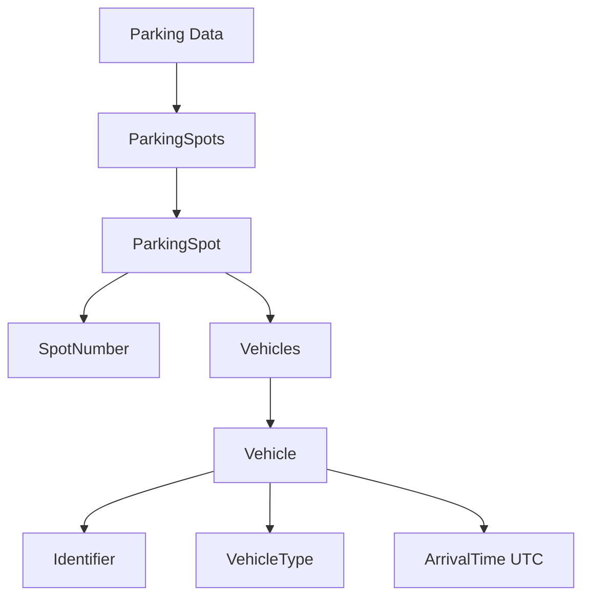

# Parkeringsdata

**Uppdaterad:** 2026-10-21  
**Omfattning:** JSON-lagring för Prague Parking 2.0 (G) och pågående utveckling av Prague Parking 2.1 (VG).  
**Versionsprincip:** G-versionens dokumenterade tester och filformat behålls. VG-specifik implementation och planerad funktionalitet redovisas separat.

**G-status – senast verifierad 2026-10-16:** `ParkingDataService`, DTO:er och `ParkingDataMapper` hanterar JSON-inläsning, återställning och automatisk sparning vid **Park Vehicle**, **Check Out Vehicle** och **Move Vehicle**. Normalflödena har verifierats med omstart. Den 16 oktober verifierades även återställning av två MC på plats 003, avvisning av korrupt och logiskt ogiltig JSON samt rollback i minnet vid simulerat skrivfel i samtliga tre åtgärder. Normal sparning fungerade därefter igen: `ABC123` återfanns på plats 051 efter omstart. **Detta är manuella tester av avgränsade scenarier, inte en garanti för fullständig transaktions- eller kraschsäkerhet.**

**VG-status 2026-10-20:** Separata projekt (`PragueParkingV2_1` och `PragueParkingV2_1.Data`) är skapade. `ParkingDataMapper` i V2.1 känner igen `Bicycle` och `Bus` som fordonsklasser och har stöd för att skapa/serialisera deras fordonsdataobjekt, men detta är **inte** en verifierad end-to-end-lösning för JSON-lagring. Storleksbaserade metoder har tillkommit i domänmodellen; återställningen i `ToGarage()` använder ännu den äldre kapacitetsmodellen och behöver migreras. Bussens fyra sammanhängande platser, persistens av reservationer och testdatagenerering är inte implementerade. Samtliga bekräftade V2.1-byggresultat avser kompilering, inte färdiga funktionstester.

**Aktuellt VG-läge 2026-10-21:** V2.1:s mapper använder storleksmodellen för Car/MC/Bicycle, och `ParkingDataService` accepterar numera även `Bicycle` och `Bus`. Vid bussåterställning återskapar `ParkingGarage.ParkBusAtSpot()` huvudplatsens fyra reservationer. Bilflytt 001→003 och omstart är manuellt verifierad, men bussens datarundtur och cykelns omstart har **inte** körtestats. Historiska noteringar nedan från 2026-10-20 är tidigare status.

## Beslutad struktur



Diagrammet visar den fastställda strukturen för G-versionen. G-formatet behålls oförändrat; en eventuell VG-utökning för bussens flera parkeringsplatser utformas separat när dess domänlogik är klar.

## Syfte

`parking-data.json` ska innehålla det aktuella tillståndet i parkeringshuset.

Filen ska användas för att återställa parkerade fordon när programmet startas igen. Varje fordon ska återfå **samma parkeringsplats, identifierare, fordonstyp och ursprungliga ankomsttid**.

Konfigurationsdata lagras inte här utan separat i `config.json`.

Endast parkeringsplatser som innehåller fordon ska sparas i `parking-data.json`.

Tomma parkeringsplatser återskapas utifrån antalet platser i `config.json`. Standardkonfigurationen innehåller **100 parkeringsplatser**, men det faktiska antalet bestäms av den giltiga konfigurationen. Återställning genom `ParkingDataMapper.ToGarage()` har verifierats med sparade bilar och två MC på samma plats efter omstart. Under testning har garaget växlats mellan 100, 200 och 1 000 platser utan att fordon på giltiga platsnummer har tappats bort.

Prisregler och gratisgränser sparas inte i `parking-data.json` utan hämtas från `config.json`. `ParkingFeeResult` och `CheckoutResult` är tillfälliga beräknings- och resultatobjekt, inte permanent parkeringsdata.

## Samband med den dynamiska garageöversikten (2026-10-13)

`GarageOverView` visar platser och fordon från `ParkingGarage`, inte direkt från `parking-data.json`. Den nya kompakta `Grid`-baserade kartan beräknar sitt utseende utifrån garagekapacitet och terminalens storlek, men ändrar inte hur parkeringsdata ska sparas.

- Garagekapaciteten styrs av `config.json` och får inte härledas från antalet poster i `parking-data.json`, eftersom datafilen endast ska innehålla **upptagna** platser.
- Garageöversikten har manuellt testats med **100, 200 och 1 000 konfigurerade platser**, inklusive intern viewport och navigering till sista platsen. Detta visar **inte** att 1 000 upptagna platser har sparats och återställts.
- Vid återställning validerar `ParkingDataMapper.ToGarage()` att ett sparat platsnummer ligger inom det konfigurerade garaget. Test med plats **201 i ett garage med 200 platser** avvisades med ett specifikt `InvalidDataException`-meddelande.
- Därefter använder mappningen `ParkingGarage.ParkVehicleAtSpot()` och `ParkingSpot`-reglerna. Tester med **tre MC på en plats för två** och **Car + MC på samma plats** avvisades under uppstart.
- Layout, färger och markering av vald plats tillhör UI-lagret och ska inte lägga till fält i G-versionens JSON-format.

## VehicleType

`VehicleType` lagras i JSON för att programmet ska kunna avgöra vilken konkret fordonsklass som ska skapas när data läses in.

Exempel:

```text
"Car" → Car
"MC"  → MC
```

`VehicleType` behöver därför inte vara en property i domänklassen `Vehicle`. Fordonstypen representeras där av den faktiska runtime-klassen.

**G (2.0):** `ParkingDataService` accepterar `Car` och `MC`; okända fordonstyper avvisas kontrollerat.

**VG (2.1, pågående):** Klasserna `Bicycle` och `Bus` finns, och `ParkingDataMapper.ToVehicle()` / `ToVehicleData()` känner igen dessa typer. Det innebär inte att de kan läsas in och återställas från fil i hela programmet ännu: valideringen i V2.1:s `ParkingDataService` behöver utökas och bussens flerplatsreservation måste först utformas. Även stöd för nya typer i UI och övriga flöden återstår.

## ArrivalTime

`ArrivalTime` lagras i UTC med en entydig tidsangivelse, exempelvis `2026-10-05T14:30:00Z`.

Det gör att den sparade tiden kan konverteras till den tidszon som anges i `config.json`, exempelvis `Europe/Prague`, när den visas för användaren.

Vid återställning måste den ursprungliga UTC-tiden bevaras. Ett återställt fordon får **inte** få en ny ankomsttid genom att konstruktorn använder `DateTime.UtcNow`.

`Car` och `MC` har konstruktorsöverlagringar som tar emot befintlig UTC-ankomsttid. `ParkingDataMapper.ToVehicle()` använder dessa, så att en omstart inte sätter om parkeringstiden. Den 16 oktober återställdes `DEF123` och `EDF123` på plats 003 med tidigare sparade ankomsttider (visade lokalt som 15:50 respektive 16:11 den 15 oktober).

**V2.1:** Även `Bicycle` och `Bus` har konstruktorer för befintlig UTC-ankomsttid. Att dessa används av mappern är implementerat, men korrekt sparning och återställning av de nya fordonstyperna har ännu inte integrationstestats.

## Exempel på `parking-data.json`

```json
{
  "ParkingSpots": [
    {
      "SpotNumber": 17,
      "Vehicles": [
        {
          "Identifier": "ABC123",
          "VehicleType": "Car",
          "ArrivalTime": "2026-10-05T14:30:00Z"
        }
      ]
    },
    {
      "SpotNumber": 18,
      "Vehicles": [
        {
          "Identifier": "MC123",
          "VehicleType": "MC",
          "ArrivalTime": "2026-10-05T14:35:00Z"
        },
        {
          "Identifier": "MC456",
          "VehicleType": "MC",
          "ArrivalTime": "2026-10-05T14:42:00Z"
        }
      ]
    }
  ]
}
```

Exemplet följer det tidigare beslutade formatet: `ParkingSpots` innehåller `SpotNumber` och `Vehicles`, medan varje fordon innehåller `Identifier`, `VehicleType` och `ArrivalTime`. Endast upptagna platser visas i filen.

Ett tomt parkeringshus kan representeras av:

```json
{
  "ParkingSpots": []
}
```

## Inläsning och återställning vid programstart

Den implementerade ordningen vid normal uppstart i **G-versionen (2.0)** är:

1. Läs och validera `config.json`.
2. Läs och validera `parking-data.json` via `ParkingDataService.Load()`; om filen saknas används ett tomt dokument i minnet.
3. Anropa `ParkingDataMapper.ToGarage(document, configuration)`, som skapar `ParkingGarage` enligt konfigurerad kapacitet.
4. För varje sparad plats och fordon: skapa `Car` eller `MC` med ursprunglig UTC-tid, hämta `VehiclesPerSpot` och anropa `ParkVehicleAtSpot()` för **exakt** platsnummer. **Detta beskriver G-implementationen, inte den framtida V2.1-modellen.**
5. Visa huvudmenyn först när hela återställningen har slutförts utan undantag.

Återställning ska **inte** använda den ordinarie metoden som automatiskt väljer första lediga parkeringsplats. Den skulle kunna flytta fordon till andra platser vid omstart.

### Validering av sparad data

`ValidateParkingData()` i `ParkingDataService` kontrollerar dokument-/plats-/fordonsobjekt, icke-tomma listor för sparade platser, positiva och unika `SpotNumber`, fordonsidentifierare, dubbletter med `StringComparer.OrdinalIgnoreCase`, fordonstyperna `Car`/`MC` samt `ArrivalTime.Kind == Utc` och icke-standarddatum. Samma interna kontroll anropas vid `Load()` och `Save()`.

Vid återställning validerar `ParkingDataMapper.ToGarage()` också **platsnummer mot aktuell garagekapacitet**. Fel som uppstår när `ParkingGarage.ParkVehicleAtSpot()` inte kan placera ett sparat fordon fångas som `InvalidOperationException` och omvandlas till `InvalidDataException` med fordonsidentifierare och platsnummer. `Program.cs` stoppar då uppstarten kontrollerat och visar ett begripligt felmeddelande.

Följande ytterligare krav gäller innan sparad data accepteras i det färdiga garaget:

- JSON-strukturen och obligatoriska fält finns och går att läsa.
- Varje `SpotNumber` är unikt och ligger inom den aktuella garagekapaciteten.
- Varje fordonsidentifierare är giltig och unik i hela garaget, **utan skillnad mellan stora och små bokstäver**.
- `VehicleType` motsvarar en fordonstyp som den aktuella versionen stöder.
- `ArrivalTime` är en giltig UTC-tidpunkt.
- Fordonen ryms på den angivna platsen enligt gällande kapacitets- och fordonsregler.

Om en befintlig fil är felaktig eller innehåller oförenliga uppgifter ska uppstarten ge ett tydligt fel. Filen får inte tyst skrivas över och ett delvis återställt garage får inte accepteras som giltigt tillstånd. Den 16 oktober verifierades detta för **trasig JSON-syntax, skiftlägesokänsliga dubbletter, platsnummer utanför intervallet, kapacitetsöverskridande samt otillåten Car/MC-blandning**. Den testade ogiltiga filen låg kvar efter nekad uppstart. Det bevisar inte att ett fristående `Save()` i andra körvägar alltid vägrar ersätta en korrupt befintlig fil.

**G-beteende:** Om `parking-data.json` saknas vid första start kan garaget starta tomt. Detta är en annan situation än att en **befintlig** datafil är ogiltig. **V2.1 har ett annat krav:** skapa saknad fil och fylla den med giltiga testfordon; detta är ännu inte implementerat.

## Uppdatering vid parkering

Efter en lyckad incheckning sparas den nya beläggningen i `parking-data.json` genom `ParkingDataMapper.ToDocument()` och `ParkingDataService.Save()`. Detta är anslutet till `ParkVehicleView` och verifierat vid vanlig bilparkering den 14 oktober. Vyn visar ett lyckat resultat först efter att sparningen har slutförts utan rapporterat fel.

Det sparade fordonet ska innehålla:

- Dess faktiska parkeringsplats (`SpotNumber` i det omgivande platsobjektet).
- Dess `Identifier` och `VehicleType`.
- Den ursprungliga `ArrivalTime` i UTC.

Användaren får bekräftelse först när `Save()` returnerar utan rapporterat fel. Om skrivningen kastar `IOException` eller `UnauthorizedAccessException` försöker UI ångra incheckningen med `ParkingGarage.RemoveVehicle()`. **Verifierat 2026-10-16:** En mapp med namnet `parking-data.json.tmp` blockerade temporärfilens sökväg och framkallade ett skrivfel. Parkeringen av testbilen `ROLL123` avbröts och fordonet kunde inte längre hittas i garaget. Testet visar att kompensationen i minnet fungerar i detta scenario; fullständig transaktionssäkerhet kan inte utlovas.

## Uppdatering vid utcheckning

**Implementerat och manuellt verifierat i normalflödet 2026-10-15.** `CheckOutVehicleView` använder `CheckoutService` för att beräkna avgift och ta bort ett utcheckat fordon ur garaget. Därefter anropas `ParkingDataMapper.ToDocument()` och `ParkingDataService.Save()`. Bekräftelse på slutförd utcheckning visas först efter att sparningen rapporterat framgång.

Om parkeringsplatsen blir tom utelämnas den ur sparade `ParkingSpots`. Ett manuellt test visade att utcheckade `UKB48K` inte återkom efter omstart medan en annan parkerad bil fanns kvar.

Vid `IOException` eller `UnauthorizedAccessException` under sparning försöker vyn lägga tillbaka **samma fordonsobjekt** på dess ursprungliga plats, så att `ArrivalTime` behålls i objektet. **Verifierat 2026-10-16:** När den blockerade temporärfilens sökväg orsakade skrivfel visades ett felmeddelande och `ABC123` återfanns fortfarande på plats 050. Ankomsttiden jämfördes inte separat under just rollback-testet. Kompensationen är ingen fullständig transaktionsgaranti.

Prisberäkningen sker före borttagningen. `ParkingFeeResult` och `CheckoutResult` är tillfälliga runtime-resultat och sparas inte i `parking-data.json`.

## Uppdatering vid förflyttning

**Implementerat och manuellt verifierat i normalflödet 2026-10-15.** `MoveVehicleView` anropar `ParkingGarage.MoveVehicle()`, exporterar sedan garagets nya tillstånd med `ParkingDataMapper.ToDocument()` och sparar via `ParkingDataService.Save()`. Först därefter visas den gröna bekräftelsepanelen.

Domänmetoden letar upp fordonets ursprungsplats och destinationsplats, nekar flytt till samma plats och kontrollerar destinationens kapacitet och fordonstyp **innan fordonet tas bort**. Samma `Vehicle`-objekt flyttas, vilket bevarar `Identifier`, `VehicleType` och den ursprungliga `ArrivalTime`. Om den gamla platsen blir tom utelämnas den ur den sparade filen.

Den 15 oktober flyttades bilen `ABC123` från plats **001 till 050**. Efter omstart kvarstod placeringen på plats 050. Den 16 oktober återställdes också två MC (`DEF123` och `EDF123`) korrekt på plats **003** efter omstart. Efter skrivfelstesterna kunde `ABC123` flyttas från **050 till 051**; vid nästa programstart låg den kvar på **051**, med ett konfigurerat garage på 100 platser.

Vid `IOException` eller `UnauthorizedAccessException` under sparning försöker vyn flytta tillbaka fordonet till ursprungsplatsen. Domänmetoden har även ett återställningsförsök om parkering på destinationsplatsen skulle kasta ett undantag. **Verifierat 2026-10-16 för skrivfel i `Save()`:** En bekräftad flytt av `ABC123` från **050 till 051** kunde inte sparas eftersom temporärfilens sökväg blockerades. Programmet rapporterade återflytt och fordonet fanns kvar på **050**; plats **051** var ledig och beläggningsräknarna visade fortfarande tre fordon på två platser. Den separata domänåterställningen vid ett undantag under själva destinationsparkeringen är däremot inte felinjiceringstestad. Detta är ingen garanti för alla tänkbara fel.

## Ansvar och säker filhantering

JSON-serialisering och filåtkomst hör hemma i det separata Data-projektet (`PragueParkingV2.Data` för G respektive `PragueParkingV2_1.Data` för VG). `ParkingGarage` och `ParkingSpot` ska fortsatt ansvara för parkeringsregler, och UI ska presentera resultat och fel. `ParkingDataMapper` i respektive huvudprojekt översätter mellan DTO:er och domänobjekt.

Principer för implementation och fortsatt verifiering:

- Använda en portabel, kontrollerad lagringsplats utan hårdkodade sökvägar till en viss dator.
- Spara efter varje **genomförd förändring** av parkeringshuset: incheckning, utcheckning och förflyttning.
- Undvika att en avbruten skrivning förstör huvudfilen, exempelvis genom skrivning till temporär fil följt av säker ersättning.
- Säkerställa konsekvens mellan tillståndet i minnet och den sparade filen om en skrivning misslyckas.
- Aldrig automatiskt skriva över en befintlig, korrupt eller ogiltig datafil med ett tomt parkeringshus.

### Implementerat 2026-10-11

- `ParkingDataService` använder `AppContext.BaseDirectory` och `Path.Combine()` för körmiljöns `Data/parking-data.json`.
- `Load()` kontrollerar om filen finns, läser texten, deserialiserar och validerar dokumentet. Saknad fil ger ett tomt dokument i minnet; den skapas inte vid enbart inläsning.
- `Save()` skapar saknad datakatalog och validerar det inkommande dokumentet innan JSON serialiseras.
- `JsonSerializerOptions { WriteIndented = true }` ger indenterad och människoläsbar JSON.
- Innehållet skrivs först till `parking-data.json.tmp` i samma katalog. `File.Move()` används om huvudfilen saknas och `File.Replace()` om den finns.
- `try/finally` försöker rensa en kvarvarande temporärfil. Att städningen alltid lyckas vid alla typer av filfel eller processavbrott är **inte** verifierat.
- Vid det manuella skrivfelstestet skapades en **katalog** med namnet `parking-data.json.tmp` för att blockera `File.WriteAllText()`. Hindret togs därefter bort och normal sparning verifierades. Testet undersökte inte fullständig kraschsäkerhet eller alla fel i `File.Replace()`.

### Manuell teststatus (uppdaterad 2026-10-16)

**Tidigare verifiering, 11–15 oktober:**

- Giltig JSON läses och återställs med rätt fordonstyp, plats och UTC-ankomsttid. Okänd fordonstyp (`Truck`) avvisas.
- Incheckning av `UKB48K`, utcheckning med sparad borttagning och flytt av `ABC123` från 001 till 050 verifierades genom omstart.
- Två MC kunde dela en plats. Flytt till en plats med otillåten fordonstyp eller utan kapacitet avvisades.

**Ytterligare manuella tester den 16 oktober:**

| Testfall | Genomförd kontroll | Resultat |
|---|---|---|
| Två MC efter omstart | `DEF123` och `EDF123` återkom på plats 003 med tidigare ankomsttider; `ABC123` återkom på dåvarande plats 050. | Godkänt |
| Korrupt JSON | Avsiktligt trasig JSON stoppade uppstarten med felkod 1; befintlig fil lämnades orörd. | Godkänt |
| Dubblett i giltig JSON | `ABC123` och `abc123` avvisades som samma identifierare. | Godkänt |
| Plats utanför garaget | Sparad plats 201 avvisades när `config.json` angav 200 platser. Specifikt felmeddelande infördes i mappern. | Godkänt |
| Kapacitetsöverskridande | Tre MC på plats 003 avvisades när kapaciteten var två. | Godkänt |
| Blandade fordonstyper | `Car` och `MC` på plats 003 avvisades vid återställning. | Godkänt |
| Skrivfel – Park Vehicle | Temporärfilens sökväg blockerades; `ROLL123` registrerades inte permanent och kunde inte hittas i minnet efteråt. | Godkänt i testat scenario |
| Skrivfel – Check Out Vehicle | Sparfel visades, utcheckning avbröts och `ABC123` fanns kvar på plats 050. | Godkänt i testat scenario |
| Skrivfel – Move Vehicle | Flytt 050 → 051 kunde inte sparas; `ABC123` återfanns på 050 och plats 051 var ledig. | Godkänt i testat scenario |
| Normal drift efter skrivfel | Tillfälligt skrivhinder togs bort; flytt 050 → 051 lyckades och 051 kvarstod efter omstart. | Godkänt |
| Ändrat antal platser | 100, 200 och 1 000 platser testades; befintliga fordon på giltiga platser återställdes. | Godkänt i testade fall |

Vid dessa negativa uppstartstester kontrollerades att den ogiltiga JSON-filen inte skrevs över. **Skrivfelstesterna visar återställning i minnet vid ett bestämt, tidigt filskrivningsfel**, men innebär inte att alla steg i filersättningen eller varje möjligt kraschscenario är verifierade.

### Kvarstående säkerhet och integration

- Kontrollera JSON med **utelämnade obligatoriska fält** som DTO-standardvärden eventuellt döljer, samt identifierarlängd och vissa normaliseringsfall.
- Pröva ogiltiga platsnummer, kapacitetsändringar och befintliga fordon tillsammans med andra kombinationer av `config.json` och datafilen där det är relevant.
- Kontrollera skydd mot överskrivning av en redan korrupt fil även vid fristående anrop av `Save()` (uppstart med korrupt fil har redan testats).
- Verifiera temporärfilens städning och filersättning i fler fel- och avbrottsscenarier, inklusive eventuellt fel under `File.Replace()` och processkrasch. Inga garantier om fullständig transaktionssäkerhet görs.
- Verifiera konsekvens mellan disk och minne vid andra skrivfel än det testade hindret mot `parking-data.json.tmp`.
- Testa körning på en annan dator och gör slutlig kravavstämning inför den gemensamma inlämningen av 2.0 och 2.1.

**G-status 2026-10-16:** De viktigaste normala persistensflödena, återställning av två MC efter omstart, flera ogiltiga JSON-scenarier och rollback vid ett framprovocerat skrivfel har verifierats manuellt. Ytterligare robusthets- och kompatibilitetstester återstår; systemet har inte genomgått fullständig automatisk eller kraschbaserad verifiering.

## Prague Parking 2.1 (VG) – Pågående arbete 2026-10-20

Prague Parking 2.1 vidareutvecklas i separata projekt i samma solution. V2.0:s dokumenterade JSON-format och verifierade beteende ändras inte. V2.1 bygger vidare på samma grundläggande DTO-struktur, men reglerna för storlekskapacitet, nya fordonstyper och flerplatsparkering behöver färdigställas **innan** komplett återställning kan verifieras. Eftersom lagringsvägen utgår från `AppContext.BaseDirectory` använder G och VG normalt varsin `Data/parking-data.json` under respektive projekts körkatalog. En gemensam datakatalog ska inte antas eller införas under migreringen.

### Genomfört på kodnivå

| Komponent | Bekräftad förändring | Aktuell status |
|---|---|---|
| `Bicycle` och `Bus` | Fordonsklasser med konstruktor för ny och återställd UTC-ankomsttid | Implementerade klasser; flöden ej verifierade |
| `IVehicle` | Gemensamt gränssnitt med bland annat `Identifier` och `ArrivalTime` | Implementerat |
| `ParkingDataMapper.ToVehicle()` | Känner igen `Car`, `MC`, `Bicycle` och `Bus` | Implementerad typmappning; full återställning ej färdig |
| `ParkingDataMapper.ToVehicleData()` | Kan ange `VehicleType` för de fyra fordonsklasserna | Implementerad typmappning; ej end-to-end-testad för nya typer |
| `ParkingSpot` och `ParkingGarage` | Nya metodöverlagringar använder `spotCapacity` och `Func<IVehicle, int> getSize` | Kompilerar; migrering av anrop pågår |
| `ParkingGarage.ParkVehicleAtSpot()` | Ny överlagring för placering på ett angivet platsnummer med storlekskapacitet | Implementerad på kodnivå; mappern använder ännu inte denna överlagring |

De nya överlagringarna finns tillfälligt parallellt med de äldre `VehiclesPerSpot`-metoderna. Detta är **en övergångslösning**, inte två avsedda kapacitetsmodeller i den färdiga V2.1-versionen.

### Skillnaden mellan G:s och VG:s kapacitet

| Fordon | G (2.0) | VG (2.1) – avsedd storlek |
|---|---|---:|
| `Bicycle` | Stöds inte | 1 enhet |
| `MC` | Högst 2 MC per plats; får inte blandas med Car | 2 enheter |
| `Car` | Högst 1 bil per plats | 4 enheter |
| `Bus` | Stöds inte | 16 enheter, fördelade på fyra platser |

En vanlig plats har i V2.1 **4 kapacitetsenheter**. Syftet är att sammanlagd storlek ska styra beläggningen, i stället för antalet fordon av en viss typ. De avsedda storlekarna hämtas ur `VehicleTypes` i `config.json`; platskapaciteten hämtas ur `Garage.SpotCapacity`. V2.1:s `GetUsedCapacity(getSize)` summerar storleken på redan parkerade fordon. `Func<IVehicle, int>` används för att skicka in uppslaget av fordonsstorlek utan att `ParkingSpot` behöver läsa JSON.

**Begränsning:** Kapacitetsmodellen för en enskild plats kan inte direkt hantera `Bus` med storlek 16 när en plats rymmer 4. Buss kräver särskild samordning i `ParkingGarage` och får inte behandlas som om den vore ett vanligt enplatsfordon.

### Återställning via `ParkingDataMapper.ToGarage()` – nästa migreringsmoment

I den senast genomgångna V2.1-koden används fortfarande det äldre anropet i återställningen:

```csharp
int capacity = configuration.VehicleTypes![vehicleData.VehicleType].VehiclesPerSpot;
parkingGarage.ParkVehicleAtSpot(vehicle, spotData.SpotNumber, capacity);
```

Det ska ersättas med V2.1:s storleksbaserade överlagring. Avsedd princip för **vanliga enplatsfordon**, efter genomförd ändring, är:

```csharp
int spotCapacity = configuration.Garage!.SpotCapacity;

Func<IVehicle, int> getSize = vehicle =>
    configuration.VehicleTypes![vehicle.GetType().Name].Size;

// Anrop vid återställning av ett vanligt fordon:
garage.ParkVehicleAtSpot(vehicle, spotData.SpotNumber, spotCapacity, getSize);
```

Kodexemplet är **ett planerat migreringssteg**, inte en uppgift om att `ToGarage()` redan har ändrats. Före färdig drift behövs även tydlig hantering av saknade/okända konfigurationstyper och motsvarande validering i Data-projektet. `Bus` ska inte skickas genom enplatsåterställningen innan dess separata flerplatsmodell är färdig.

### `Bicycle` – ännu inte komplett lagringsflöde

En cykel behöver en unik och stabil `Identifier` även utan registreringsnummer. Fordonsklassen och typmappningen finns, men V2.1:s JSON-validering samt registrering, återställning, utcheckning och omstartstester för `Bicycle` återstår. Vid en framtida genomförd implementation ska identifieraren och UTC-ankomsttiden behållas vid sparning och återställning på samma sätt som för `Car` och `MC`.

### `Bus` – fyra sammanhängande parkeringsplatser

En buss har storlek 16 och kräver **fyra sammanhängande, helt lediga platser**. De första 50 platserna utgör det område där **nyparkering av buss** ska kunna ske. **Området är inte exklusivt reserverat för bussar** – andra fordon kan också parkera där. För ett område med platsnummer 1–50 är den sista möjliga startplatsen **47** (platserna 47–50).

Den föreslagna sökstrategin är att kontrollera fönstren **1–4, 2–5, 3–6, ... 47–50** tills fyra sammanhängande lediga platser hittas. Dubblettkontroll av bussens identifierare ska ske före reservation. Om ingen giltig grupp finns ska parkeringen nekas utan att garaget ändras.

**Föreslagen princip, ännu inte implementerad:** Varje buss ska behandlas som **ett logiskt fordon** med en identifierare och en ankomsttid, samtidigt som fyra platser är reserverade för den. Uppgiften kräver därmed att följande hanteras konsekvent:

- Vid incheckning: reservera alla fyra platserna eller ingen av dem.
- Vid sökning och garageöversikt: visa en buss som ett fordon men visa dess faktiska beläggning.
- Vid flytt: bevara bussens identifierare och UTC-ankomsttid samt flytta reservationen utan partiellt tillstånd.
- Vid utcheckning: frigöra samtliga fyra platser och debitera **en** bussavgift.
- Vid JSON-sparning och omstart: återställa sambandet mellan bussen och samtliga reserverade platser utan att skapa fyra separata bussfordon eller fyra avgifter.

**Öppen designfråga:** Exakt hur en buss och dess fyra platser representeras i V2.1:s domänmodell och JSON är inte fastställt. Det kan exempelvis krävas en huvudplacering samt separata platsreservationer, men inget sådant JSON-format är beslutat. Därför ges **inget påhittat färdigt Bus-JSON-exempel** här. Tillåtna destinationer vid flytt till platsnummer över 50 behöver dessutom avgöras enligt den slutliga kravtolkningen innan funktionen färdigställs.

### Saknad datafil – särskilt VG-krav

V2.0:s `ParkingDataService.Load()` returnerar ett tomt datadokument i minnet när filen saknas; filen skapas senare vid sparning. **V2.1 ska i stället skapa en saknad `parking-data.json` och fylla den med giltiga testfordon.** Detta VG-krav är inte implementerat eller testat ännu.

En framtida implementation måste skilja på två fall:

1. **Filen saknas:** Generera giltiga testdata som följer aktuell konfiguration, skapa filen och verifiera att den går att läsa in.
2. **Filen finns men är ogiltig:** Avvisa den kontrollerat. Ersätt inte användarens befintliga data med testfordon.

Exakt antal testfordon och deras placering är inte beslutade; testdata får inte förutsättas kunna placeras om konfigurationen gör dem ogiltiga.

### Tester som återstår för V2.1

- Bygga och starta V2.1 efter migreringen och kontrollera att befintliga Car/MC-data går att återställa korrekt med `Size`/`SpotCapacity`.
- Testa delning och blandning utifrån storleksenheter, fullt utnyttjad plats, otillåtna storlekar och dubblettidentifierare.
- Spara, starta om och återställa `Bicycle` samt validera ogiltiga eller okända `VehicleType`-värden.
- Parkera en buss på fyra sammanhängande lediga platser, prova luckor med upptagna platser samt nekad parkering när ingen giltig grupp finns.
- Verifiera att en buss söks, flyttas, checkas ut, debiteras och återställs som **ett** fordon med fyra reservationer; testa avbrutna eller misslyckade sparningar utan kvarvarande delreservationer.
- Kontrollera saknad datafil, korrekt skapande av giltiga testdata, omstart samt att en befintlig korrupt fil inte skrivs över.
- Upprepa lämpliga G-regressionstester i V2.1. G-versionens testresultat den 11–16 oktober är **inte** tester av de nya VG-funktionerna.

## Relaterad dokumentation

- [`configuration.md`](configuration.md) – inställningar, priser, tidszon och kapacitetsregler.
- [`class-diagram.md`](class-diagram.md) – domänmodell, klasser, interfaces och relationer.
- [`design-decisions.md`](design-decisions.md) – dokumenterade arkitekturval och ännu öppna designfrågor.
- [`requirements.md`](requirements.md) – krav och status för G respektive VG.
- [`project-plan.md`](project-plan.md) – milstolpar och återstående utvecklingsarbete.
- [`README.md`](../README.md) och [`LOGGBOK.md`](../LOGGBOK.md) – projektöversikt respektive utvecklingshistorik.

---

## 2026-10-21 – V2.1:s buss- och cykelpersistens

### Buss: en JSON-post och fyra reservationer i minnet

En buss lagras **en gång** som `VehicleType: "Bus"` under sin **första** parkeringsplats (huvudplatsen). De ytterligare tre platsreservationerna lagras inte som separata `VehicleData`-poster. De återskapas i minnet efter start genom anrop till `ParkingGarage.ParkBusAtSpot(bus, spotData.SpotNumber, spotCapacity, getSize(bus), busMaxParkingSpot)`.

Exempel på tänkt sparat format (exempeldata – **inte** ett dokumenterat genomfört bussprov):

```json
{
  "ParkingSpots": [
    {
      "SpotNumber": 10,
      "Vehicles": [
        {
          "Identifier": "BUS123",
          "VehicleType": "Bus",
          "ArrivalTime": "2026-10-21T08:00:00Z"
        }
      ]
    }
  ]
}
```

Efter återställning reserveras 010–013 för **samma bussobjekt**. `ReservedByBus` finns på varje plats; bara huvudplatsens `ParkedVehicles` innehåller bussen. Flera sparade busskopior med samma identifierare ska nekas av `ParkingDataService`-valideringen.

För Bicycle används **befintlig JSON-struktur**: flera cyklar får finnas i samma `Vehicles`-lista om summan av `Size` inte överstiger `SpotCapacity`. `ToDocument()` serialiserar fordonen från upptagna platser; `ToGarage()` använder storlekskapacitet för återställningen.

### Bevisläge och risker

- **Verifierat:** V2.1 kunde flytta `UKB48K` 001 → 003, och `Find Vehicle` visade 003 efter omstart. Första Bicycle-registreringen lyckades.
- **Ej verifierat:** fyra cyklar på samma plats, Bicycle efter omstart, bussens JSON-rundtur och rollback efter verkligt filskrivningsfel.
- **Viktigt:** Ordningsföljd, konflikter, dubbletter, reserverade och upptagna platser måste testas vid bussåterställning. `Bus` får inte gå genom vanliga enplatsmetoden.
- Saknad datafil och automatisk ifyllning med giltiga testfordon är fortfarande ett **VG-krav som återstår**. Den nya konfigurationsmallen löser inte testdatakravet.
