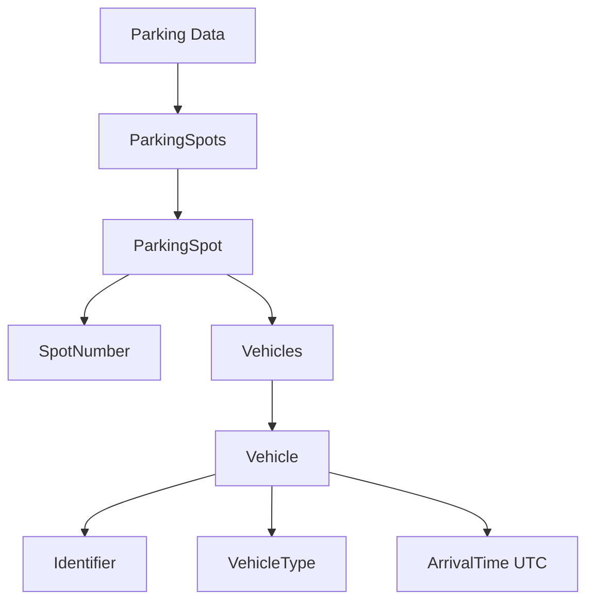

# Parkeringsdata

## Planerad struktur



## Syfte

`parking-data.json` kommer att innehålla det aktuella tillståndet i parkeringshuset.

Filen ska användas för att återställa parkerade fordon när programmet startas igen.

Konfigurationsdata lagras inte här utan separat i `config.json`.

Endast parkeringsplatser som innehåller fordon ska sparas i `parking-data.json`.

Tomma parkeringsplatser återskapas från `config.json` när programmet startar.

Prisregler och gratisgränser sparas inte i `parking-data.json` utan hämtas från `config.json`.

## VehicleType

`VehicleType` lagras i JSON för att programmet ska kunna avgöra vilken konkret
fordonsklass som ska skapas när data läses in.

Exempel:

```text
"Car" → Car
"MC"  → MC
```

`VehicleType` behöver därför inte vara en property i domänklassen `Vehicle`.
Fordonstypen representeras där av den faktiska runtime-klassen.

## ArrivalTime

`ArrivalTime` lagras i UTC.

Det gör att den sparade tiden är entydig och senare kan konverteras till
den tidszon som anges i `config.json`, exempelvis `Europe/Prague`.

## Exempel på `parking-data.json`

```json
{
  "ParkingSpots": [
    {
      "SpotNumber": 17,
      "Vehicles": [
        {
          "Identifier": "ABC123",
          "VehicleType": "Car",
          "ArrivalTime": "2026-10-05T14:30:00Z"
        }
      ]
    },
    {
      "SpotNumber": 18,
      "Vehicles": [
        {
          "Identifier": "MC123",
          "VehicleType": "MC",
          "ArrivalTime": "2026-10-05T14:35:00Z"
        },
        {
          "Identifier": "MC456",
          "VehicleType": "MC",
          "ArrivalTime": "2026-10-05T14:42:00Z"
        }
      ]
    }
  ]
}
```

## Uppdatering vid utcheckning

När ett fordon checkas ut ska det tas bort från det aktuella
parkeringsläget.

Efter en lyckad utcheckning ska `parking-data.json` uppdateras så att det
utcheckade fordonet inte längre finns kvar i den persistenta datan.

Prisberäkning, `ParkingFeeResult` och `CheckoutResult` är tillfälliga
runtime-resultat och ska inte sparas i `parking-data.json`.