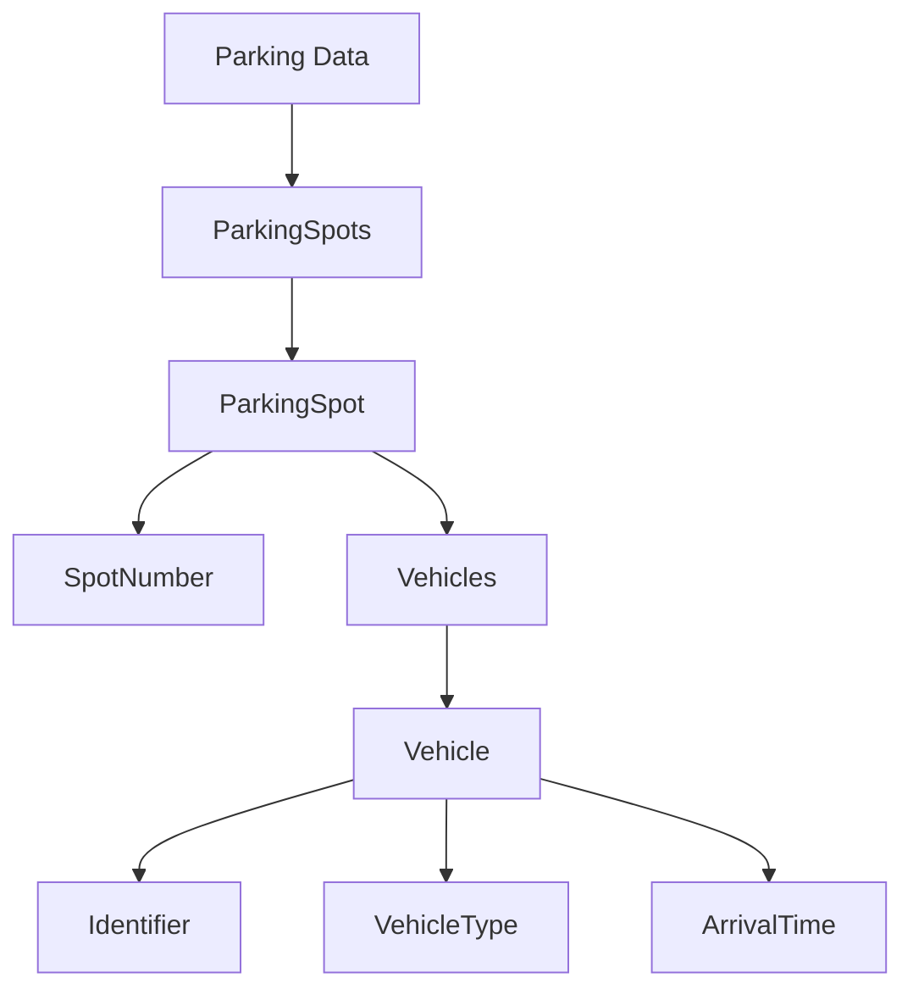

# Parkeringsdata

## Struktur



## Syfte

`parking-data.json` innehåller det aktuella tillståndet i parkeringshuset.

Filen används för att återställa parkerade fordon när programmet startas igen.

Konfigurationsdata lagras inte här utan separat i `config.json`.

Endast parkeringsplatser som innehåller fordon sparas i `parking-data.json`.

Tomma parkeringsplatser återskapas från `config.json` när programmet startar.

## Exempel på `parking-data.json`

```json
{
  "ParkingSpots": [
    {
      "SpotNumber": 17,
      "Vehicles": [
        {
          "Identifier": "ABC123",
          "VehicleType": "Car",
          "ArrivalTime": "2026-10-05T14:30:00"
        }
      ]
    },
    {
      "SpotNumber": 18,
      "Vehicles": [
        {
          "Identifier": "MC123",
          "VehicleType": "MC",
          "ArrivalTime": "2026-10-05T14:35:00"
        },
        {
          "Identifier": "MC456",
          "VehicleType": "MC",
          "ArrivalTime": "2026-10-05T14:42:00"
        }
      ]
    }
  ]
}
```

