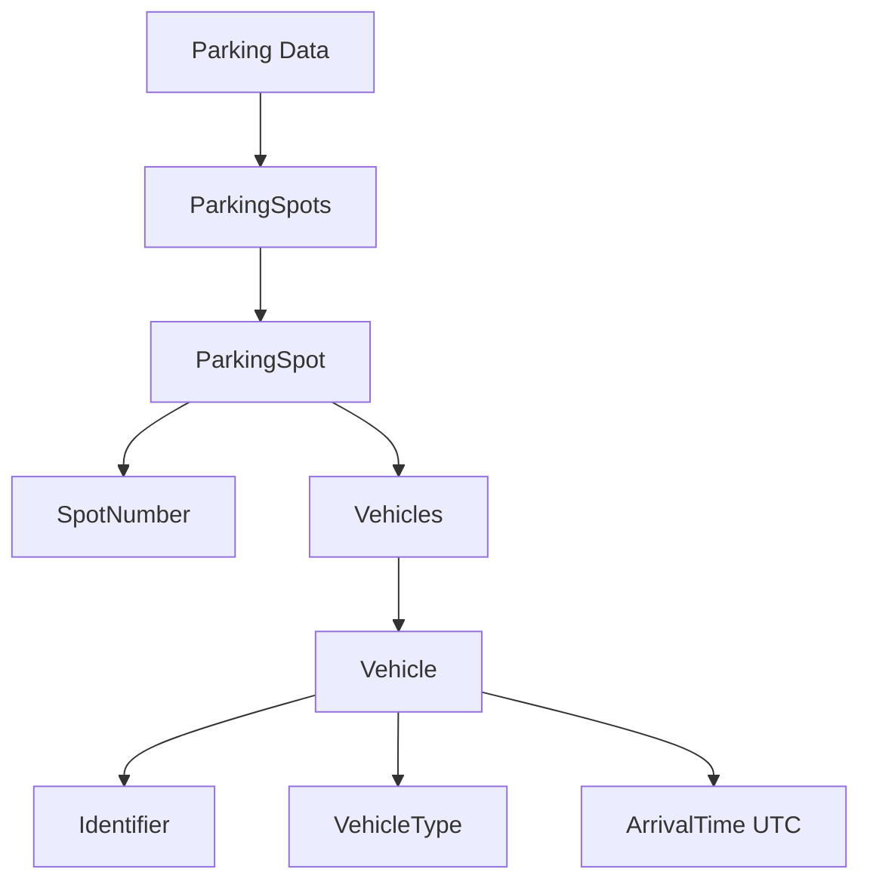

# Parkeringsdata

**Uppdaterad:** 2026-10-15  
**Omfattning:** JSON-lagring för Prague Parking 2.0 (G), med avgränsningar inför Prague Parking 2.1 (VG).

**Status 2026-10-15:** `ParkingDataService`, DTO:er och `ParkingDataMapper` är implementerade. JSON-inläsning och automatisk sparning används nu av **Park Vehicle**, **Check Out Vehicle** och **Move Vehicle**. Normalflöden har testats manuellt: parkering återställdes efter omstart den 14 oktober; den 15 oktober verifierades sparad utcheckning och flytt av bilen `ABC123` från plats 001 till 050, med bibehållen placering efter omstart. Två MC har dessutom visats på samma plats i garageöversikten och reglerna för MC/bil har testats vid flytt. **Återställning av två MC efter omstart, framprovocerade skrivfel och fullständig negativ JSON-validering återstår.**

## Beslutad struktur



Diagrammet visar den fastställda strukturen för G-versionen. Vi inför inte extra obligatoriska fält eller en alternativ, platt struktur under implementationen av 2.0.

## Syfte

`parking-data.json` ska innehålla det aktuella tillståndet i parkeringshuset.

Filen ska användas för att återställa parkerade fordon när programmet startas igen. Varje fordon ska återfå **samma parkeringsplats, identifierare, fordonstyp och ursprungliga ankomsttid**.

Konfigurationsdata lagras inte här utan separat i `config.json`.

Endast parkeringsplatser som innehåller fordon ska sparas i `parking-data.json`.

I det färdiga återställningsflödet ska tomma parkeringsplatser återskapas utifrån antalet platser i `config.json`. Standardkonfigurationen innehåller 100 parkeringsplatser, men det faktiska antalet bestäms av den giltiga konfigurationen. Återställning genom `ParkingDataMapper.ToGarage()` är implementerad och testad med sparade bilar, även efter en genomförd flytt.

Prisregler och gratisgränser sparas inte i `parking-data.json` utan hämtas från `config.json`. `ParkingFeeResult` och `CheckoutResult` är tillfälliga beräknings- och resultatobjekt, inte permanent parkeringsdata.

## Samband med den dynamiska garageöversikten (2026-10-13)

`GarageOverView` visar platser och fordon från `ParkingGarage`, inte direkt från `parking-data.json`. Den nya kompakta `Grid`-baserade kartan beräknar sitt utseende utifrån garagekapacitet och terminalens storlek, men ändrar inte hur parkeringsdata ska sparas.

- Garagekapaciteten styrs av `config.json` och får inte härledas från antalet poster i `parking-data.json`, eftersom datafilen endast ska innehålla **upptagna** platser.
- En garageöversikt med **200 platser har kontrollerats visuellt** i utvecklingsmiljön. Detta verifierar **inte** att 200 parkerade platser kan sparas och återställas efter omstart.
- Vid återställning används `ParkingGarage.ParkVehicleAtSpot()`, som avvisar platser som saknas i det konfigurerade garaget och tillämpar `ParkingSpot`-reglerna. Negativa testfall med felaktiga platsnummer återstår.
- Layout, färger och markering av vald plats tillhör UI-lagret och ska inte lägga till fält i G-versionens JSON-format.

## VehicleType

`VehicleType` lagras i JSON för att programmet ska kunna avgöra vilken konkret fordonsklass som ska skapas när data läses in.

Exempel:

```text
"Car" → Car
"MC"  → MC
```

`VehicleType` behöver därför inte vara en property i domänklassen `Vehicle`. Fordonstypen representeras där av den faktiska runtime-klassen.

Vid inläsning ska okända eller ännu inte stödda fordonstyper avvisas kontrollerat. Detta gäller även framtida `Bicycle` och `Bus` tills dessa faktiskt har implementerats.

## ArrivalTime

`ArrivalTime` lagras i UTC med en entydig tidsangivelse, exempelvis `2026-10-05T14:30:00Z`.

Det gör att den sparade tiden kan konverteras till den tidszon som anges i `config.json`, exempelvis `Europe/Prague`, när den visas för användaren.

Vid återställning måste den ursprungliga UTC-tiden bevaras. Ett återställt fordon får **inte** få en ny ankomsttid genom att konstruktorn använder `DateTime.UtcNow`.

`Car` och `MC` har konstruktorsöverlagringar som tar emot befintlig UTC-ankomsttid. `ParkingDataMapper.ToVehicle()` använder dessa, så att en omstart inte sätter om parkeringstiden.

## Exempel på `parking-data.json`

```json
{
  "ParkingSpots": [
    {
      "SpotNumber": 17,
      "Vehicles": [
        {
          "Identifier": "ABC123",
          "VehicleType": "Car",
          "ArrivalTime": "2026-10-05T14:30:00Z"
        }
      ]
    },
    {
      "SpotNumber": 18,
      "Vehicles": [
        {
          "Identifier": "MC123",
          "VehicleType": "MC",
          "ArrivalTime": "2026-10-05T14:35:00Z"
        },
        {
          "Identifier": "MC456",
          "VehicleType": "MC",
          "ArrivalTime": "2026-10-05T14:42:00Z"
        }
      ]
    }
  ]
}
```

Exemplet följer det tidigare beslutade formatet: `ParkingSpots` innehåller `SpotNumber` och `Vehicles`, medan varje fordon innehåller `Identifier`, `VehicleType` och `ArrivalTime`. Endast upptagna platser visas i filen.

Ett tomt parkeringshus kan representeras av:

```json
{
  "ParkingSpots": []
}
```

## Inläsning och återställning vid programstart

Den implementerade ordningen vid normal uppstart är:

1. Läs och validera `config.json`.
2. Läs och validera `parking-data.json` via `ParkingDataService.Load()`; om filen saknas används ett tomt dokument i minnet.
3. Anropa `ParkingDataMapper.ToGarage(document, configuration)`, som skapar `ParkingGarage` enligt konfigurerad kapacitet.
4. För varje sparad plats och fordon: skapa `Car` eller `MC` med ursprunglig UTC-tid, hämta `VehiclesPerSpot` och anropa `ParkVehicleAtSpot()` för **exakt** platsnummer.
5. Visa huvudmenyn först när hela återställningen har slutförts utan undantag.

Återställning ska **inte** använda den ordinarie metoden som automatiskt väljer första lediga parkeringsplats. Den skulle kunna flytta fordon till andra platser vid omstart.

### Validering av sparad data

`ValidateParkingData()` i `ParkingDataService` kontrollerar redan dokument-/plats-/fordonsobjekt, icke-tomma listor för sparade platser, positiva och unika `SpotNumber`, fordonsidentifierare, dubbletter med `StringComparer.OrdinalIgnoreCase`, fordonstyperna `Car`/`MC` samt `ArrivalTime.Kind == Utc` och icke-standarddatum. Samma interna kontroll anropas vid `Load()` och `Save()`.

Följande ytterligare krav gäller innan sparad data accepteras i det färdiga garaget:

- JSON-strukturen och obligatoriska fält finns och går att läsa.
- Varje `SpotNumber` är unikt och ligger inom den aktuella garagekapaciteten.
- Varje fordonsidentifierare är giltig och unik i hela garaget, **utan skillnad mellan stora och små bokstäver**.
- `VehicleType` motsvarar en fordonstyp som den aktuella versionen stöder.
- `ArrivalTime` är en giltig UTC-tidpunkt.
- Fordonen ryms på den angivna platsen enligt gällande kapacitets- och fordonsregler.

Om en befintlig fil är felaktig eller innehåller oförenliga uppgifter ska uppstarten ge ett tydligt fel. Filen får inte tyst skrivas över och ett delvis återställt garage får inte accepteras som giltigt tillstånd.

Om `parking-data.json` saknas vid första start ska garaget kunna starta tomt. Det är en annan situation än att en **befintlig** datafil är ogiltig.

## Uppdatering vid parkering

Efter en lyckad incheckning sparas den nya beläggningen i `parking-data.json` genom `ParkingDataMapper.ToDocument()` och `ParkingDataService.Save()`. Detta är anslutet till `ParkVehicleView` och verifierat vid vanlig bilparkering den 14 oktober. Vyn visar ett lyckat resultat först efter att sparningen har slutförts utan rapporterat fel.

Det sparade fordonet ska innehålla:

- Dess faktiska parkeringsplats (`SpotNumber` i det omgivande platsobjektet).
- Dess `Identifier` och `VehicleType`.
- Den ursprungliga `ArrivalTime` i UTC.

Användaren får bekräftelse först när `Save()` returnerar utan rapporterat fel. Om skrivningen kastar `IOException` eller `UnauthorizedAccessException` försöker UI ångra incheckningen med `ParkingGarage.RemoveVehicle()`. Detta är **inte testat med framprovocerade skrivfel**, och fullständig transaktionssäkerhet kan därför inte utlovas.

## Uppdatering vid utcheckning

**Implementerat och manuellt verifierat i normalflödet 2026-10-15.** `CheckOutVehicleView` använder `CheckoutService` för att beräkna avgift och ta bort ett utcheckat fordon ur garaget. Därefter anropas `ParkingDataMapper.ToDocument()` och `ParkingDataService.Save()`. Bekräftelse på slutförd utcheckning visas först efter att sparningen rapporterat framgång.

Om parkeringsplatsen blir tom utelämnas den ur sparade `ParkingSpots`. Ett manuellt test visade att utcheckade `UKB48K` inte återkom efter omstart medan en annan parkerad bil fanns kvar.

Vid `IOException` eller `UnauthorizedAccessException` under sparning försöker vyn lägga tillbaka **samma fordonsobjekt** på dess ursprungliga plats, så att `ArrivalTime` bevaras. Detta kompensationsflöde har **inte** testats genom att framkalla skrivfel och är inte en fullständig transaktionsgaranti.

Prisberäkningen sker före borttagningen. `ParkingFeeResult` och `CheckoutResult` är tillfälliga runtime-resultat och sparas inte i `parking-data.json`.

## Uppdatering vid förflyttning

**Implementerat och manuellt verifierat i normalflödet 2026-10-15.** `MoveVehicleView` anropar `ParkingGarage.MoveVehicle()`, exporterar sedan garagets nya tillstånd med `ParkingDataMapper.ToDocument()` och sparar via `ParkingDataService.Save()`. Först därefter visas den gröna bekräftelsepanelen.

Domänmetoden letar upp fordonets ursprungsplats och destinationsplats, nekar flytt till samma plats och kontrollerar destinationens kapacitet och fordonstyp **innan fordonet tas bort**. Samma `Vehicle`-objekt flyttas, vilket bevarar `Identifier`, `VehicleType` och den ursprungliga `ArrivalTime`. Om den gamla platsen blir tom utelämnas den ur den sparade filen.

Den 15 oktober flyttades bilen `ABC123` från plats **001 till 050**. Garageöversikten visade den nya beläggningen och efter fullständig programomstart kvarstod placeringen på plats 050. Även två MC på samma plats har testats visuellt, och flytt av MC till en bilupptagen plats nekades. **Det är ännu inte verifierat att två MC på samma plats återställs korrekt efter omstart.**

Vid `IOException` eller `UnauthorizedAccessException` under sparning försöker vyn flytta tillbaka fordonet till ursprungsplatsen. Domänmetoden har även ett återställningsförsök om parkering på destinationsplatsen skulle kasta ett undantag. **Ingen av dessa felvägar har felinjiceringstestats.** Det återstår att verifiera att tillståndet i minnet och datafilen alltid blir konsekvent vid misslyckad sparning.

## Ansvar och säker filhantering

JSON-serialisering och filåtkomst hör hemma i det separata projektet `PragueParkingV2.Data`. `ParkingGarage` och `ParkingSpot` ska fortsatt ansvara för parkeringsregler, och UI ska endast presentera resultat och fel.

Principer för implementation och fortsatt verifiering:

- Använda en portabel, kontrollerad lagringsplats utan hårdkodade sökvägar till en viss dator.
- Spara efter varje **genomförd förändring** av parkeringshuset: incheckning, utcheckning och förflyttning.
- Undvika att en avbruten skrivning förstör huvudfilen, exempelvis genom skrivning till temporär fil följt av säker ersättning.
- Säkerställa konsekvens mellan tillståndet i minnet och den sparade filen om en skrivning misslyckas.
- Aldrig automatiskt skriva över en befintlig, korrupt eller ogiltig datafil med ett tomt parkeringshus.

### Implementerat 2026-10-11

- `ParkingDataService` använder `AppContext.BaseDirectory` och `Path.Combine()` för körmiljöns `Data/parking-data.json`.
- `Load()` kontrollerar om filen finns, läser texten, deserialiserar och validerar dokumentet. Saknad fil ger ett tomt dokument i minnet; den skapas inte vid enbart inläsning.
- `Save()` skapar saknad datakatalog och validerar det inkommande dokumentet innan JSON serialiseras.
- `JsonSerializerOptions { WriteIndented = true }` ger indenterad och människoläsbar JSON.
- Innehållet skrivs först till `parking-data.json.tmp` i samma katalog. `File.Move()` används om huvudfilen saknas och `File.Replace()` om den finns.
- `try/finally` försöker rensa en kvarvarande temporärfil.

### Manuell teststatus (uppdaterad 2026-10-15)

- **Verifierat:** Giltig JSON läses till ett dokument med plats 1, `Car`, `ABC123` och korrekt UTC-ankomsttid.
- **Verifierat:** Okänd typ (`Truck`) avvisas med `InvalidDataException` och fångas av programmets felhantering.
- **Verifierat:** Serialiserad text är indenterad och behåller rätt identifierare, fordonstyp och UTC-tidsmarkering.
- **Verifierat 2026-10-14 – incheckning:** Ny bil `UKB48K` parkerades på plats 002 genom UI och sparades. Programmet avslutades och startades igen; `UKB48K` återkom på samma plats med ursprunglig ankomsttid. Tidigare sparad bil `ABC123` återställdes på plats 001. Garaget visade `FREE 198`, `OCCUPIED 2`, `VEHICLES 2`.
- **Verifierat 2026-10-15 – utcheckning:** `UKB48K` checkades ut via UI med beräknad avgift och borttagningen sparades. Efter omstart var plats 002 ledig och `ABC123` fanns kvar.
- **Verifierat 2026-10-15 – flytt:** `ABC123` flyttades från plats 001 till 050. Ändringen visades i garageöversikten och plats 050 förblev upptagen efter omstart.
- **Verifierat 2026-10-15 – MC-regler:** Två motorcyklar kunde dela samma plats, medan flytt av en MC till en bilupptagen plats nekades. Garageöversikten visade `FREE 198`, `OCCUPIED 2`, `VEHICLES 3` när en bil och två MC stod på sammanlagt två platser.
- **Fortfarande ej verifierat:** Återställning av **båda MC efter omstart**, verkligt beteende vid framprovocerad `IOException`/`UnauthorizedAccessException`, om `.tmp` alltid städas och fullständig filersättningssäkerhet vid krasch eller trasig befintlig data.

### Kvarstående säkerhet och integration

- Kontroll av att obligatoriska JSON-fält faktiskt förekommer, även om DTO:ernas standardvärden annars kan dölja utelämnade fält.
- Kontroll av identifierarlängd, normalisering och garagekapacitet i relation till `config.json`.
- Skydd mot att en redan befintlig korrupt/ogiltig fil skrivs över genom ett fristående `Save()`-anrop. Den normala uppstartssekvensen anropar redan `Load()` och stoppar vid upptäckta ogiltiga data.
- Fullständig verifiering av `Save()` med befintlig respektive saknad fil, inklusive rensning av temporärfil och hantering av skrivfel.
- Säker konsekvens mellan tillståndet i minnet och filen när lagring misslyckas.
- Testa fler återställningsfall (särskilt **två MC på samma plats efter omstart**, ogiltiga platsnummer och kapacitetsöverskridande). Automatisk sparning efter **incheckning, utcheckning och förflyttning** är implementerad och normalt testad; återstående arbete gäller främst negativa testfall och robusthet.

**Status 2026-10-15:** Normalflödena för **bilincheckning, utcheckning och förflyttning med JSON-sparning** är manuellt verifierade, inklusive relevant omstartskontroll. Fullständig felhantering, kraschåterhämtning och återställning av två MC efter omstart återstår.

## Förberedelser inför Prague Parking 2.1 (VG)

Den nuvarande JSON-strukturen ska fungera som utgångspunkt även när `Bicycle` och `Bus` införs.

### Bicycle

`Bicycle` blir en egen fordonstyp. En cykel som saknar registreringsnummer behöver en stabil, unik `Identifier` som kan sparas och återställas på samma sätt som för övriga fordon.

### Bus

En buss motsvarar 16 storleksenheter och behöver fyra sammanhängande parkeringsplatser, där en normal plats motsvarar 4 enheter.

- **Nyparkering:** Fyra sammanhängande platser inom platsnummer 1–50.
- **Förflyttning:** En redan parkerad buss får flyttas till fyra sammanhängande platser även efter platsnummer 50.
- Bussens identifierare och ursprungliga UTC-ankomsttid ska behållas vid flytt.
- En buss ska behandlas som **ett fordon**, inte som fyra separata fordon.

Eftersom en buss använder flera platser behövs en framtida utökning av domän- och lagringsmodellen som kan bevara sambandet mellan bussen och dess fyra upptagna platser. **Den exakta JSON-representationen för buss är inte beslutad.** Vi lägger därför inte till exempelvis `OccupiedSpotNumbers` i G-versionens filformat redan nu.

VG-funktionaliteten implementeras efter att G-versionens lagring och övriga funktioner har färdigställts och verifierats.

## Relaterad dokumentation

- `configuration.md` – inställningar, priser, tidszon och kapacitetsregler.
- `class-diagram.md` – domänmodell och klassernas relationer.
- `design-decisions.md` – särskilt DD-008–DD-011, DD-023, DD-025 och DD-026.
- `requirements.md` – krav och status för G respektive VG.
