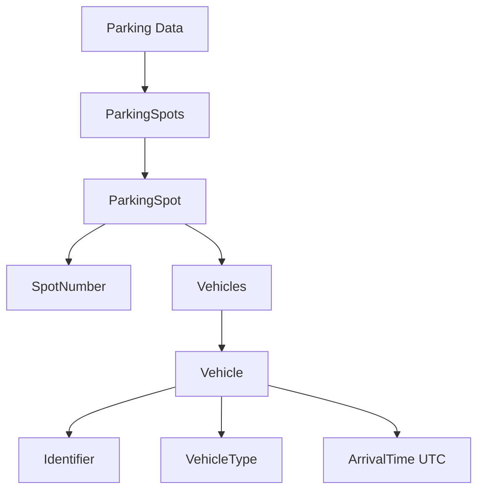

# Parkeringsdata

**Uppdaterad:** 2026-10-10  
**Omfattning:** Planerad persistent lagring för Prague Parking 2.0 (G), med avgränsningar inför Prague Parking 2.1 (VG).

**Status:** Den grundläggande JSON-persistensen är under utveckling.
Datamodeller samt funktioner för inläsning och sparning är
implementerade i `PragueParkingV2.Data`.

Fullständig validering, återställning av domänobjekt och
automatisk sparning från parkeringsfunktionerna återstår.

## Planerad struktur



Diagrammet visar den fastställda strukturen för G-versionen. Vi inför inte extra obligatoriska fält eller en alternativ, platt struktur under implementationen av 2.0.

## Syfte

`parking-data.json` ska innehålla det aktuella tillståndet i parkeringshuset.

Filen ska användas för att återställa parkerade fordon när programmet startas igen. Varje fordon ska återfå **samma parkeringsplats, identifierare, fordonstyp och ursprungliga ankomsttid**.

Konfigurationsdata lagras inte här utan separat i `config.json`.

Endast parkeringsplatser som innehåller fordon ska sparas i `parking-data.json`.

Tomma parkeringsplatser återskapas från `config.json` när programmet startar. Standardkonfigurationen innehåller 100 parkeringsplatser, men det faktiska antalet bestäms av den giltiga konfigurationen.

Prisregler och gratisgränser sparas inte i `parking-data.json` utan hämtas från `config.json`. `ParkingFeeResult` och `CheckoutResult` är tillfälliga beräknings- och resultatobjekt, inte permanent parkeringsdata.

## VehicleType

`VehicleType` lagras i JSON för att programmet ska kunna avgöra vilken konkret fordonsklass som ska skapas när data läses in.

Exempel:

```text
"Car" → Car
"MC"  → MC
```

`VehicleType` behöver därför inte vara en property i domänklassen `Vehicle`. Fordonstypen representeras där av den faktiska runtime-klassen.

Vid inläsning ska okända eller ännu inte stödda fordonstyper avvisas kontrollerat. Detta gäller även framtida `Bicycle` och `Bus` tills dessa faktiskt har implementerats.

## ArrivalTime

`ArrivalTime` lagras i UTC med en entydig tidsangivelse, exempelvis `2026-10-05T14:30:00Z`.

Det gör att den sparade tiden kan konverteras till den tidszon som anges i `config.json`, exempelvis `Europe/Prague`, när den visas för användaren.

Vid återställning måste den ursprungliga UTC-tiden bevaras. Ett återställt fordon får **inte** få en ny ankomsttid genom att konstruktorn använder `DateTime.UtcNow`.

Domänklasserna behöver därför stöd för att skapa `Car` och `MC` med en befintlig, giltig UTC-ankomsttid. Att dessa konstruktorsöverlagringar finns i den aktuella koden återstår att verifiera.

## Exempel på `parking-data.json`

```json
{
  "ParkingSpots": [
    {
      "SpotNumber": 17,
      "Vehicles": [
        {
          "Identifier": "ABC123",
          "VehicleType": "Car",
          "ArrivalTime": "2026-10-05T14:30:00Z"
        }
      ]
    },
    {
      "SpotNumber": 18,
      "Vehicles": [
        {
          "Identifier": "MC123",
          "VehicleType": "MC",
          "ArrivalTime": "2026-10-05T14:35:00Z"
        },
        {
          "Identifier": "MC456",
          "VehicleType": "MC",
          "ArrivalTime": "2026-10-05T14:42:00Z"
        }
      ]
    }
  ]
}
```

Exemplet följer det tidigare beslutade formatet: `ParkingSpots` innehåller `SpotNumber` och `Vehicles`, medan varje fordon innehåller `Identifier`, `VehicleType` och `ArrivalTime`. Endast upptagna platser visas i filen.

Ett tomt parkeringshus kan representeras av:

```json
{
  "ParkingSpots": []
}
```

## Inläsning och återställning vid programstart

Den planerade ordningen är:

1. Läs och validera `config.json`.
2. Skapa garagets parkeringsplatser utifrån det konfigurerade antalet.
3. Läs och validera en befintlig `parking-data.json`.
4. Återskapa varje fordon på det `SpotNumber` som finns i filen, med dess ursprungliga `ArrivalTime`.
5. Aktivera garaget först när hela den sparade beläggningen har validerats.

Återställning ska **inte** använda den ordinarie metoden som automatiskt väljer första lediga parkeringsplats. Den skulle kunna flytta fordon till andra platser vid omstart.

### Validering av sparad data

Innan sparad data accepteras ska systemet bland annat kontrollera att:

- JSON-strukturen och obligatoriska fält finns och går att läsa.
- Varje `SpotNumber` är unikt och ligger inom den aktuella garagekapaciteten.
- Varje fordonsidentifierare är giltig och unik i hela garaget, **utan skillnad mellan stora och små bokstäver**.
- `VehicleType` motsvarar en fordonstyp som den aktuella versionen stöder.
- `ArrivalTime` är en giltig UTC-tidpunkt.
- Fordonen ryms på den angivna platsen enligt gällande kapacitets- och fordonsregler.

Om en befintlig fil är felaktig eller innehåller oförenliga uppgifter ska uppstarten ge ett tydligt fel. Filen får inte tyst skrivas över och ett delvis återställt garage får inte accepteras som giltigt tillstånd.

Om `parking-data.json` saknas vid första start ska garaget kunna starta tomt. Det är en annan situation än att en **befintlig** datafil är ogiltig.

## Uppdatering vid parkering

Efter en lyckad incheckning ska den nya beläggningen sparas i `parking-data.json`.

Det sparade fordonet ska innehålla:

- Dess faktiska parkeringsplats (`SpotNumber` i det omgivande platsobjektet).
- Dess `Identifier` och `VehicleType`.
- Den ursprungliga `ArrivalTime` i UTC.

Användaren ska inte få ett meddelande om varaktigt lyckad parkering om lagringen misslyckas.

## Uppdatering vid utcheckning

När ett fordon checkas ut ska det tas bort från det aktuella parkeringsläget.

Efter en lyckad utcheckning ska `parking-data.json` uppdateras så att det utcheckade fordonet inte längre finns kvar i den persistenta datan. Om platsen därefter är tom ska den inte längre finnas med bland de sparade `ParkingSpots`.

Prisberäkningen ska ske innan fordonet tas bort, enligt ansvaret i `CheckoutService`.

Prisberäkning, `ParkingFeeResult` och `CheckoutResult` är tillfälliga runtime-resultat och ska inte sparas i `parking-data.json`.

En utcheckning får inte presenteras som varaktigt slutförd om sparningen misslyckas.

## Uppdatering vid förflyttning

När ett fordon flyttas ska `parking-data.json` uppdateras så att det inte längre finns på den gamla parkeringsplatsen utan på den nya.

Förflyttningen ska behålla fordonets `Identifier`, `VehicleType` och ursprungliga `ArrivalTime`.

Om den gamla platsen blir tom ska den utelämnas ur den sparade filen. En misslyckad förflyttning eller sparning får inte lämna ett ofullständigt eller motsägelsefullt parkeringsläge.

## Ansvar och säker filhantering

JSON-serialisering och filåtkomst hanteras i det separata klassbiblioteket `PragueParkingV2.Data`.

`ParkingGarage` och `ParkingSpot` ansvarar fortsatt för parkeringsregler och fordonsplacering, medan UI endast presenterar resultat och felmeddelanden.

Följande principer gäller för persistensen:

- Använda portabla filsökvägar utan hårdkodade sökvägar till en specifik dator.
- Spara efter varje genomförd förändring: incheckning, utcheckning och förflyttning.
- Skydda befintliga parkeringsdata mot ofullständiga skrivningar.
- Säkerställa konsekvens mellan parkeringshusets tillstånd i minnet och den sparade informationen.
- Validera parkeringsdata innan informationen används eller sparas.
- Aldrig automatiskt ersätta en befintlig korrupt eller ogiltig datafil med ett tomt parkeringshus.

### Implementerat 2026-10-10

`ParkingDataService` har implementerats med grundläggande funktionalitet för JSON-inläsning och sparning.

**Sökvägshantering**

- `AppContext.BaseDirectory` används för att utgå från applikationens körkatalog.
- `Path.Combine()` används för plattformsoberoende sökvägar.
- Parkeringsdata lagras under `Data/parking-data.json`.
- `Directory.CreateDirectory()` skapar datakatalogen om den saknas.

**Inläsning**

- `File.Exists()` kontrollerar om datafilen existerar.
- Om filen saknas returneras ett tomt `ParkingDataDocument`.
- `File.ReadAllText()` läser en befintlig datafil.
- `JsonSerializer.Deserialize<T>()` omvandlar JSON till datamodeller.
- Deserialisering som returnerar `null` avvisas.
- Grundläggande innehållsvalidering genomförs före retur.

**Sparning**

- `JsonSerializer.Serialize()` omvandlar datamodellerna till JSON.
- Informationen skrivs först till `parking-data.json.tmp`.
- `File.Move()` används vid första sparningen när originalfilen saknas.
- `File.Replace()` används när en befintlig datafil ska ersättas.
- `try/finally` används för att försöka rensa kvarvarande temporära filer.

Den temporära filen minskar risken för att en avbruten skrivning skadar den befintliga datafilen.

**Grundläggande validering**

Metoden `ValidateParkingData()` har implementerats och anropas från både `Load()` och `Save()`.

Följande kontroller finns:

- `ParkingSpots` får inte vara `null`.
- En parkeringsplats i listan får inte vara `null`.
- `SpotNumber` måste vara större än noll.
- `Vehicles` får inte vara `null`.

En tom `ParkingSpots`-lista är giltig eftersom endast upptagna parkeringsplatser ska sparas.

### Kvarstående arbete

**Datavalidering**

- Kontrollera att varje sparad parkeringsplats innehåller fordon.
- Validera fordonsidentifierare.
- Validera fordonstyper.
- Validera ankomsttider och UTC-format.
- Kontrollera dubblerade parkeringsplatsnummer.
- Kontrollera dubblerade fordonsidentifierare.
- Kontrollera parkeringskapacitet mot `config.json`.
- Upptäcka saknade obligatoriska JSON-fält.

**Datasäkerhet**

- Förhindra att befintliga korrupta parkeringsdata skrivs över.
- Förbättra felhantering vid borttagning av temporära filer.
- Verifiera beteendet vid misslyckad filskrivning.
- Säkerställa konsekvens mellan minnet och datafilen vid sparfel.

**Integration**

- Återställa parkerade fordon vid programstart.
- Bevara ursprungliga parkeringsplatser och ankomsttider.
- Spara automatiskt efter lyckad incheckning.
- Spara automatiskt efter lyckad utcheckning.
- Spara automatiskt efter lyckad förflyttning.
- Genomföra integrationstester.

### Status

**Pågår – grundläggande JSON-inläsning och sparning är implementerad.**

Fullständig validering, återställning av domänobjekt och integration med parkeringsfunktionerna återstår.

Funktionaliteten är ännu inte fullständigt testad eller verifierad.

Den nuvarande implementationen ska därför inte betraktas som färdig för produktionsanvändning.

### Kvarstående säkerhetskontroller

- Validera identifierare, fordonstyper och UTC-tider.
- Kontrollera dubblerade parkeringsplatser och fordon.
- Kontrollera kapacitet mot konfigurationen.
- Upptäcka saknade obligatoriska JSON-fält.
- Skydda befintliga korrupta data mot överskrivning.
- Hantera fel vid rensning av temporära filer.
- Verifiera filskrivning och återställning genom tester.

Den nuvarande implementationen ska inte betraktas som
fullständigt säker eller färdig för produktionsanvändning.
## Förberedelser inför Prague Parking 2.1 (VG)

Den nuvarande JSON-strukturen ska fungera som utgångspunkt även när `Bicycle` och `Bus` införs.

### Bicycle

`Bicycle` blir en egen fordonstyp. En cykel som saknar registreringsnummer behöver en stabil, unik `Identifier` som kan sparas och återställas på samma sätt som för övriga fordon.

### Bus

En buss motsvarar 16 storleksenheter och behöver fyra sammanhängande parkeringsplatser, där en normal plats motsvarar 4 enheter.

- **Nyparkering:** Fyra sammanhängande platser inom platsnummer 1–50.
- **Förflyttning:** En redan parkerad buss får flyttas till fyra sammanhängande platser även efter platsnummer 50.
- Bussens identifierare och ursprungliga UTC-ankomsttid ska behållas vid flytt.
- En buss ska behandlas som **ett fordon**, inte som fyra separata fordon.

Eftersom en buss använder flera platser behövs en framtida utökning av domän- och lagringsmodellen som kan bevara sambandet mellan bussen och dess fyra upptagna platser. **Den exakta JSON-representationen för buss är inte beslutad.** Vi lägger därför inte till exempelvis `OccupiedSpotNumbers` i G-versionens filformat redan nu.

VG-funktionaliteten implementeras efter att G-versionens lagring och övriga funktioner har färdigställts och verifierats.

## Relaterad dokumentation

- `configuration.md` – inställningar, priser, tidszon och kapacitetsregler.
- `class-diagram.md` – domänmodell och klassernas relationer.
- `design-decisions.md` – särskilt DD-008–DD-011, DD-023, DD-025 och DD-026.
- `requirements.md` – krav och status för G respektive VG.
